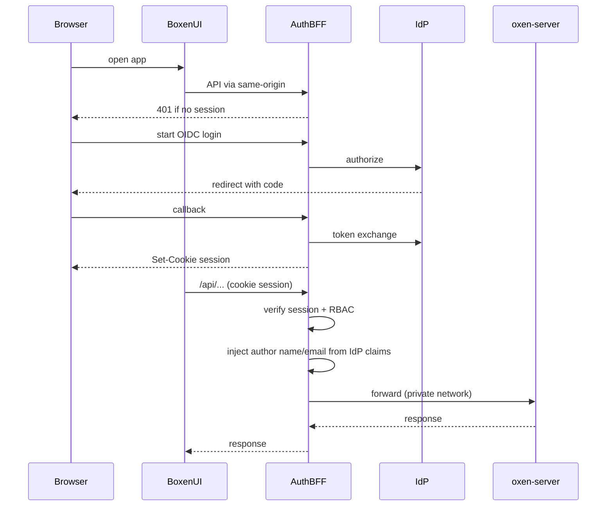

# AUTH — PLAT-AUTH implementation plan

Living design and phased plan for epic [`PLAT-AUTH`](./EPICS.md#plat-auth--idp--sso-authn--authz): IdP SSO, session lifecycle, org/repo RBAC, and mapping identities to oxen-server credentials.

Related: [EPICS.md](./EPICS.md) · [README.md](./README.md)

## 1. Purpose & scope

**In scope**

- Interactive authentication via enterprise IdP (OIDC MVP; SAML later)
- Auth BFF / gateway that issues sessions and proxies oxen-server
- Platform RBAC (org + repo) enforced at the BFF
- Server-side mapping of IdP identity → oxen credentials
- UI: login / logout; demote Settings bearer to break-glass / automation

**Out of scope (this document)**

- Detailed design of [`PLAT-AUDIT`](./EPICS.md#plat-audit--gxp-oriented-change-audit), [`PLAT-JOB`](./EPICS.md#plat-job--versioned-workspace-jobs), [`PLAT-GW`](./EPICS.md#plat-gw--vm-gateways) — they **consume** identity and authZ from this plan
- Oxen Hub cloud SSO
- GitHub Apps / OAuth Apps product model

**Hooks for later epics**

| Epic | Needs from PLAT-AUTH |
| --- | --- |
| PLAT-AUDIT | Stable actor `sub` (and email/display) on every audited mutation |
| PLAT-JOB / PLAT-GW | Session or service identity; org/repo role checks before mount/run |

## 2. Current state

Boxen is a Vite/React SPA that talks to self-hosted oxen-server. There is **no** platform login, session, IdP, or roles today.

| Piece | Behavior |
| --- | --- |
| Settings | Optional API base + bearer token + commit author ([`web/src/pages/SettingsPage.tsx`](./web/src/pages/SettingsPage.tsx)) |
| Persistence | `localStorage` keys in [`web/src/lib/oxen/settings.ts`](./web/src/lib/oxen/settings.ts) |
| API client | `Authorization: Bearer …` when token set ([`web/src/lib/oxen/client.ts`](./web/src/lib/oxen/client.ts)) |
| Proxy | Vite/Compose `/api` → oxen-server with **no** auth injection ([`compose.yaml`](./compose.yaml), [`web/vite.config.ts`](./web/vite.config.ts)) |
| Env | [`.env.example`](./.env.example) has ports only — no OIDC vars |

Commit author name/email are metadata for oxen commits, not authentication.

## 3. Goals & non-goals

### Goals (from EPICS)

1. IdP configuration (OIDC first; SAML later) for the Boxen platform
2. Login / logout UI and secure session lifecycle
3. Role / permission model (org and repo scoped) enforced on platform APIs / proxied oxen calls
4. Replace Settings bearer as the **primary** path for interactive users
5. Map IdP identities into credentials usable against oxen-server

### Non-goals

- Replacing oxen-server itself with a fork that owns identity
- Browser-held long-lived oxen PATs as the normal interactive path
- Full SCIM / Enterprise Managed Users in MVP (Phase 3+)

## 4. Target architecture

### Decisions (locked)

| Decision | Choice |
| --- | --- |
| Protocol MVP | **OIDC** Authorization Code + PKCE |
| Trust boundary | **Auth BFF / gateway** in front of oxen-server; browser does not hold oxen bearer for normal use |
| BFF implementation | New [`auth/`](./auth/) service in this repo, **Node.js + TypeScript** (same toolchain as `web/`) |
| Session | **Signed/encrypted cookie only** (stateless BFF session; HTTP-only, Secure, SameSite); no server-side session DB in MVP |
| Gate to oxen | **No request reaches oxen-server without a valid BFF session** (or explicit break-glass path). Stock oxen-server stays on a private network. |
| Identity to oxen | BFF uniquely identifies the user from IdP (`iss`+`sub`; profile email/name for oxen fields) and **injects commit author fields** on mutating proxied calls. Settings author override is **removed entirely** — clients cannot set name/email. |
| Oxen bearer vault | **Not used** for stock oxen-server (server does not mint or validate per-user tokens as of 0.59+). AuthN/authZ live in the BFF. |
| AuthZ | Platform RBAC at org + repo scope, enforced at the BFF (and later platform APIs) |
| Settings bearer | **Break-glass / automation** only (BFF-issued or admin path — not raw oxen exposure) |
| Local/dev | Compose **Keycloak** (OIDC) for `make up` / e2e — closer to enterprise IdPs; SAML later if needed |

### Components

| Component | Role |
| --- | --- |
| Boxen UI | Login entry, account menu, logout; same-origin API calls with cookies |
| Auth BFF (`auth/`) | Node/TS service: OIDC dance, **stateless signed session cookie**, RBAC, **identity injection** on write bodies, reverse proxy to oxen-server |
| IdP | Enterprise OIDC issuer; local Compose **Keycloak** |
| oxen-server | Unchanged data plane; **not publicly exposed**; reached only via BFF |



### Future Compose shape (not implemented yet)

- `oxen-server` — data plane (as today)
- `auth` — Node/TS BFF; browser `/api` and `/auth/*` terminate here
- `web` — UI; proxy target becomes the BFF, not oxen-server directly
- `keycloak` (Compose profile or always-on for local) — OIDC issuer for `make up` / e2e

## 5. Identity model

### Claims → platform user

| Source | Use |
| --- | --- |
| OIDC `sub` (+ `iss`) | Stable primary key for the platform user |
| `email` | Commit **author email** injected by BFF; display; audit attribution |
| `name` / `preferred_username` | Commit **author name** injected by BFF; UI display |
| Groups / roles claims | Optional bootstrap into org membership (configurable claim → role map) |

### Starter RBAC

Roles are **additive** within a scope. Deny by default when no role applies.

| Role | Org scope | Repo scope |
| --- | --- | --- |
| **Owner** | Manage members/roles; all repo ops in org | Full control including delete / transfer |
| **Member** | Create repos; read org metadata | Read/write data, workspaces, merges |
| **Reader** | List org / repos | Read-only tree, commits, data frames |

Enforcement points (BFF):

- Map HTTP method + oxen path → required permission (e.g. `GET` tree = read; `POST` workspace merge = write; delete repo = owner)
- Return `403` when session is valid but role is insufficient
- Return `401` when no session (interactive HTML clients may redirect to login)

Jobs and gateways (later) call the same permission checks before mount/run.

## 6. Auth gate + identity toward oxen-server

Stock [`oxen-server`](https://docs.oxen.ai/getting-started/oxen-server) (0.59+) **does not authenticate** and no longer has `add-user` / `-a`. It expects a gateway in front. Commit/merge APIs already accept **author `name` / `email`** as request fields (what Boxen Settings fills today).

### Options considered

| Option | Pros | Cons |
| --- | --- | --- |
| Browser Settings bearer (today) | Simple | No IdP; token in `localStorage`; author spoofable |
| Mint short-lived oxen tokens via API | No vault | **Not available** on current oxen-server |
| Per-user oxen bearer vault | Tokens per user | oxen-server ignores them unless you add another checker |
| **BFF session gate + inject author from IdP (chosen)** | Matches Oxen’s gateway model; unique user; honest “who committed” | Must rewrite/override client body fields; oxen still has no ACL of its own |

### Chosen model

1. **Authenticate uniquely at the BFF** — OIDC → signed session cookie with `iss`, `sub`, email, display name.
2. **Block the gate** — any `/api/*` without a valid session → `401`; do not proxy. In production, oxen-server listens only on the Docker/private network (not published to the host, or firewalled).
3. **Authorize at the BFF** — RBAC before proxy (Phase 2); until then, authenticated-only is the floor.
4. **Send who commits** — for mutating oxen routes that accept author fields (`name`/`email`, `user_name`/`user_email`, form fields, etc.), the BFF **overwrites** those fields from the session IdP claims. Client-supplied author values are **not trusted**.
5. **UI** — Settings **commit author override is removed entirely**. No client-editable name/email. Author fields on oxen writes come **only** from IdP claims via the BFF.
6. **CLI / PAT** — after SSO, user mints a `boxen_pat_*` token (Settings → CLI tokens). Oxen CLI and Python use the **BFF** as remote with `oxen config --auth <BFF-host> <PAT>`. BFF validates PAT, injects author, proxies to oxen-server. Do **not** point CLI at raw `:3001` in normal use.
7. **Break-glass** — optional shared `AUTH_BREAKGLASS_TOKEN` on the BFF for emergencies; prefer PATs.
8. **PLAT-AUDIT later** — audit log uses the same session/`sub` the BFF already resolved (not oxen’s word alone).

### CLI through the BFF

```bash
# After creating a PAT in Boxen Settings → CLI tokens:
oxen config --auth localhost:8080 boxen_pat_…
oxen clone http://localhost:8080/<namespace>/<repo>
```

| Surface | Auth |
| --- | --- |
| Boxen UI | Session cookie (SSO) |
| Oxen CLI / Python | PAT → BFF `Authorization: Bearer` |
| Raw oxen-server `:3001` | Private / e2e helpers only — not the product remote |

`GET /auth/cli-info` returns the public remote + example commands. Clone box uses `VITE_OXEN_REMOTE` / that endpoint.

### Author field mapping (initial)

| IdP claim | Injected into oxen request |
| --- | --- |
| `name` or `preferred_username` | `name` / `author` / `user_name` (per endpoint shape) |
| `email` | `email` / `user_email` |

Exact path/body rewrite table will be maintained next to the BFF proxy code as endpoints are covered.

## 7. Session & token lifecycle

| Concern | Plan |
| --- | --- |
| Login | BFF `/auth/login` → IdP authorize (PKCE) → `/auth/callback` → create **signed/encrypted session cookie** → `Set-Cookie` |
| Cookie | Stateless session payload (user id, `iss`/`sub`, expiry, roles snapshot as needed); HTTP-only, Secure (prod), SameSite=`Lax`; short idle + absolute max lifetime; signed with `SESSION_SECRET` |
| Server session store | **None in MVP** — no Redis/memory session table; revoke = short TTL + logout clears cookie (accept limited instant-revoke until a denylist is added later) |
| CSRF | Double-submit or synchronizer token for cookie-authenticated mutating requests from the SPA |
| Logout | BFF clears session cookie; **RP-initiated IdP end-session** (when `id_token` present) then return to `/login`; next `/auth/login` uses `prompt=login` so the IdP credential form always appears |
| Refresh | Prefer embedding refreshable IdP tokens only if needed; keep cookie payload small — refresh via re-login or silent OIDC when access expired |
| Idle timeout | Configurable; align with GxP session expectations when PLAT-AUDIT lands |

## 8. Configuration

See [`.env.example`](./.env.example). Compose wires these into the `auth` service.

| Variable | Purpose |
| --- | --- |
| `OIDC_ISSUER` | IdP issuer URL |
| `OIDC_CLIENT_ID` | Confidential or public client id |
| `OIDC_CLIENT_SECRET` | If confidential client |
| `OIDC_REDIRECT_URI` | BFF callback URL |
| `SESSION_SECRET` | Cookie / session signing |
| `OXEN_UPSTREAM` | oxen-server base URL for the BFF proxy |
| `PUBLIC_OXEN_REMOTE` | Browser/CLI-facing BFF base (e.g. `http://localhost:8080`) |
| `AUTH_DATA_DIR` | Directory for hashed PAT store (`pats.json`) |
| `AUTH_BREAKGLASS_TOKEN` | Optional shared Bearer for emergencies |
| `AUTH_RBAC_BOOTSTRAP` | Optional claim → role mapping JSON (Phase 2) |

Local Keycloak: document realm, client id/secret, and redirect URI for the Compose `keycloak` service when added.

## 9. Phased delivery

### Phase 0 — BFF stub + protected proxy — **done** (`auth/`)

- [x] Hono auth service terminates `/api` with signed session cookie
- [x] `AUTH_DEV_MODE` → `POST /auth/dev-login` for local/e2e
- [x] Unauthenticated `/api` → `401` (never proxied)
- [x] Author injection on JSON/multipart writes
- [x] Compose: `web` → `auth` → `oxen-server` (oxen port still published for e2e helpers)

### Phase 1 — OIDC login / logout — **done** (Keycloak + UI)

- [x] OIDC Authorization Code + PKCE against Keycloak
- [x] Login page + account menu logout
- [x] Author injection from session (IdP or dev-login)
- [x] Settings: author fields removed; bearer under Advanced / break-glass
- [x] Client: `credentials: 'same-origin'`; primary path is SSO session

### Phase 1.5 — CLI / PATs — **done**

- [x] Mint / list / revoke `boxen_pat_*` (hashed in `AUTH_DATA_DIR/pats.json`)
- [x] `Authorization: Bearer` PAT accepted on `/api` proxy with author injection
- [x] Settings → CLI tokens UI; Clone box uses BFF remote + `oxen config --auth`
- [x] Playwright: `e2e/tests/cli-auth.spec.ts` (TC-CLI-01…06)

### Phase 2 — Org / repo RBAC

- Persist memberships and roles
- Enforce on proxied reads/writes
- Admin UI or bootstrap from IdP groups for initial orgs
- Playwright coverage for `403` paths

### Phase 3 — SAML + enterprise extras

- SAML SSO alongside OIDC
- SCIM provisioning if required by IdP estate
- Harden session (and optional future secret storage) for validated deployments

## 10. UI changes

| Surface | Change |
| --- | --- |
| Login route | Start SSO; handle return errors; **outside** app chrome |
| Auth gate | Unauthenticated routes → `/login?next=…`; do not render Boxen UI |
| Layout / account menu | Signed-in identity; Logout |
| Unauthenticated API | BFF `401`; SPA never reaches app chrome without session |
| Settings | Bearer under Advanced / break-glass only; **no** commit author name/email fields |
| Commit author | IdP → BFF injection only; Settings override **removed entirely** |

Touchpoints when coding: [`SettingsPage.tsx`](./web/src/pages/SettingsPage.tsx), [`client.ts`](./web/src/lib/oxen/client.ts), [`Layout.tsx`](./web/src/components/Layout.tsx), new login route in the app router.

## 11. Test plan

| Case | Expectation |
| --- | --- |
| Unauthenticated `/api` | `401`; oxen-server access log shows **no** corresponding hit |
| OIDC login happy path | Session cookie set; home loads against live oxen via BFF |
| Logout | Cookie cleared; subsequent `/api` is `401` |
| Author injection | Commit/merge via UI shows IdP email/name in oxen history, not a forged Settings author |
| RBAC deny | Member/Reader cannot perform Owner-only action → `403` |
| Break-glass | Automation authenticates to BFF; oxen remains private |
| Dev/e2e | Phase 0 static session + Keycloak in Phase 1 |

## 12. Open risks

| Risk | Mitigation |
| --- | --- |
| oxen-server lacks fine-grained ACL | Enforce authZ at BFF; **do not publish** oxen-server ports in production compose |
| Client spoofs author fields | BFF always overwrites author from session; ignore client values |
| Incomplete rewrite coverage | Maintain an explicit allowlist of write routes + body shapes; fail closed or reject unknown write shapes that need identity |
| Unstable IdP `sub` | Prefer issuer-stable subjects; document IdP requirements |
| GxP attribution | PLAT-AUDIT uses session `sub`/email from BFF — same source as injected author |
| Proxy path drift | Single hop: browser → BFF → oxen; no browser→oxen shortcut |

## 13. How to use this file

1. Implement one phase at a time; tick Phase bullets in PRs.
2. Keep decisions in §4 unless an ADR supersedes them.
3. When PLAT-AUTH epic bullets in [EPICS.md](./EPICS.md) land, mark them done and point at the phase that closed them.
