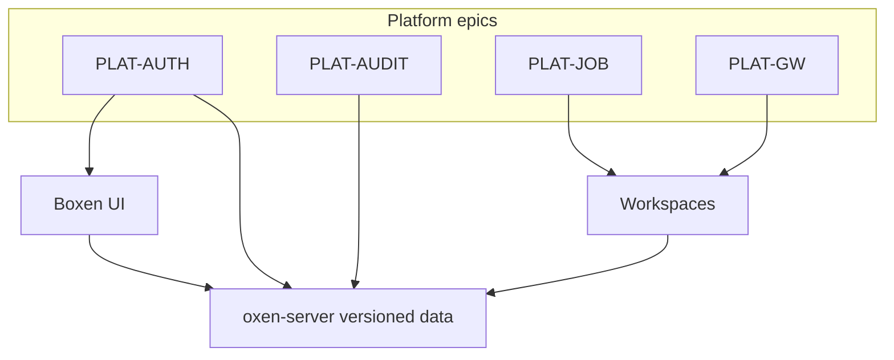

# EPICS — Boxen platform

Top-level TODO for Boxen + self-hosted [`oxen-server`](https://docs.oxen.ai/getting-started/oxen-server) as a **platform**: identity, GxP-oriented audit, and compute that mounts **workspaces** pinned to **versioned data**.

These epics need services beyond stock oxen-server (`new backend`). Flip status when an epic lands or narrows; add child bullets rather than renumbering IDs.

## Legend

| Column | Values |
| --- | --- |
| **Status** | `Todo` / `Partial` / `Done` |
| **ID** | Stable `PLAT-*` prefix |

**Shared foundation:** `PLAT-JOB` and `PLAT-GW` share a **workspace mount + version pin** contract (commit / content hash). Both require `PLAT-AUTH` and should emit `PLAT-AUDIT` events.

## Summary

| ID | Epic | Status | Depends on |
| --- | --- | --- | --- |
| [PLAT-AUTH](#plat-auth--idp--sso-authn--authz) | IdP / SSO authN + authZ | Done | — |
| [PLAT-AUDIT](#plat-audit--gxp-oriented-change-audit) | GxP-oriented change audit | Todo | PLAT-AUTH (attributable identity) |
| [PLAT-JOB](#plat-job--versioned-workspace-jobs) | Versioned workspace jobs | Todo | PLAT-AUTH; emit PLAT-AUDIT |
| [PLAT-GW](#plat-gw--vm-gateways) | VM gateways | Todo | PLAT-AUTH; emit PLAT-AUDIT |

---

## PLAT-AUTH — IdP / SSO authN + authZ

**Goal:** Enterprise IdP (OIDC/SAML) login; session/token issuance; authorize Boxen and proxied oxen-server calls by identity and roles.

**Status:** Done

**Plan:** [AUTH.md](./AUTH.md)

### TODO

- [x] IdP configuration (OIDC) for the Boxen platform — Keycloak in Compose; SAML later
- [x] Login / logout UI and secure session (or equivalent token) lifecycle
- [x] Replace Settings bearer token as the primary auth path for interactive users
- [x] Gate oxen-server via BFF; inject commit author from IdP session (unique `sub` in oxen history later)
- [x] CLI / Python via BFF PATs (`boxen_pat_*`); Clone box points at BFF remote
- [ ] Org/repo RBAC enforcement (Phase 2 — tracked as follow-on, not blocking auth close)

---

## PLAT-AUDIT — GxP-oriented change audit

**Goal:** Append-only, attributable audit of mutations against oxen-server (who / what / when / which repo + version); retention and export suitable for a validated GxP concept.

**Status:** Todo

### TODO

- [ ] Intercept or subscribe to write paths that mutate oxen-server state
- [ ] Immutable, append-only audit store with attributable actor identity
- [ ] Audit query UI (filter by actor, repo, time, change type)
- [ ] GxP metadata on relevant changes (reason / change-control id)
- [ ] Retention policy and export for review / inspection

---

## PLAT-JOB — Versioned workspace jobs

**Goal:** Run containers that **mount a workspace** pinned to versioned data; lifecycle for submit, logs, status, and artifact hooks.

**Status:** Todo

### TODO

- [ ] Job API and runner service
- [ ] Image + workspace mount contract (same pin model as gateways)
- [ ] Pin jobs to commit and/or version-store hash
- [ ] Boxen jobs UI (submit, logs, status)
- [ ] Enforce authZ (`PLAT-AUTH`) and emit audit events (`PLAT-AUDIT`)

---

## PLAT-GW — VM gateways

**Goal:** Gateway access to VMs that likewise **mount workspaces** on versioned data; session / connect UX from Boxen.

**Status:** Todo

### TODO

- [ ] Gateway service in front of VMs
- [ ] VM provision or attach path
- [ ] Same workspace mount + version pin contract as `PLAT-JOB`
- [ ] Boxen connect / session UX
- [ ] Enforce authZ (`PLAT-AUTH`) and emit audit events (`PLAT-AUDIT`)

---

## How to use this file

1. Pick an epic whose dependencies are met (auth before compute; audit alongside writes).
2. Implement a bullet → check it off; narrow the epic Status to `Partial` when useful.
3. Keep IDs stable; add new `PLAT-*` epics with the next free suffix rather than renumbering.

Related: [README.md](./README.md)
