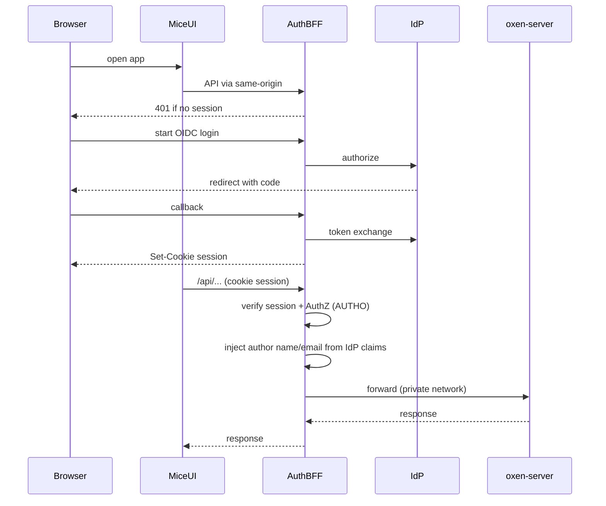

# AUTHENTICATION — PLAT-AUTH implementation plan

Living design and phased plan for epic [`PLAT-AUTH`](./EPICS.md#plat-auth--idp--sso-authn): IdP SSO, session lifecycle, and mapping identities to oxen-server credentials.

**Authorization (namespace/repo RBAC)** lives in [`02-authorization.md`](./02-authorization.md) / [`PLAT-AUTHO`](./EPICS.md#plat-autho--authorization-authz).

Related: [EPICS.md](./EPICS.md) · [02-authorization.md](./02-authorization.md) · [04-gxp-compliance.md](./04-gxp-compliance.md) · [README.md](../README.md)

## 1. Purpose & scope

**In scope**

- Interactive authentication via enterprise IdP (OIDC MVP; SAML later)
- Auth BFF / gateway that issues sessions and proxies oxen-server
- Server-side mapping of IdP identity → oxen credentials (author injection)
- UI: login / logout; CLI PATs for automation

**Out of scope (this document)**

- Namespace/repo AuthZ model and enforcement — see [02-authorization.md](./02-authorization.md)
- Detailed design of [`PLAT-AUDIT`](./EPICS.md#plat-audit--gxp-oriented-change-audit), [`PLAT-JOB`](./EPICS.md#plat-job--versioned-workspace-jobs), [`PLAT-SESS`](./EPICS.md#plat-sess--desktop-sessions) — they **consume** identity from this plan and AuthZ from AUTHO
- Oxen Hub cloud SSO
- GitHub Apps / OAuth Apps product model

**Hooks for later epics**

| Epic | Needs from PLAT-AUTH |
| --- | --- |
| PLAT-AUTHO | Stable `iss`/`sub` (and email) for membership keys; session/PAT principal at the BFF — see [02-authorization.md](./02-authorization.md) |
| PLAT-AUDIT | Stable actor `sub` (and email/display) + auth `via` on every audited mutation — see [03-audit.md](./03-audit.md) |
| PLAT-JOB / PLAT-SESS | Session or service identity; AuthZ checks via PLAT-AUTHO before mount/run |

## 2. Current state

Mice is a Vite/React SPA that talks to self-hosted oxen-server **through the auth BFF** ([`auth/`](../auth/)). Phases 0–2.5 below are shipped; trust decisions are recorded in [ADR 0001](../docs/adr/0001-bff-identity-trust-model.md).

| Piece | Behavior |
| --- | --- |
| Login / session | OIDC Authorization Code + PKCE; signed session cookie keyed on `iss`+`sub`; sliding idle timeout (`SESSION_IDLE_SEC`) plus absolute `SESSION_TTL_SEC` |
| Settings | CLI tokens, optional API base; commit author override removed |
| Proxy | `/api` → BFF → oxen-server; unauthenticated → `401`; author injection fails closed ([`auth/src/proxy.ts`](../auth/src/proxy.ts)) |
| CSRF | Same-origin (`Origin` / `Sec-Fetch-Site`) guard on cookie-authenticated non-GET; PATs exempt |
| Revocation | Admin "revoke sessions" per `iss`+`sub`; also rejects PATs created at/before the cut-off |
| PATs | Expiry (default 90d, max 365d) + last-used; hashed in `pats.json` |
| id_token | `iss`, `aud`, `exp`, `nonce` checked; `auth_time` captured; no JWKS signature check |
| Bootstrap | `iss`+`sub` or `email_verified` email only; `@users.local` never matches |
| Production gate | Refuses to start with dev/missing `SESSION_SECRET`, shipped `OIDC_CLIENT_SECRET`, or non-Secure cookies ([`auth/src/startupGate.ts`](../auth/src/startupGate.ts)) |
| Scoped PATs | A PAT may carry scopes `{namespace, repo?, maxRole}` that cap the owner's repo role (`capByPatScopes` in [`auth/src/authz.ts`](../auth/src/authz.ts)); scoped PATs never get the instance-admin bypass or fine-grained custom-role grants, and are refused on notifications, favorites and similar per-user routes via scattered `patScopes?.length` checks |
| Env | [`.env.example`](../.env.example) — OIDC, session and AuthZ vars (§8) |

Commit author name/email are metadata for oxen commits, not authentication.

## 3. Goals & non-goals

### Goals (from EPICS)

1. IdP configuration (OIDC first; SAML later) for the Mice platform
2. Login / logout UI and secure session lifecycle
3. Replace Settings bearer as the **primary** path for interactive users
4. Map IdP identities into credentials usable against oxen-server
5. Leave a clear hook for AuthZ at the BFF ([02-authorization.md](./02-authorization.md))

### Non-goals

- Replacing oxen-server itself with a fork that owns identity
- Browser-held long-lived oxen PATs as the normal interactive path
- Full SCIM / Enterprise Managed Users in MVP (Phase 3+)

## 4. Target architecture

### Decisions (locked)

| Decision | Choice |
| --- | --- |
| Protocol MVP | **OIDC** Authorization Code + PKCE |
| Trust boundary | **Auth BFF / gateway** in front of oxen-server; browser does not hold oxen bearer for normal use |
| BFF implementation | New [`auth/`](../auth/) service in this repo, **Node.js + TypeScript** (same toolchain as `web/`) |
| Session | **Signed/encrypted cookie only** (stateless BFF session; HTTP-only, Secure, SameSite); no server-side session DB in MVP |
| Gate to oxen | **No request reaches oxen-server without a valid BFF session or PAT**. Stock oxen-server stays on a private network. |
| Identity to oxen | BFF uniquely identifies the user from IdP (`iss`+`sub`; profile email/name for oxen fields) and **injects commit author fields** on mutating proxied calls. Settings author override is **removed entirely** — clients cannot set name/email. |
| Oxen bearer vault | **Not used** for stock oxen-server (server does not mint or validate per-user tokens as of 0.59+). AuthN/authZ live in the BFF. |
| AuthZ | Enforced at the BFF — model and phases in [02-authorization.md](./02-authorization.md) (not detailed here) |
| Automation | **CLI PATs** (`mice_pat_*`) minted in Settings; session cookie for interactive use |
| Local/dev | Compose **Keycloak** (OIDC) for `make up` / e2e — closer to enterprise IdPs; SAML later if needed |

### Components

| Component | Role |
| --- | --- |
| Mice UI | Login entry, account menu, logout; same-origin API calls with cookies |
| Auth BFF (`auth/`) | Node/TS service: OIDC dance, **stateless signed session cookie**, AuthZ hook ([02-authorization.md](./02-authorization.md)), **identity injection** on write bodies, reverse proxy to oxen-server |
| IdP | Enterprise OIDC issuer; local Compose **Keycloak** |
| oxen-server | Unchanged data plane; **not publicly exposed**; reached only via BFF |



### Compose shape (implemented)

- `oxen-server` — data plane (as today)
- `auth` — Node/TS BFF; browser `/api` and `/auth/*` terminate here
- `web` — UI; proxy target becomes the BFF, not oxen-server directly
- `keycloak` (Compose profile or always-on for local) — OIDC issuer for `make up` / e2e

## 5. Identity model

### Claims → platform user

| Source | Use |
| --- | --- |
| OIDC `sub` (+ `iss`) | Stable primary key for the platform user |
| `email` | Commit **author email** injected by BFF; display; audit attribution |
| `name` / `preferred_username` | Commit **author name** injected by BFF; UI display |
| Groups / roles claims | Session `groups` via `OIDC_GROUPS_CLAIM` (default `groups`); live AuthZ bindings + optional `AUTHZ_GROUP_BOOTSTRAP` — see [02-authorization.md](./02-authorization.md) |

### Authorization (moved)

Starter Owner/Member/Reader sketch is **superseded**. Namespace/repo roles, additive resolution, instance permissions, and enforcement phases are specified in **[02-authorization.md](./02-authorization.md)** (GitHub Enterprise–shaped model).

PLAT-AUTHO Phase 0 is shipped: the BFF enforces AuthZ when `AUTHZ_ENFORCE` is on; authenticated-only applies only to dev (`AUTHZ_DEV_GRANT_ALL`).

## 6. Auth gate + identity toward oxen-server

Stock [`oxen-server`](https://docs.oxen.ai/getting-started/oxen-server) (0.59+) **does not authenticate** and no longer has `add-user` / `-a`. It expects a gateway in front. Commit/merge APIs already accept **author `name` / `email`** as request fields (what Mice Settings fills today).

### Options considered

| Option | Pros | Cons |
| --- | --- | --- |
| Browser Settings bearer (today) | Simple | No IdP; token in `localStorage`; author spoofable |
| Mint short-lived oxen tokens via API | No vault | **Not available** on current oxen-server |
| Per-user oxen bearer vault | Tokens per user | oxen-server ignores them unless you add another checker |
| **BFF session gate + inject author from IdP (chosen)** | Matches Oxen’s gateway model; unique user; honest “who committed” | Must rewrite/override client body fields; oxen still has no ACL of its own |

### Chosen model

1. **Authenticate uniquely at the BFF** — OIDC → signed session cookie with `iss`, `sub`, email, display name.
2. **Block the gate** — any `/api/*` without a valid session → `401`; do not proxy. In production, oxen-server listens only on the Docker/private network (not published to the host, or firewalled).
3. **Authorize at the BFF** — AuthZ before proxy per [02-authorization.md](./02-authorization.md); authenticated-only is the floor only in dev mode.
4. **Send who commits** — for mutating oxen routes that accept author fields (`name`/`email`, `user_name`/`user_email`, form fields, etc.), the BFF **overwrites** those fields from the session IdP claims. Client-supplied author values are **not trusted**.
5. **UI** — Settings **commit author override is removed entirely**. No client-editable name/email. Author fields on oxen writes come **only** from IdP claims via the BFF.
6. **CLI / PAT** — after SSO, user mints a `mice_pat_*` token (Settings → CLI tokens). Oxen CLI and Python use the **BFF** as remote with `oxen config --auth <BFF-host> <PAT>`. BFF validates PAT, injects author, proxies to oxen-server. Do **not** point CLI at raw `:3001` in normal use.
7. **Automation** — mint CLI PATs; no shared break-glass bearer.
8. **PLAT-AUDIT** — audit log uses the same session/`sub` (and `via`) the BFF already resolved — see [03-audit.md](./03-audit.md).

### CLI through the BFF

```bash
# After creating a PAT in Mice Settings → CLI tokens:
oxen config --auth localhost:8080 mice_pat_…
oxen clone http://localhost:8080/<namespace>/<repo>
```

| Surface | Auth |
| --- | --- |
| Mice UI | Session cookie (SSO) |
| Oxen CLI / Python | PAT → BFF `Authorization: Bearer` |
| Raw oxen-server `:3001` | Private / e2e helpers only — not the product remote |

`GET /auth/cli-info` returns the public remote + example commands. Clone box uses `VITE_OXEN_REMOTE` / that endpoint.

### Author field mapping (initial)

| IdP claim | Injected into oxen request |
| --- | --- |
| `name` or `preferred_username` | `name` / `author` / `user_name` (per endpoint shape) |
| `email` | `email` / `user_email` |

Exact path/body rewrite table will be maintained next to the BFF proxy code as endpoints are covered.

## 7. Session & token lifecycle

| Concern | Plan |
| --- | --- |
| Login | BFF `/auth/login` → IdP authorize (PKCE) → `/auth/callback` → create **signed/encrypted session cookie** → `Set-Cookie` |
| Cookie | Stateless session payload (user id, `iss`/`sub`, expiry, roles snapshot as needed); HTTP-only, Secure (prod), SameSite=`Lax`; short idle + absolute max lifetime; signed with `SESSION_SECRET` |
| Server session store | No session table. Revocation = short absolute TTL + per-`iss`+`sub` **not-valid-before** cut-off checked on every request; instance admins can "revoke sessions" (shipped, Phase 2.5). The same cut-off also rejects PATs created at or before it; PATs minted afterwards work |
| CSRF | `Origin` / `Sec-Fetch-Site` check on every cookie-authenticated non-GET request; PAT requests exempt; no token scheme (shipped, Phase 2.5) |
| Logout | BFF clears session cookie; **RP-initiated IdP end-session** (when `id_token` present) then return to `/login`; next `/auth/login` uses `prompt=login` so the IdP credential form always appears |
| Refresh | Prefer embedding refreshable IdP tokens only if needed; keep cookie payload small — refresh via re-login or silent OIDC when access expired |
| Idle timeout | **Shipped.** Sliding window: the BFF re-seals the cookie on activity; idle value is `SESSION_IDLE_SEC` (default `0` = off). [04-gxp-compliance.md](./04-gxp-compliance.md) owns the value policy for validated deployments |
| PAT lifetime | **Shipped.** Required expiry (default 90 days, max 365) plus last-used timestamp; existing PATs grandfathered to 365 days from migration; expired PATs rejected |
| id_token | **Shipped.** `iss`, `aud`, `exp`, `nonce` validated at login; `auth_time` captured for e-signature step-up ([04-gxp-compliance.md](./04-gxp-compliance.md) Phase 3); no JWKS signature check ([ADR 0001](../docs/adr/0001-bff-identity-trust-model.md)) |
| Production gate | **Shipped.** BFF refuses to start in production unless `SESSION_SECRET` is set (not the dev default), `OIDC_CLIENT_SECRET` is not `mice-auth-secret`, and cookies are Secure; oxen port exposure is documented, not probed |

## 8. Configuration

See [`.env.example`](../.env.example). Compose wires these into the `auth` service.

| Variable | Purpose |
| --- | --- |
| `OIDC_ISSUER` | IdP issuer URL |
| `OIDC_CLIENT_ID` | Confidential or public client id |
| `OIDC_CLIENT_SECRET` | If confidential client |
| `OIDC_REDIRECT_URI` | BFF callback URL |
| `SESSION_SECRET` | Cookie / session signing |
| `OXEN_UPSTREAM` | oxen-server base URL for the BFF proxy |
| `PUBLIC_OXEN_REMOTE` | Browser/CLI-facing BFF base (e.g. `http://localhost:8080`) |
| `AUTH_DATA_DIR` | Directory for hashed PAT store (`pats.json`) |
| `OIDC_GROUPS_CLAIM` | Id token claim for IdP groups — see [02-authorization.md](./02-authorization.md) |
| `AUTHZ_GROUP_BOOTSTRAP` | Optional login-time materialize — see [02-authorization.md](./02-authorization.md) |
| `AUTHZ_BOOTSTRAP_ADMINS` | Instance admin allowlist — see [02-authorization.md](./02-authorization.md) |

### Other OIDC IdPs

Compose Keycloak is the local default. Any OIDC Authorization Code + PKCE IdP works: set `OIDC_ISSUER`, `OIDC_ISSUER_PUBLIC` (browser host if different), `OIDC_CLIENT_ID` / `OIDC_CLIENT_SECRET`, `OIDC_REDIRECT_URI`, and `OIDC_POST_LOGOUT_REDIRECT_URI` on the auth service. Set `DIRECTORY_PROVIDER=none` when the Keycloak Admin directory is unavailable. See the root [README](../README.md#use-another-oidc-idp).

Local Keycloak: realm `mice`, client `mice-auth` / secret `mice-auth-secret`, redirect `http://localhost:5173/auth/callback` (see [`auth/keycloak/realm-mice.json`](../auth/keycloak/realm-mice.json)). The client has a **service account** with `view-users` / `query-users` / `view-groups` / `query-groups` so the BFF can run directory search (`KEYCLOAK_ADMIN_URL`, `GET /auth/directory/search` — see [02-authorization.md](./02-authorization.md)). Re-import the realm (or recreate the Keycloak volume) after changing the realm JSON.

## 9. Phased delivery

### Phase 0 — BFF stub + protected proxy — **done** (`auth/`)

- [x] Hono auth service terminates `/api` with signed session cookie
- [x] OIDC required for interactive login (local Keycloak in Compose)
- [x] Unauthenticated `/api` → `401` (never proxied)
- [x] Author injection on JSON/multipart writes
- [x] Compose: `web` → `auth` → `oxen-server` (oxen port still published for e2e helpers)

### Phase 1 — OIDC login / logout — **done** (Keycloak + UI)

- [x] OIDC Authorization Code + PKCE against Keycloak
- [x] Login page + account menu logout
- [x] Author injection from session (IdP claims)
- [x] Settings: author fields removed; CLI tokens for automation
- [x] Client: `credentials: 'same-origin'`; primary path is SSO session

### Phase 1.5 — CLI / PATs — **done**

- [x] Mint / list / revoke `mice_pat_*` (hashed in `AUTH_DATA_DIR/pats.json`)
- [x] `Authorization: Bearer` PAT accepted on `/api` proxy with author injection
- [x] Settings → CLI tokens UI; Clone box uses BFF remote + `oxen config --auth`
- [x] Playwright: `e2e/tests/cli-auth.spec.ts` (TC-CLI-01…06)

Phase 2 (org / repo RBAC) moved to [02-authorization.md](./02-authorization.md).

### Phase 2.5 — Session & PAT hardening

- [x] Origin / `Sec-Fetch-Site` CSRF check on cookie-authenticated non-GET
- [x] Not-valid-before denylist + admin "revoke sessions"
- [x] Sliding idle timeout (value from `SESSION_IDLE_SEC`)
- [x] PAT expiry + last-used; migrate existing PATs
- [x] Author injection fails closed: `400` on unparseable or unclassified non-GET bodies; explicit allowlist of author-free writes ([ADR 0001](../docs/adr/0001-bff-identity-trust-model.md))
- [x] Bootstrap admin / group bootstrap match `iss`+`sub` or `email_verified` email only; `@users.local` fallback never matches
- [x] Key all authz, bootstrap and audit stores on `iss`+`sub`; one-off migration
- [x] Validate `iss`, `aud`, `exp`, `nonce` on the id_token; capture `auth_time` (no JWKS signature check)
- [x] Production startup gate for `SESSION_SECRET`, `OIDC_CLIENT_SECRET` (not `mice-auth-secret`) and cookie Secure; compose override documented for unpublished oxen port

The phases below are **proposed, not approved**; every item is unchecked. Order was settled in review: 2.6, 2.7, 3, 4 (GxP Phase 1 in [04-gxp-compliance.md](./04-gxp-compliance.md) still lands first).

### Phase 2.6 — Revocation and credential hygiene (proposed)

- [ ] Self-service "sign out everywhere" on Profile: reuses the per-principal cut-off for **sessions only**; PATs are untouched unless the user also chooses to revoke them. No per-device list (sessions are stateless)
- [ ] `GXP_STRICT` refuses to start when `SESSION_IDLE_SEC` is `0` (the startup gate states the rule; [04-gxp-compliance.md](./04-gxp-compliance.md) owns the value, GXP-R-005)
- [ ] One `isScopedCredential(user)` check (in `principal.ts` or `requireAuth.ts`) replaces the scattered `patScopes?.length` checks in `authz.ts`, `notifications.ts`, `favoritesRoutes.ts` and `index.ts`
- [ ] Document PAT scopes in Settings and the CLI; confirm scopes can be set at mint time in UI and `mice`

### Phase 2.7 — id_token signature verification (proposed)

- [ ] Verify the id_token signature with `jose` (`createRemoteJWKSet`, default key rotation); `alg` allowlist RS256 and ES256; a JWKS fetch failure at login returns `500` (fails closed). Only the id_token is verified; access tokens are not used. `jose` is the only new dependency
- [ ] Enabled by default when `GXP_STRICT` is set; elsewhere the [ADR 0001](../docs/adr/0001-bff-identity-trust-model.md) behaviour stays the default
- [ ] Production startup gate requires an `https` `OIDC_ISSUER`

### Phase 3 — SAML recipe, deprovisioning, step-up (proposed)

- [ ] **SAML via Keycloak brokering (documented recipe):** not native in the BFF, which stays OIDC-only. One brokering recipe is documented and covered by an e2e test case
- [ ] **Back-channel logout:** the IdP sends `sub` (and maybe `sid`); the BFF records a **sessions-only** cut-off. PATs survive an IdP logout, because logout is not offboarding. `credentialRevocation.ts` then stores two cut-offs per principal (sessions-only and full)
- [ ] **Directory-sync revocation:** a job using the existing directory client sets the **full** cut-off (sessions and PATs) for users that are disabled or removed in the IdP. Runs on an env-configurable interval (default 15 min) and on admin demand. If the directory is unreachable it **fails open** (revokes nothing), and raises an audit event plus an admin notification ([14-notifications.md](./14-notifications.md)) once the sync is stale beyond 2× the interval
- [ ] **Step-up re-authentication:** `reauthenticate(maxAge)` flow (`prompt=login&max_age`, then a fresh `auth_time` check). AUTH provides the mechanism; [04-gxp-compliance.md](./04-gxp-compliance.md) Phase 3 (GXP-R-052) decides when it is invoked
- **SCIM:** not planned; the two items above cover offboarding

### Phase 4 — Service principals (proposed; needs its own design review)

- [ ] Admin-created service principals for CI, keyed `urn:mice:service|<uuid>` through the existing `principalKey` / `parsePrincipalKey`; the reserved issuer `urn:mice:service` is rejected as an OIDC issuer at config load
- [ ] Each has a required human owner, who is notified before PAT expiry; PATs follow the human rules (default 90 days, max 365)
- [ ] When the owner is offboarded the principal is **suspended, not deleted**, so CI fails visibly and can be reassigned
- [ ] Creation is instance-admin only at first; AUTHO membership and audit identity for service principals are specified in [02-authorization.md](./02-authorization.md) and [03-audit.md](./03-audit.md)

## 10. UI changes

| Surface | Change |
| --- | --- |
| Login route | Start SSO; handle return errors; **outside** app chrome |
| Auth gate | Unauthenticated routes → `/login?next=…`; do not render Mice UI |
| Layout / account menu | Signed-in identity; Logout |
| Unauthenticated API | BFF `401`; SPA never reaches app chrome without session |
| Settings | CLI tokens for automation; optional API base; **no** commit author name/email fields |
| Commit author | IdP → BFF injection only; Settings override **removed entirely** |

Touchpoints when coding: [`SettingsPage.tsx`](../web/src/pages/SettingsPage.tsx), [`client.ts`](../web/src/lib/oxen/client.ts), [`Layout.tsx`](../web/src/components/Layout.tsx), new login route in the app router.

## 11. Test plan

| Case | Expectation |
| --- | --- |
| Unauthenticated `/api` | `401`; oxen-server access log shows **no** corresponding hit |
| OIDC login happy path | Session cookie set; home loads against live oxen via BFF |
| Logout | Cookie cleared; subsequent `/api` is `401` |
| Author injection | Commit/merge via UI shows IdP email/name in oxen history, not a forged Settings author |
| AuthZ deny | Covered in [02-authorization.md](./02-authorization.md) TC-AUTHO-* (e.g. insufficient repo role → `403`) |
| PAT | Automation authenticates to BFF with `mice_pat_*`; oxen remains private |
| E2e | Keycloak SSO + sealed session cookies for multi-identity cases |

## 12. Open risks

| Risk | Mitigation |
| --- | --- |
| oxen-server lacks fine-grained ACL | Enforce authZ at BFF; **do not publish** oxen-server ports in production compose |
| Client spoofs author fields | BFF always overwrites author from session; ignore client values |
| Incomplete rewrite coverage | Fails closed: `400` on unparseable or unclassified non-GET bodies, explicit allowlist of author-free writes; new oxen write routes must be classified before proxying — [ADR 0001](../docs/adr/0001-bff-identity-trust-model.md) |
| Unstable or reused IdP `sub` | Key on `iss`+`sub`; bootstrap by verified email only; document IdP requirements |
| GxP attribution | PLAT-AUDIT uses session `sub`/email from BFF — same source as injected author |
| Proxy path drift | Single hop: browser → BFF → oxen; no browser→oxen shortcut |

### Open questions

1. **Deprovisioning / offboarding (resolved in review, proposed Phase 3: back-channel logout plus directory-sync; SCIM not planned):** session revocation is manual (admin action) and the BFF only sees IdP state at login. Should offboarding be automated via SCIM or an event-based path (IdP webhook / back-channel logout / periodic directory sync) that sets the not-valid-before cut-off and removes memberships? Owner and trigger unassigned.

## 13. How to use this file

1. Implement one phase at a time; tick Phase bullets in PRs.
2. Keep decisions in §4 unless an ADR supersedes them.
3. When PLAT-AUTH epic bullets in [EPICS.md](./EPICS.md) land, mark them done and point at the phase that closed them.
