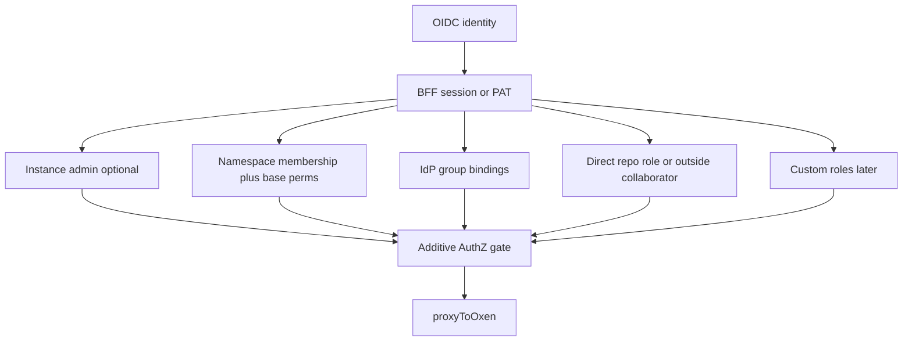

# AUTHO — PLAT-AUTHO authorization plan

Living design and phased plan for epic [`PLAT-AUTHO`](./EPICS.md#plat-autho--authorization-authz): namespace/repo authorization at the Mice BFF, modeled on **GitHub Enterprise** organization/repository AuthZ.

Related: [EPICS.md](./EPICS.md) · [01-authentication.md](./01-authentication.md) (AuthN) · [03-audit.md](./03-audit.md) · [04-gxp-compliance.md](./04-gxp-compliance.md) · [README.md](../README.md)

**Primary source of truth:** GitHub Enterprise org/repo authorization ([roles in an organization](https://docs.github.com/en/organizations/managing-peoples-access-to-your-organization-with-roles/roles-in-an-organization), [repository roles](https://docs.github.com/en/organizations/managing-user-access-to-your-organizations-repositories/managing-repository-roles/repository-roles-for-an-organization), [base permissions](https://docs.github.com/en/organizations/managing-user-access-to-your-organizations-repositories/managing-repository-roles/setting-base-permissions-for-an-organization), custom org/repo roles, outside collaborators, additive resolution).

**Mice delta:** oxen-server has no ACL — enforce at the auth BFF ([`auth/`](../auth/)). Product vocabulary uses **namespace** (not “organization”); semantics still follow GH Enterprise.

## 1. Purpose & scope

**In scope**

- Additive AuthZ for namespaces and repositories (GH Enterprise–shaped)
- Instance-level permissions for product surfaces without a GH repo analogue (`create_namespace`, `view_audit`, …)
- Enforcement on proxied `/api` and AuthZ admin APIs at the BFF
- Stores under `AUTH_DATA_DIR`; admin UI; Playwright TC-AUTHO-*
- Bootstrap instance admins; last-admin / last-Owner guards; audited site-admin bypass

**Out of scope (this document)**

- AuthN / OIDC / sessions / PAT minting mechanics — see [01-authentication.md](./01-authentication.md)
- Audit event emission schema — see [03-audit.md](./03-audit.md) (this plan only gates who may **query**)
- GitHub Apps / OAuth Apps as principals, EMU, SCIM, billing roles
- Implementing enforcement code (phases below are the delivery plan)

**Depends on:** [`PLAT-AUTH`](./01-authentication.md) — session / PAT identity at the BFF.

**Consumed by:** [`PLAT-AUDIT`](./03-audit.md) query gates; later [`PLAT-JOB`](./EPICS.md#plat-job--versioned-workspace-jobs) / [`PLAT-SESS`](./EPICS.md#plat-sess--desktop-sessions) before mount/run.

## 2. Terminology map

| GitHub Enterprise | Mice |
| --- | --- |
| Enterprise (account) | Mice **instance** (one deployment) |
| Organization | Oxen **namespace** (API, UI, and docs say namespace) |
| Repository | Oxen **repository** |
| Org Owner / Member | Namespace **Owner** / **Member** |
| Repo Read / Triage / Write / Maintain / Admin | Same names and intent |
| Outside collaborator | Repo role **without** namespace membership |
| Team | IdP group bindings as members/collaborators (no nested Teams / SCIM) |
| Fine-grained PAT | Mice PAT with optional resource grants (Phase 2) |
| Enterprise Owner | Instance admin (`AUTHZ_BOOTSTRAP_ADMINS`) |

## 3. Current state

| Piece | Behavior |
| --- | --- |
| Auth BFF | Session / PAT AuthN; proxies `/api` with AuthZ enforce ([`auth/`](../auth/)) |
| AuthZ | Additive ns/repo roles; instance admin + instance permissions; hard gate + `/pending`; IdP group bindings; fine-grained PAT scopes; training gate; directory search |
| Stores | `instance-admins.json`, `namespaces.json`, `namespace-members.json`, `repo-collaborators.json`, `custom-roles.json`, `access-requests.json`, `pats.json`, `audit.jsonl` under `AUTH_DATA_DIR` |
| Admin UI | Namespace Settings (members, base perms, custom roles); repo collaborators; Settings (instance admins, instance permissions, access-request review); directory pickers |
| Custom roles | Namespace capabilities + custom repo roles (`base` + fine permissions); enforced on `/api` and AuthZ admin routes |
| Directory | `GET /auth/directory/search` — Keycloak Admin API when configured + merge of known AuthZ store principals ([`directory.ts`](../auth/src/directory.ts)) |

## 4. Goals & non-goals

### Goals

1. GH Enterprise–shaped additive AuthZ for namespaces/repos at the BFF
2. Deny by default when no grant applies (except documented bypass / hard-gate exceptions)
3. Admin UX for namespace members, base permissions, repo collaborators
4. Instance bootstrap and recovery without silent untracked privilege
5. Clear Mice-only deltas vs GitHub (see §5)

### Non-goals

- Mice-style platform persona switcher / active-role-only functionality matrix
- Matching GitHub Apps, EMU, or billing
- Mongo/Postgres for role stores in MVP (JSON under `AUTH_DATA_DIR`)
- Enforcing ACL inside oxen-server

## 5. Mice deltas (vs GitHub Enterprise)

Everything else in this plan should read as GH Enterprise adapted to namespaces. Only these differ:

1. **Enforcement point** — AuthZ at Mice BFF; oxen-server has no ACL. Direct `:3001` bypass remains a deployment risk ([01-authentication.md](./01-authentication.md)).
2. **Naming** — API, UI, and docs use **namespace**, not “organization.”
3. **No GitHub Apps / OAuth Apps** as AuthZ principals in v1 (users + PATs + IdP groups).
4. **IdP groups as team analogue** — Admins bind IdP group names as namespace members or repo collaborators; access is resolved live from session (or PAT mint-time) `groups`. Nested GitHub Teams / SCIM remain out of scope. `AUTHZ_GROUP_BOOTSTRAP` still materializes instance perms / auto-create namespace on login. Directory search uses **Keycloak Admin API** in Compose (not Microsoft Graph); store-known principals always merge as fallback.
5. **No billing roles** — omit Billing Manager.
6. **SSO shape** — OIDC (Keycloak/Entra) per 01-authentication.md; not GH SAML/EMU/SCIM in v1.
7. **Storage** — JSON under `AUTH_DATA_DIR` (same volume pattern as PATs/audit).
8. **Oxen permission matrix** — Map GH repo roles onto oxen HTTP routes. **Triage** is first-class but may be sparse (Read + any non-code moderation/metadata routes); expand as product grows.
9. **Instance permission catalog** — `create_namespace`, instance-wide `view_audit`, `session_create` / `session_connect` / `session_admin` (see §7.8). Namespace **Owners** may query audit **scoped to their namespace** (needs AUDIT filters). Instance admin has audited **`site_admin_bypass`** on org/repo checks.
10. **Visibility** — Follow oxen public/private (or equivalent); do not assume GH “internal” until oxen supports it.
11. **EMU** — out of scope; identities are IdP users in the BFF session.
12. **01-authentication.md starter RBAC** — replaced by Owner/Member + five-tier repo roles below.

## 6. Decisions

| # | Topic | Choice |
| --- | --- | --- |
| — | Model family | GitHub Enterprise org/repo AuthZ |
| — | Permission combine | **Additive** (highest / union of grants) |
| — | Predefined namespace roles | **Owner**, **Member** |
| — | Predefined repo roles | **Read**, **Triage**, **Write**, **Maintain**, **Admin** |
| D1 | Base permissions at create | Required field on namespace create; UI suggests **`none`** |
| D2 | Instance admin data plane | **Site-admin bypass**; audit each as `site_admin_bypass` |
| D3 | Create namespace | Instance admin **or** instance permission `create_namespace` |
| D4 | Triage | Keep five-tier names; sparse matrix OK |
| D5 | Namespace Owner on repos | Implicit **Admin** on all repos in that namespace |
| D6 | Hard gate | Zero grants → pending/request-access; **except** instance admin and `create_namespace` holders |
| D7 | Members create repos | Default **on**; creator gets **Admin**; Owner can disable |
| D8 | Product vocabulary | **Namespace** everywhere |
| D9 | Audit query | Instance admin + `view_audit` (instance-wide); namespace Owners → **ns-scoped** only |
| D10 | Last guards | Last instance admin **and** last namespace Owner protected |
| — | Persona switcher | **None** |
| — | PATs | ≤ minting user’s effective access; fine-grained scopes; **groups snapshotted at mint** |
| — | IdP groups | Live group→role bindings (members + collaborators) |
| — | Custom roles | Namespace + repo custom roles with full Mice fine catalog |

## 7. Authorization model

### 7.1 Additive resolution

Effective repo access = highest grant from:

1. Namespace **base permissions** (Members only; not outside collaborators) — from user seat **or** IdP group membership
2. Namespace **Owner** ⇒ implicit **Admin** on every repo in the namespace (user or group Owner)
3. IdP group → direct repo collaborator role
4. Direct repository role (user Member or outside collaborator)
5. Custom namespace capabilities / custom repo role base + fine permissions
6. Instance admin **`site_admin_bypass`** (audited; prefer normal grants day-to-day)

No “active persona” shrinking rights. Explicit collaborator lists **add** grants; they do not wipe namespace membership.

### 7.2 Namespace roles

| Role | Capabilities |
| --- | --- |
| **Owner** | Manage members, base permissions, member-create-repos setting; implicit **Admin** on all repos; ns-scoped audit query; cannot remove/demote the last Owner |
| **Member** | Subject to base permissions + explicit repo roles; may create repos if org setting allows |

### 7.3 Repository roles (oxen-adapted intent)

| Role | Intent (oxen) |
| --- | --- |
| **Read** | List/read tree, commits, data frames, metadata |
| **Triage** | Read + non-code moderation/metadata routes that exist (sparse until product grows) |
| **Write** | Push / write files / workspace mutations that change data |
| **Maintain** | Write + merge / branch maintenance without full destructive admin |
| **Admin** | Manage collaborators/settings; delete and other destructive ops as oxen allows |

The `action → minimum role` table lives in the `auth/` path map and is the enforced source of truth. Unknown mutating routes need **Admin**; unrecognised GET/HEAD routes with no namespace and repo are **denied** unless allowlisted ([ADR 0002](../docs/adr/0002-bff-default-deny.md)). Push transport routes (commit upload, publish, version chunks) need **Write**; the version query needs **Read**.

**Staging and Mice Workspaces:** Oxen's own workspaces (the glossary's **Staging**) and Mice Workspaces sit at the repo-role floor here (Read for GET, Write for mutations). Per-owner or lease rules are decided in [08-workspaces.md](./08-workspaces.md) and the Jobs/Sessions plans, not in this plan.

### 7.4 Base permissions

- Values: `none` \| `read` \| `triage` \| `write` \| `maintain` \| `admin`
- Applies to all **Members** on all repos in the namespace
- Does **not** apply to outside collaborators
- **Required** when creating a namespace; recommend presenting **`none`** as the suggested default in the control

### 7.5 Outside collaborators

A user may hold a repo role without namespace membership. They do not receive base permissions. Used for consultants / limited access (GH outside collaborator analogue).

### 7.6 Create rules

| Action | Who |
| --- | --- |
| Create namespace | Instance admin or `create_namespace`; must set base permissions; creator becomes namespace **Owner** |
| Create repository | Per namespace setting (default: Members may create); creator gets repo **Admin**. Owners always may create. |

### 7.7 Hard gate (post-SSO)

| Principal | Access |
| --- | --- |
| No namespace membership, no outside-collaborator repo role, not instance admin, no `create_namespace` | Pending / request-access only; product `/api` to private data blocked |
| Instance admin or `create_namespace` | May proceed (bootstrap / create first namespace) even with zero seats |
| Any grant (member, outside collaborator, etc.) | Normal additive AuthZ |

### 7.8 Instance permission catalog

When `AUTHZ_ENFORCE` is on, missing permission → deny (no authenticated-user defaults). Instance admins receive the full catalog. Recommended developer `AUTHZ_GROUP_BOOTSTRAP` pack: `session_create`, `session_connect`, `manage_own_tokens`, `cli_device_approve` (+ `create_namespace` / `view_audit` / `view_lineage` as needed).

| Permission | Intent |
| --- | --- |
| `create_namespace` | Create namespaces (also skips hard gate) |
| `view_audit` | Instance-wide audit query UI/API |
| `view_lineage` | Unscoped / cross-repo lineage query |
| `manage_own_tokens` | List / create / revoke own PATs |
| `cli_device_approve` | Approve / deny CLI device login codes |
| `session_create` | Provision desktop Sessions ([10-sessions.md](./10-sessions.md)) |
| `session_connect` | Connect to own Sessions (ownership alone is not enough under enforce) |
| `session_admin` | Administer any Session (list/stop/destroy/connect); implied by instance admin |

Session **mounts** do not use a separate instance permission: each mount is gated with Jobs’ `authorizeJobRead` (ro) / `authorizeJobSubmit` (rw) on the target repo, and Connect re-checks mounts.

**Namespace capability** `view_lineage` allows ns-scoped lineage without per-repo read. **Repo fines** (atomic; predefined roles imply them): `job_submit`, `job_read`, `job_cancel`, `job_complete`, `lineage_read`, `lineage_rebuild`, plus existing contents/workspaces/merge/…/`manage_repo_metadata`.

Instance **admins** (bootstrap) hold full instance catalog + `site_admin_bypass`. Delegation of individual instance permissions is supported for non-admins.

### 7.9 Tokens (PATs)

- Phase 0: PAT AuthZ = minting user’s full effective access (additive), evaluated on every request: direct grants shrink immediately when the user loses them; scopes cap the result. Group-derived access is fixed at mint (see §12 runbook).
- Phase 2: optional fine-grained resource grants (selected namespaces/repos + max role) ⊆ user’s access.
- Under enforce, mint/list/revoke own PATs requires `manage_own_tokens` (or instance admin).
- PAT cannot escalate beyond the user.

## 8. Stores & APIs (target)

Under `AUTH_DATA_DIR` (illustrative filenames):

| Store | Purpose |
| --- | --- |
| `instance-admins.json` / flags on users | Instance admins + instance permission grants |
| `namespaces.json` | Per-namespace settings (base permissions, members_can_create_repos) |
| `namespace-members.json` | User → Owner/Member; `groupMembers` → IdP group → role (v2) |
| `repo-collaborators.json` | User → repo role; `groupCollaborators` → IdP group → role (v2) |
| `custom-roles.json` | Custom namespace + repo roles per namespace |

Suggested BFF routes (names may adjust at implement time):

| Route | Behavior |
| --- | --- |
| `GET/PATCH /auth/instance/...` | Instance admin / permission admin |
| `POST /auth/namespaces` | Create namespace (`create_namespace` or instance admin); body includes `base_permission` |
| `GET /auth/namespaces` | List AuthZ namespaces visible to the caller |
| `GET/PATCH /auth/namespaces/:ns` | Settings (Owners) |
| `DELETE /auth/namespaces/:ns` | Delete namespace AuthZ; optionally delete all oxen repos (`deleteRepositories`, default true). Owners / instance admin |
| `GET/PUT/DELETE /auth/namespaces/:ns/members` | Membership (Owners; last-Owner guard). Body: `{ kind: 'user', sub, iss, role }` or `{ kind: 'group', group, role }` |
| `GET/PUT/DELETE /auth/namespaces/:ns/repos/:repo/collaborators` | Repo roles (repo Admin / Owner); same `kind` discriminator for IdP groups |
| `GET /auth/me/authz` | Effective grants for UI |
| `GET /auth/directory/search` | Directory search (`q`, `kind=user\|group`); instance admin / `manage_members` / access reviewers |
| Existing `GET /auth/audit` | Gated per §7.8 / D9 |

Env:

| Variable | Purpose |
| --- | --- |
| `AUTHZ_BOOTSTRAP_ADMINS` | Comma-separated emails or subject IDs; matching SSO login becomes instance admin when none exist |
| `OIDC_GROUPS_CLAIM` | Id token claim for groups (default `groups`; string or string[]) |
| `AUTHZ_GROUP_BOOTSTRAP` | Optional login-time materialize of instance perms / namespace seats from group or email keys |
| `AUTH_DATA_DIR` | Shared with PATs/audit |
| `DIRECTORY_PROVIDER` | `keycloak` \| `none` (default keycloak when `KEYCLOAK_ADMIN_URL` set) |
| `KEYCLOAK_ADMIN_URL` | Keycloak base for Admin API (Compose: `http://keycloak:8080`) |
| `KEYCLOAK_REALM` | Realm name (default `mice`) |

## 9. UI (target)

| Surface | Change |
| --- | --- |
| Pending / request access | Zero-grant users (except bootstrap exceptions) |
| Namespace settings | Members (users + IdP groups), base permissions, “members can create repos”; directory picker |
| Repo settings | Collaborators (users + IdP groups; outside collaborators); directory picker |
| Instance admin | Settings: instance admins, instance permissions, access-request review; directory picker |
| Custom roles | Namespace Settings: create/assign custom ns + repo roles |
| Audit | Instance-wide vs ns-scoped results per D9 |
| Create namespace | Requires base permission selection; optional members via directory picker |

## 10. Phased delivery

### Phase 0 — Stores + enforce — **done**

- [x] JSON stores + `hasRepoPermission` / additive resolution (`../auth/src/authz*.ts`)
- [x] Enforce on `/api` proxy when `AUTHZ_ENFORCE` / store `enforce`; `403` when insufficient
- [x] Audit query gates: instance admin / `view_audit` / Owner ns-scoped
- [x] `AUTHZ_BOOTSTRAP_ADMINS` + last instance-admin + last namespace-Owner guards
- [x] Base permissions at create; `create_namespace`; Owner implicit Admin; five repo roles; outside collaborators
- [x] `site_admin_bypass` audit when admin lacks a normal grant
- [x] Hard gate for zero-grant users (exceptions per D6); UI `/pending`
- [x] AuthZ admin APIs under `/auth/namespaces`, `/auth/instance`, `/auth/me/authz`
- [x] Unit tests: `npm test` in `auth/` (`authz.test.ts`) — TC-AUTHO-01…14
- [x] Dev: `AUTHZ_DEV_GRANT_ALL` (default with `AUTH_DEV_MODE`); prod: `AUTHZ_ENFORCE=true` + bootstrap allowlist

### Phase 1 — Admin UI + e2e — **done**

- [x] Namespace Settings UI (`/n/:ns/settings`); repo collaborators on repo Settings
- [x] Path → role map catalog (`../auth/src/authzPathMap.ts`) + `requiredRepoRoleForRequest`
- [x] Playwright `e2e/tests/authz.spec.ts` (API + Settings UI)
- [x] Full TC-AUTHO-01…14 unit matrix (`../auth/src/authz.test.ts`)

### Phase 2 — Enterprise parity extras — **done (MVP)**

- [x] Access-request UX (`POST /auth/access-requests`, pending page form; admin/Owner approve/deny + Settings review UI)
- [x] IdP group / email bootstrap via `AUTHZ_GROUP_BOOTSTRAP` JSON (`groupBootstrap.ts`)
- [x] Fine-grained PAT resource scopes on mint (`scopes` on `POST /auth/tokens`)
- [x] IdP groups as live members/collaborators (`OIDC_GROUPS_CLAIM`, session/PAT groups, `groupMembers` / `groupCollaborators`)
- [x] Custom namespace / custom repository roles (`custom-roles.json`, fine catalog, Settings UI)

### Phase 3 — Optional product gates — **done (MVP)**

- [x] Training / GxP gate: `AUTHZ_REQUIRE_TRAINING=true` + `POST /auth/training` self/admin complete

### Phase 4 — Directory search — **done**

- [x] Keycloak Admin API user/group search (`directory.ts`) + AuthZ store fallback
- [x] `GET /auth/directory/search`; service account on `mice-auth` in realm import
- [x] `DirectoryPicker` on namespace/repo/instance/create member flows
- [x] Unit + Playwright coverage (`directory.test.ts`, TC-AUTHO-directory)

### Phase 5 — Access lifecycle — **proposed** (see Open questions in §12)

- [ ] Immediate path to drop IdP-group-derived access held by existing PATs (snapshot at mint)
- [ ] Periodic access review (members, collaborators, group bindings, instance admins/permissions) with audited attestation
- [ ] Optional expiry for delegated instance permissions and emergency admin grants; expiry audited
- [ ] Documented, tested behavior for stale IdP group claims and directory outage

### Production readiness (ticketed in `.scratch/auth-readiness/`)

- [x] Production startup refuses to run un-enforced, without a bootstrap admin, with dev flags, with an unwritable data directory, or with a non-internal oxen upstream; the enforce flag is always on in production
- [x] Unrecognised unscoped GET/HEAD denied; one action table drives enforcement; table-completeness test
- [x] Non-canonical paths rejected with `400`
- [x] Write role can push through the BFF (Read cannot)
- [x] Oxen unpublished in the base compose; dev override publishes it
- [x] Single-replica lock on `AUTH_DATA_DIR` in production
- [x] PAT shrink and scope-cap tests; Owner audit scope tests (list, export, facets)
- [x] ADR 0002; auth unit tests and typecheck in CI

## 11. Test plan

| Case | Expectation |
| --- | --- |
| TC-AUTHO-01 | Authenticated, zero grants → pending; `/api` denied |
| TC-AUTHO-02 | `create_namespace` / instance admin skips hard gate; can create namespace |
| TC-AUTHO-03 | Member with base `none` and no repo role → cannot read private repo |
| TC-AUTHO-04 | Member with base `read` → can read; cannot write |
| TC-AUTHO-05 | Namespace Owner → Admin on all repos without explicit collaborator row |
| TC-AUTHO-06 | Outside collaborator Write → write that repo only; no base perms elsewhere |
| TC-AUTHO-07 | Additive: base Read + direct Write → Write |
| TC-AUTHO-08 | Insufficient role → `403`; oxen not called (or equivalent fail-closed) |
| TC-AUTHO-09 | Cannot demote/remove last namespace Owner |
| TC-AUTHO-10 | Cannot remove last instance admin |
| TC-AUTHO-11 | Instance admin bypass succeeds; audit contains `site_admin_bypass` |
| TC-AUTHO-12 | Owner audit query limited to own namespace; `view_audit` sees instance-wide |
| TC-AUTHO-13 | PAT cannot exceed minting user’s grants |
| TC-AUTHO-14 | Members create repo (default on) → creator is Admin; setting off → Members denied |

## 12. Open risks

| Risk | Mitigation |
| --- | --- |
| Direct `:3001` bypass | Do not publish oxen in production; product remote is BFF |
| Incomplete path → role map | Deny unknown mutating routes; expand map with Mice features |
| Sparse Triage | Document equality with Read where no triage routes exist; revisit |
| Site-admin bypass overuse | Audit every bypass; prefer normal grants |
| Stale IdP group claims | Session `groups` are fixed at login and PAT `groups` at mint, so a removed IdP group keeps granting access until re-login / PAT revoke; see Open question 1 and the not-valid-before cut-off ([01-authentication.md](./01-authentication.md)) |
| Directory outage | Keycloak Admin API down degrades directory search to store-known principals only; grants and enforcement are unaffected (no live IdP lookup). Fail-open vs fail-closed behavior for any future live group re-check is undefined — Open question 3 |
| JSON store concurrency | Single-writer BFF assumptions; swap store later if multi-instance |
| AUDIT ns filter gaps | Owners must not see other namespaces; enforce server-side filter |

### Runbook: dropping group-derived access (until Phase 5)

Session and PAT `groups` are fixed at login and at mint, so removing someone from an IdP group does not shrink what they already hold. To cut it off now:

1. Remove or change the group binding in AuthZ if the access came from a binding.
2. Revoke the Principal's credentials by `iss`+`sub` (admin revocation). This ends their Sessions and rejects PATs created at or before the cut-off.
3. The user signs in again (fresh `groups`) and mints new PATs.

Direct grants (member, collaborator, custom role) take effect immediately without this.

### Open questions

1. **Immediate group-membership revocation:** PAT group claims are snapshotted at mint time, so removing a user from an IdP group does not shrink existing PATs. Define a path that takes effect immediately (e.g. admin "revoke tokens/sessions" per `iss`+`sub`, which already rejects PATs created at or before the cut-off; or unbinding the group in AuthZ; or re-checking groups against the directory on PAT use). Which is the supported route, and does it need a UI action?
2. **Periodic access review and emergency/delegated-admin expiry:** should the platform support scheduled access-review campaigns (members, collaborators, group bindings, instance admins, instance permissions) with attestation audit events? Should delegated instance permissions and emergency (breakglass) admin grants carry a mandatory expiry that auto-revokes and is audited?
3. **Directory outage behavior:** if a live directory/group re-check is added, should an outage fail closed (deny) or use last-known groups for a bounded time? Who is alerted? (For the AUTH directory-sync revocation job the proposed answer is fail open with an alert; see [01-authentication.md](./01-authentication.md) Phase 3. Group re-checks may differ.)
4. **Service principals (proposed in [01-authentication.md](./01-authentication.md) Phase 4):** membership, instance-permission and audit rules for `urn:mice:service|<uuid>` principals, including suspension when the owner is offboarded.

## 13. How to use this file

1. Implement one phase at a time; tick Phase bullets in PRs.
2. Keep decisions in §6 unless an ADR supersedes them.
3. When PLAT-AUTHO epic bullets in [EPICS.md](./EPICS.md) land, mark them done and point at the phase that closed them.
4. Treat GitHub Enterprise docs as behavioral SoT; record new Mice deltas only in §5.
