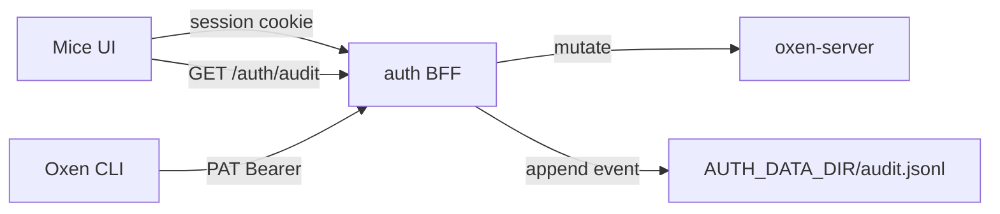

# AUDIT — PLAT-AUDIT implementation plan

Living design and phased plan for epic [`PLAT-AUDIT`](./EPICS.md#plat-audit--gxp-oriented-change-audit): append-only, attributable audit of mutations through the auth BFF.

Related: [EPICS.md](./EPICS.md) · [01-authentication.md](./01-authentication.md) · [02-authorization.md](./02-authorization.md) · [04-gxp-compliance.md](./04-gxp-compliance.md) · [README.md](../README.md)

## 1. Purpose & scope

**In scope**

- Emit audit events for non-GET/HEAD requests proxied by the auth BFF
- Append-only JSONL store under `AUTH_DATA_DIR`
- Query API + Audit UI (filter by actor, repo, time, action)
- Attribution from BFF-resolved identity (`sub` / `iss` / email / name) and auth `via`

**Out of scope (this document)**

- Required GxP reason / change-control id before mutate (Phase 2)
- Retention policies and formal export packaging (Phase 2)
- Auditing raw oxen-server `:3001` (e2e helpers only)
- Separate audit microservice; Mongo/Postgres store (future swap)

**Depends on:** [`PLAT-AUTH`](./01-authentication.md) — session / PAT identity at the BFF.

**AuthZ for query:** [`02-authorization.md`](./02-authorization.md) — instance admin or instance permission `view_audit` for instance-wide `GET /auth/audit`; namespace **Owners** (and custom ns roles with `view_audit`) may query events **scoped to their namespace** only via `authorizeAuditQuery`.

## 2. Current state

| Piece | Behavior |
| --- | --- |
| Auth BFF | Proxies `/api/*` with author injection ([`../auth/src/proxy.ts`](../auth/src/proxy.ts)) |
| Identity | Session cookie or `mice_pat_*` ([`../auth/src/index.ts`](../auth/src/index.ts)) |
| PAT store | `AUTH_DATA_DIR/pats.json` |
| Audit | Append-only JSONL (`../auth/src/audit.ts`); query UI at `/audit`; AuthZ gates on `GET /auth/audit` |

## 3. Goals & non-goals

### Goals

1. Intercept write paths that mutate oxen-server state (via BFF)
2. Immutable, append-only audit store with attributable actor identity
3. Audit query UI (filter by actor, repo, time, change type)
4. Reuse existing commit/message/description fields as narrative (no required GxP reason gate)

### Non-goals (MVP)

- Blocking writes without a GxP reason
- Cryptographic hash-chaining / WORM media
- Multi-instance shared audit without a later store swap

## 4. Target architecture

### Decisions

| Topic | Choice |
| --- | --- |
| Scope | Capture + query first; message/description from mutation bodies when present |
| Store | Append-only **JSONL** at `AUTH_DATA_DIR/audit.jsonl` |
| Emitter | Auth BFF `proxyToOxen` after upstream response (success and failure; include `status`) |
| Reads | Never audited |
| Attribution | Plumb `via` (`session` \| `pat`) with `SessionUser` |

### Components

| Component | Role |
| --- | --- |
| [`../auth/src/audit.ts`](../auth/src/audit.ts) | Append + query JSONL |
| [`../auth/src/proxy.ts`](../auth/src/proxy.ts) | Classify action; extract ns/repo/message; append after upstream |
| `GET /auth/audit` | Filtered query for UI / automation |
| `/audit` UI | Platform audit table + filters |

## 5. Event schema

One JSON object per line:

| Field | Notes |
| --- | --- |
| `id` | Random hex id |
| `ts` | ISO-8601 |
| `actor` | `{ sub, iss, email, name }` |
| `via` | `session` \| `pat` |
| `method` | HTTP method |
| `path` | Request pathname (`/api/...`) |
| `status` | Upstream HTTP status |
| `action` | Coarse class (`repo.create`, `file.write`, `file.delete`, `branch.*`, `merge`, `workspace.create/delete/commit/merge/file.write/file.delete/other`, `other`). New names keep the `file.`/`workspace` prefixes that AuthZ maps on |
| `namespace` / `repo` | Parsed from `/api/repos/:ns/:repo/...` when possible |
| `dataset` | *(proposed)* Dataset version the mutation acted on: oxen commit id / content hash before and after (`{ base, head }`), when determinable; see Open question 2 |
| `reason` / `change_control_id` | *(proposed, [04-gxp-compliance.md](./04-gxp-compliance.md) Phase 2)* Structured fields, not free text in `message`/`detail`; absent when policy does not require them |
| `message` | From body `message` / `commit_message` when present |
| `detail` | Small non-secret extras (e.g. branch, file path); never tokens or file bytes |

Never log `Authorization`, cookies, or request body blobs.

## 5.1 BFF-native mutation actions

Mutations handled directly by the auth BFF (not proxied to oxen) emit events via `auditMutation` in `auth/src/index.ts` (jobs and sessions emit from their own modules). Denied/failed attempts are recorded where they reveal privilege changes (`status` 400/403).

| Area | Actions |
| --- | --- |
| Auth | `auth.login`, `auth.logout` |
| Tokens / CLI | `token.create`, `token.revoke`, `device.approve`, `device.deny`, `device.redeem` |
| Instance | `instance.settings.update`, `instance.admin.add/remove`, `instance.permissions.update`, `announcement.create/update/delete` |
| Access / training | `access-request.submit/approve/deny`, `training.update` |
| Namespaces | `namespace.create`, `namespace.settings.update`, `namespace.delete`, `namespace.member.set/remove` (and `repo.delete` per cascaded repo) |
| Repo access | `repo.collaborator.set/remove` |
| Custom roles | `custom-role.namespace.create/update/delete`, `custom-role.repo.create/update/delete` |
| Lineage | `lineage.rebuild` |
| Jobs / Sessions | `job.*`, `session.create/connect/stop/retry/destroy/disconnect/sync` |

Token secrets are never written to `detail`.

## 6. Configuration

| Variable | Purpose |
| --- | --- |
| `AUTH_DATA_DIR` | Directory for `audit.jsonl` (and `pats.json`) |

Same Compose `auth_data` volume as PATs.

## 7. Phased delivery

### Phase 0 — Emit (Hono) — **this delivery**

- [x] `audit.ts` JSONL append + query helpers
- [x] Proxy hooks + `via` plumbing; action/ns/repo/message extraction
- [x] `GET /auth/audit`
- [x] E2E: mutate via BFF → event with correct `actor.sub`

### Phase 1 — Query UI + tests — **this delivery**

- [x] Audit page + Layout nav
- [x] Playwright `e2e/tests/audit.spec.ts` (TC-AUDIT-01…06)
- [x] Docs: this file, EPICS Partial, README pointer

### Phase 1.5 — AuthZ gates on query (depends on PLAT-AUTHO)

- [x] Enforce [02-authorization.md](./02-authorization.md) D9 on `GET /auth/audit` and `/audit` UI
- [x] Instance-wide: instance admin or `view_audit`
- [x] Namespace Owners / ns `view_audit` capability: results limited to allowed namespaces
- [ ] Playwright: insufficient principal → `403`; Owner cannot read other namespaces (if not already covered in authz e2e)

### Phase 2 — GxP extras

Umbrella checklist and sequencing live in [`04-gxp-compliance.md`](./04-gxp-compliance.md) (Phases 1–4). This epic keeps audit-store detail:

- Reason / change-control id on audit events — [04-gxp-compliance.md](./04-gxp-compliance.md) Phase 2 (`GXP-R-040`…`042`)
- Fail-closed append when `GXP_STRICT=true` — [04-gxp-compliance.md](./04-gxp-compliance.md) Phase 1 (`GXP-R-025`)
- Retention / export (filtered NDJSON + manifest) — [04-gxp-compliance.md](./04-gxp-compliance.md) Phase 4
- Store swap (Postgres JSONB / Mongo) behind the same schema (optional, with export)

### Phase 2.1 — Durability & schema (proposed, unchecked)

- [ ] Durable outbox / reconciliation for the mutation→audit crash gap: persist intent before proxying, mark complete after append, and reconcile orphaned intents on restart (needed for [04-gxp-compliance.md](./04-gxp-compliance.md) `GXP_STRICT`, `GXP-R-025`)
- [ ] Schema: explicit dataset version/commit fields (`dataset.base` / `dataset.head`)
- [ ] Schema: structured `reason` and `change_control_id` fields (shared with [04-gxp-compliance.md](./04-gxp-compliance.md) `GXP-R-040`…`042`)
- [ ] Namespace-owner query test coverage: unit + Playwright for Owner scoped to own namespace, other-namespace `403`/empty, ns `view_audit` capability, `403` for insufficient principal (extends the open Phase 1.5 Playwright item)

## 8. API

| Route | Auth | Behavior |
| --- | --- | --- |
| `GET /auth/audit` | Session; **AuthZ per [02-authorization.md](./02-authorization.md)** (`authorizeAuditQuery`: instance admin / `view_audit` / ns-scoped Owner) | Query params: `actor`, `namespace`, `repo`, `action`, `since`, `until`, `limit`, `cursor` |
| (no write routes) | — | Append only from proxy |

Disk append is **best-effort**: if JSONL write fails, the proxied oxen response still returns (logged server-side). Documented risk until a durable queue exists. A crash after the upstream mutation but before append leaves no event at all; Phase 2.1 outbox/reconciliation targets this ([04-gxp-compliance.md](./04-gxp-compliance.md) strict mode).

## 9. UI

| Surface | Change |
| --- | --- |
| Layout nav | **Audit** → `/audit` |
| Audit page | Table + filters; link to repo when ns/repo present |

## 10. Test plan

| Case | Expectation |
| --- | --- |
| TC-AUDIT-01 | Session write via BFF → audit row with actor name/email/sub |
| TC-AUDIT-02 | PAT write → `via: pat` |
| TC-AUDIT-03 | GET `/api/...` → no new audit line |
| TC-AUDIT-04 | `GET /auth/audit` without session → 401 |
| TC-AUDIT-05 | UI `/audit` lists recent event after a mutation |
| TC-AUDIT-06 | Filter by namespace returns only matching rows |

## 11. Open risks

| Risk | Mitigation |
| --- | --- |
| JSONL scan does not scale | Cap `limit`; swap store in Phase 2 behind same API |
| Append failure silent to client | Log error; revisit fail-closed if GxP demands |
| Crash between mutation and audit append | No record of a committed mutation; outbox/reconciliation (Phase 2.1), cross-ref [04-gxp-compliance.md](./04-gxp-compliance.md) |
| Owner-scoped query leaks | Server-side ns filter; add explicit test coverage (Phase 2.1) |
| Direct `:3001` bypass | Production: do not publish oxen port; product remote is BFF |
| Over-broad `other` actions | Tighten path heuristics as routes are catalogued |

### Open questions

1. **Outbox location:** same JSONL volume (intent records beside `audit.jsonl`) or the future store swap? Does reconciliation record an `unconfirmed` outcome or re-query oxen to infer the result?
2. **Dataset version capture:** is the pre/post commit id available from the oxen response for every mutation class, or does the BFF need an extra read (and lock) before/after proxying?
3. **Reason/change-control placement:** top-level fields vs inside `detail`; ownership split with [04-gxp-compliance.md](./04-gxp-compliance.md) Phase 2.

## 12. How to use this file

1. Implement phases; tick bullets in PRs.
2. Keep decisions in §4 unless an ADR supersedes them.
3. When epic bullets in [EPICS.md](./EPICS.md) land, mark them done.
