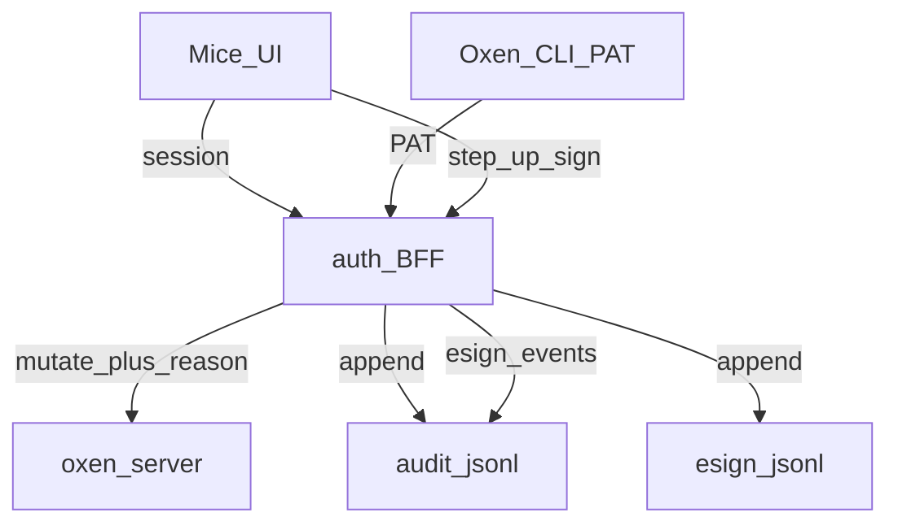
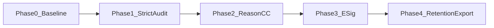

# GXP — PLAT-GXP product requirements + implementation plan

Living catalog of **product/tech controls** for Mice as a GxP-capable platform, plus phased engineering delivery. Grounded in FDA [21 CFR Part 11](https://www.ecfr.gov/current/title-21/chapter-I/subchapter-A/part-11), EU GMP Annex 11, ALCOA+ data integrity, and GAMP 5–style *system* controls the software must support.

Related: [EPICS.md](./EPICS.md) · [01-authentication.md](./01-authentication.md) · [02-authorization.md](./02-authorization.md) · [03-audit.md](./03-audit.md) · [README.md](../README.md)

**Detail SoTs:** AuthN → [01-authentication.md](./01-authentication.md); AuthZ / training gate → [02-authorization.md](./02-authorization.md); audit store/API → [03-audit.md](./03-audit.md). This document owns the cross-cutting requirements matrix, GxP-strict mode, reason/change-control gate, electronic signatures, and retention/export umbrella.

## 1. Purpose & scope

**In scope (product controls)**

- Requirements the Mice auth BFF, UI, and deployment contract must implement for GxP use
- Full Part 11 electronic signatures (re-auth at sign time, meaning, manifestation bound to record)
- Reason / change-control metadata on GxP mutations
- Audit-trail hardening (fail-closed in strict mode), retention, and inspection export
- Session / access / attribution controls that Part 11 and Annex 11 expect from the *system*

**Out of scope (this document)**

- CSV / QMS paperwork: URS, risk assessment, IQ/OQ/PQ protocols, Validation Summary Report, supplier qualification, periodic review SOPs, training curricula as QMS artifacts
- Paper / hybrid signature workflows, biometric e-signatures, certified WORM appliances (deployment option only)
- Oxen Hub cloud; raw oxen-server without the BFF as a GxP path

**Depends on:** [`PLAT-AUTH`](./01-authentication.md), [`PLAT-AUTHO`](./02-authorization.md), [`PLAT-AUDIT`](./03-audit.md)

**Consumed by:** later [`PLAT-JOB`](./EPICS.md#plat-job--versioned-workspace-jobs) / [`PLAT-SESS`](./EPICS.md#plat-sess--desktop-sessions) (AuthZ + audit + e-sig where actions are GxP-critical)

## 2. Current state

| Piece | Behavior | GxP relevance |
| --- | --- | --- |
| OIDC / session / PAT | IdP login; signed session cookie; `mice_pat_*` ([`../auth/src/`](../auth/src/), [01-authentication.md](./01-authentication.md)) | Unique attributable identity |
| Author injection | BFF overwrites commit author from session/PAT ([`../auth/src/proxy.ts`](../auth/src/proxy.ts)) | ALCOA+ attributable |
| AuthZ | Namespace/repo roles; instance perms; hard gate ([02-authorization.md](./02-authorization.md)) | Access control |
| Training gate | `AUTHZ_REQUIRE_TRAINING` + `POST /auth/training` ([`../auth/src/authz.ts`](../auth/src/authz.ts)) | Personnel qualification *hook* (product) |
| Audit JSONL | Append-only events on mutate via BFF; query API + `/audit` UI ([03-audit.md](./03-audit.md)) | Part 11 audit trail (partial) |
| Audit query AuthZ | `authorizeAuditQuery` — instance admin / `view_audit` / ns-Owner scoped ([`../auth/src/authz.ts`](../auth/src/authz.ts)) | Restricted audit review |
| Site-admin bypass | Audited `site_admin_bypass` | Privileged path visibility |
| Session TTL / idle | `SESSION_TTL_SEC` (default 8h) plus sliding idle timeout `SESSION_IDLE_SEC` (shipped; default `0` = off, validated value set by GXP policy) ([`../auth/src/env.ts`](../auth/src/env.ts)) | Session controls |
| Audit append | Best-effort (fail-open to client); strict fail-closed mode **not implemented** ([03-audit.md](./03-audit.md) §8) | Integrity gap for strict GxP |
| Reason / CC id | Not required | Gap |
| Electronic signatures | None beyond login + author injection | Gap |
| Retention / export | None | Gap |

## 3. Goals & non-goals

### Goals

1. Single numbered requirements catalog (`GXP-R-*`) with status and owning epic
2. `GXP_STRICT` mode that fail-closes audit append and enforces reason/e-sig policies
3. Full Part 11 e-signatures on a closed initial action set (merge approval first)
4. Retention + filtered export suitable for inspection review
5. Keep AUTH / AUTHO / AUDIT as implementation detail docs; sync status here

### Non-goals

- Implementing org validation packages inside this repo
- Replacing oxen version history (complement it with BFF audit + e-sig)
- Multi-instance shared audit store (same schema swap as [03-audit.md](./03-audit.md) Phase 2)

## 4. Requirements catalog

Status: `Done` / `Partial` / `Todo`. Anchors are indicative (Part 11 / Annex 11 / ALCOA+), not a legal interpretation.

### 4.1 Identity & access

| ID | Requirement | Anchor | Status | Owner |
| --- | --- | --- | --- | --- |
| GXP-R-001 | Unique user identity per human (`iss`/`sub`); no shared interactive accounts in GxP deployments | Part 11 §11.10(d); Annex 11 §12 | Partial | AUTH — IdP uniqueness; ops must not share logins |
| GXP-R-002 | All product mutations authenticated at BFF (session, PAT, or audited breakglass) | Part 11 §11.10(d); Annex 11 §12 | Done | AUTH |
| GXP-R-003 | Role-based authorization on namespaces/repos and instance permissions | Part 11 §11.10(g); Annex 11 §12 | Done | AUTHO |
| GXP-R-004 | Configurable session absolute max lifetime | Part 11 §11.10(d); Annex 11 §12 | Done | AUTH (`SESSION_TTL_SEC`) |
| GXP-R-005 | Configurable idle timeout that ends the session | Part 11 §11.10(d) | Partial | AUTH (`SESSION_IDLE_SEC` shipped); GXP owns the validated value policy |
| GXP-R-006 | Ability to disable or remove a user’s effective access (membership revoke / no grants) | Part 11 §11.10(d) | Done | AUTHO |
| GXP-R-007 | Breakglass path limited, attributable, and audited | Part 11 §11.10(e) | Partial | AUTH + AUDIT (use audited; tighten in strict mode) |
| GXP-R-008 | PATs scoped, attributable (`via: pat`), revocable | Part 11 §11.10(d)/(g) | Done | AUTH / AUTHO |
| GXP-R-009 | Production GxP path only via BFF; oxen `:3001` not a product remote | Annex 11 §12; ALCOA+ | Partial | Deploy contract — document + Compose prod profile |

### 4.2 Training gate (product)

| ID | Requirement | Anchor | Status | Owner |
| --- | --- | --- | --- | --- |
| GXP-R-010 | Optional product gate blocking `/api` mutations until training completed | Annex 11 §2 (personnel) *hook* | Done | AUTHO (`AUTHZ_REQUIRE_TRAINING`) |

### 4.3 Audit trail

| ID | Requirement | Anchor | Status | Owner |
| --- | --- | --- | --- | --- |
| GXP-R-020 | Automatic computer-generated audit of creates/updates/deletes via BFF (no user toggle) | Part 11 §11.10(e); Annex 11 §9 | Done | AUDIT |
| GXP-R-021 | Each event: who (`actor`), what (`action`/`path`), when (`ts`), outcome (`status`), where (`namespace`/`repo`) | Part 11 §11.10(e); ALCOA+ | Done | AUDIT |
| GXP-R-022 | Append-only store; no user/API delete or edit of events | Part 11 §11.10(e); Annex 11 §9 | Partial | AUDIT — no delete API; OS file still mutable |
| GXP-R-023 | Audit query restricted by AuthZ | Annex 11 §9 / §12 | Done | AUTHO + AUDIT (`authorizeAuditQuery`) |
| GXP-R-024 | Never log secrets (tokens, cookies, file bytes) | Part 11 §11.10; security | Done | AUDIT |
| GXP-R-025 | When `GXP_STRICT=true`, failed audit append fails the mutation (fail-closed) | Part 11 §11.10(a)/(e) | Todo | GXP Phase 1 / AUDIT |
| GXP-R-026 | Coarse action taxonomy sufficient for review (tighten `other`) | Annex 11 §9 | Partial | AUDIT |

### 4.4 Record integrity (ALCOA+)

| ID | Requirement | Anchor | Status | Owner |
| --- | --- | --- | --- | --- |
| GXP-R-030 | Commit author name/email injected from BFF identity (not client-spoofable) | ALCOA+ Attributable | Done | AUTH |
| GXP-R-031 | Versioned data retained via oxen history; mutations attributable in audit | ALCOA+ Original / Complete | Partial | oxen + AUDIT |
| GXP-R-032 | Contemporaneous timestamps (ISO-8601; host clock; NTP assumed in deploy) | ALCOA+ Contemporaneous | Partial | AUDIT + deploy docs |
| GXP-R-033 | Records retained and retrievable for configured retention period | Part 11 §11.10(c); Annex 11 §17 | Todo | GXP Phase 4 |
| GXP-R-034 | Human-readable audit / export for inspection | Part 11 §11.10(b); ALCOA+ Legible | Partial | AUDIT UI; export Todo |

### 4.5 Change metadata

| ID | Requirement | Anchor | Status | Owner |
| --- | --- | --- | --- | --- |
| GXP-R-040 | Required **reason** on configured GxP mutate classes when strict/reason policy enabled | Annex 11 §9; ALCOA+ | Todo | GXP Phase 2 |
| GXP-R-041 | Optional **change-control id** captured with the reason | Change control support | Todo | GXP Phase 2 |
| GXP-R-042 | Reason / CC id stored on the audit event | Part 11 §11.10(e) | Todo | GXP Phase 2 / AUDIT |

### 4.6 Electronic signatures

| ID | Requirement | Anchor | Status | Owner |
| --- | --- | --- | --- | --- |
| GXP-R-050 | E-signatures apply to a defined action set (initial: merge approval; then privileged settings) | Part 11 Subpart C | Todo | GXP Phase 3 |
| GXP-R-051 | Signature manifestation: printed name, date/time, meaning (e.g. Reviewed / Approved) | Part 11 §11.50 | Todo | GXP Phase 3 |
| GXP-R-052 | Re-authentication at signing (password, IdP step-up, or equivalent) — not session cookie alone | Part 11 §11.200 | Todo | GXP Phase 3 |
| GXP-R-053 | Signature bound to record identity (action + resource + content/version id); re-sign required after material change | Part 11 §11.70 | Todo | GXP Phase 3 |
| GXP-R-054 | Signatures unique to one individual; no shared signing credentials | Part 11 §11.100 / §11.200 | Todo | GXP Phase 3 + AUTH |
| GXP-R-055 | Each signature attempt (success/failure) produces an audit event (`esign.*`) | Part 11 §11.10(e) | Todo | GXP Phase 3 |
| GXP-R-056 | Signature records non-repudiable within system (append-only; linked from signed action) | Part 11 §11.70 | Todo | GXP Phase 3 |

### 4.7 Operational tech controls

| ID | Requirement | Anchor | Status | Owner |
| --- | --- | --- | --- | --- |
| GXP-R-060 | `GXP_STRICT` config enabling fail-closed audit, reason policy, e-sig enforcement | Annex 11 §4 / §12 | Todo | GXP Phase 1 |
| GXP-R-061 | Documented backup/restore path for `AUTH_DATA_DIR` (audit, authz, esign, PATs) | Annex 11 §7 / §16 | Todo | GXP Phase 4 + ops notes in this doc |
| GXP-R-062 | No product API to purge audit or e-sig history in strict mode | Part 11 §11.10(c)/(e) | Todo | GXP Phase 4 |
| GXP-R-063 | Integrity verification of regulated records after backup/restore (audit, esign, authz stores; hashes checked against export manifests) | Annex 11 §7 / §16; ALCOA+ Complete | Todo | GXP Phase 4 |

### 4.8 Signature lifecycle & review

| ID | Requirement | Anchor | Status | Owner |
| --- | --- | --- | --- | --- |
| GXP-R-057 | Signature revocation / correction workflow: a signature is never edited or deleted; revoke/supersede is a new audited record linked to the original with reason | Part 11 §11.10(e)/§11.70 | Todo | GXP Phase 3 |
| GXP-R-058 | Reviewer notification and escalation when a signature or approval is requested, pending past a threshold, or revoked | Annex 11 §9; workflow support | Todo | GXP Phase 3 + [14-notifications.md](./14-notifications.md) |

## 5. Target architecture

### Decisions

| Topic | Choice |
| --- | --- |
| Umbrella doc | This file; AUTH/AUTHO/AUDIT remain detail SoTs |
| Strict mode | `GXP_STRICT=true` fail-closes audit append; enables reason + e-sig enforcement lists |
| Reason gate | Header or JSON fields `X-Mice-Reason` / `reason` + optional `change_control_id`; required for configured action classes |
| E-sig store | Append-only JSONL (or same store family as audit) under `AUTH_DATA_DIR/esign.jsonl` |
| E-sig step-up | Prefer IdP re-auth / password verify via BFF; PAT cannot satisfy interactive e-sig (session + step-up only) unless a later device-flow is added |
| Initial signed actions | Merge approval first; expand via config allowlist |
| Validation paperwork | Outside repo (QMS) |

### Components (planned)

| Component | Role |
| --- | --- |
| [`../auth/src/audit.ts`](../auth/src/audit.ts) | Append/query; fail-closed when strict; reason/CC fields |
| [`../auth/src/proxy.ts`](../auth/src/proxy.ts) | Reason gate; refuse mutate if audit append fails (strict) |
| `../auth/src/esign.ts` (new) | Create/list signatures; bind to resource version; step-up verify |
| `GET/POST /auth/esign` | E-sig API |
| `GET /auth/audit/export` | Filtered NDJSON + manifest (Phase 4) |
| UI reason modal / e-sig dialog | Capture reason, meaning, step-up |

## 6. Configuration (planned)

| Variable | Purpose |
| --- | --- |
| `GXP_STRICT` | `true` → fail-closed audit; enforce reason + e-sig allowlists |
| `GXP_REASON_ACTIONS` | Comma-separated action classes requiring reason (e.g. `merge,file.write,repo.create`) |
| `GXP_ESIGN_ACTIONS` | Actions requiring a prior valid e-signature token/id |
| `GXP_RETENTION_DAYS` | Minimum retention hint for export/ops (enforce no-delete in strict) |
| `SESSION_TTL_SEC` | Absolute session lifetime (existing) |
| `SESSION_IDLE_SEC` | Idle timeout (shipped; default `0` = off; value policy owned here) |
| `AUTHZ_REQUIRE_TRAINING` | Existing training gate |
| `AUTH_DATA_DIR` | Audit, authz, PAT, esign stores |

## 7. Phased delivery

### Phase 0 — Requirements baseline — **this delivery (docs)**

- [x] Author this catalog (`GXP-R-*`) and architecture
- [x] Link from [EPICS.md](./EPICS.md) (`PLAT-GXP`) and [README.md](../README.md)
- [x] Point [03-audit.md](./03-audit.md) Phase 2 at this umbrella
- [ ] Keep requirement statuses updated as phases land

### Phase 1 — GxP-strict audit hardening

- [ ] `GXP_STRICT` env + wiring in [`../auth/src/env.ts`](../auth/src/env.ts)
- [ ] **Strict fail-closed audit is still unimplemented:** when `GXP_STRICT=true`, a failed audit append must fail the mutation (GXP-R-025; today best-effort, see [03-audit.md](./03-audit.md) §8) ([`../auth/src/proxy.ts`](../auth/src/proxy.ts) / [`../auth/src/audit.ts`](../auth/src/audit.ts))
- [ ] Set and document the validated `SESSION_IDLE_SEC` value/default for GxP deployments (GXP-R-005); mechanism shipped in [01-authentication.md](./01-authentication.md) Phase 2.5
- [ ] Document BFF-only production remote + NTP expectation (GXP-R-009 / R-032)
- [ ] Tighten action classification where `other` is over-broad (GXP-R-026)
- [x] Sync EPICS/AUDIT checklist drift for audit query AuthZ
- [ ] E2E: TC-GXP-01…03

### Phase 2 — Reason / change-control gate

- [ ] Accept `reason` + optional `change_control_id` (body or headers) on mutate
- [ ] When policy requires reason, reject with `400` + stable error code if missing
- [ ] Persist on audit events (schema fields)
- [ ] UI: prompt on covered mutate flows; show on Audit page
- [ ] CLI/PAT contract documented (headers)
- [ ] E2E: TC-GXP-10…13

### Phase 3 — Electronic signatures

- [ ] `../auth/src/esign.ts` + append-only `esign.jsonl`
- [ ] `POST /auth/esign` — step-up auth, meaning, bind `(action, resource, versionId)`; step-up = IdP re-auth (`prompt=login`, `max_age=0`, fresh `auth_time` check), no password handling in the BFF; PATs cannot sign
- [ ] Signatures are single-use, head-bound (rejected if the source head moved), expire after 10 minutes (configurable); no silent rebinding
- [ ] `GET /auth/esign` — list/filter by resource (AuthZ-scoped)
- [ ] Enforce `GXP_ESIGN_ACTIONS`: mutate requires valid unconsumed/bound signature id
- [ ] UI: e-sig dialog (meaning + re-auth) on merge approval first
- [ ] Signature revoke/supersede as a new audited, linked record with reason; originals immutable (GXP-R-057)
- [ ] Reviewer notification and escalation for pending/revoked signatures via [14-notifications.md](./14-notifications.md) events (GXP-R-058)
- [ ] Audit events `esign.create` / `esign.fail`; under `GXP_STRICT`, workspace commit/merge fails closed if the audit append fails
- [ ] E2E: TC-GXP-20…25

### Phase 4 — Retention & export

- [ ] `GXP_RETENTION_DAYS` documented; no delete APIs in strict mode (GXP-R-062)
- [ ] `GET /auth/audit/export` — filtered NDJSON + manifest (hashes, time range, generator version)
- [ ] Ops note: backup/restore of `AUTH_DATA_DIR` (GXP-R-061)
- [ ] Restore verification: integrity check of audit/esign records against export-manifest hashes (GXP-R-063)
- [ ] Optional store swap remains per [03-audit.md](./03-audit.md) (Postgres/Mongo behind same schema)
- [ ] E2E: TC-GXP-30…32

## 8. API (planned)

| Route | Auth | Behavior |
| --- | --- | --- |
| Mutate `/api/*` | Session / PAT / breakglass + AuthZ | When strict: reason/e-sig gates; fail-closed audit |
| `GET /auth/audit` | Per [02-authorization.md](./02-authorization.md) | Existing query; expose reason/CC when present |
| `GET /auth/audit/export` | `view_audit` / instance admin (ns-scoped for Owners) | NDJSON + manifest download |
| `POST /auth/esign` | Session + step-up | Create signature record |
| `GET /auth/esign` | Session + AuthZ | List signatures for resource |

## 9. UI (planned)

| Surface | Change |
| --- | --- |
| Mutate flows (merge, etc.) | Reason (+ CC id) modal when required |
| Merge approval | E-sig dialog: meaning + re-auth |
| `/audit` | Columns for reason, CC id, linked signature id |
| Settings / admin | Document strict-mode expectations (no purge) |

## 10. Test plan

| Case | Expectation |
| --- | --- |
| TC-GXP-01 | `GXP_STRICT=true`, audit disk error → mutate fails (non-2xx), no silent success |
| TC-GXP-02 | `GXP_STRICT=false`, audit disk error → mutate may succeed; server logs error (current best-effort) |
| TC-GXP-03 | Idle timeout expires session; next `/api` → 401 |
| TC-GXP-10 | Reason-required action without reason → 400 |
| TC-GXP-11 | Reason-required action with reason → 2xx; audit row has `reason` |
| TC-GXP-12 | Optional `change_control_id` stored on audit event |
| TC-GXP-13 | PAT mutate with `X-Mice-Reason` header accepted when policy allows PAT |
| TC-GXP-20 | Merge approval without e-sig when required → rejected |
| TC-GXP-21 | Step-up failure → no signature; audit `esign.fail` |
| TC-GXP-22 | Successful e-sig → manifestation fields + bind to version id |
| TC-GXP-23 | Material version change invalidates prior signature for that action |
| TC-GXP-24 | PAT alone cannot create interactive e-sig |
| TC-GXP-25 | Audit lists `esign.create` with actor |
| TC-GXP-30 | Export returns NDJSON + manifest for filtered range |
| TC-GXP-31 | Export AuthZ: non-`view_audit` → 403 |
| TC-GXP-32 | No API deletes audit lines in strict mode |

## 11. Open risks

| Risk | Mitigation |
| --- | --- |
| JSONL mutable on disk by admins | Strict deploy: FS permissions, backup WORM/object-lock optional; hash manifest on export |
| Direct `:3001` bypass | Do not publish oxen port in GxP prod; product remote = BFF |
| IdP step-up UX variance | Abstract step-up behind BFF; document Keycloak/OIDC config |
| Clock skew | NTP on hosts; document in Phase 1 |
| E-sig on PAT automation | Disallow PAT for e-sig create; human session only for Phase 3 |
| Mutation succeeds but audit append never runs (crash between) | Strict mode needs a durable outbox/reconciliation — see [03-audit.md](./03-audit.md) Phase 2 / §11 |
| Scope creep into QMS docs | Keep paperwork out; catalog stays product-only |

### Open questions

1. **Backup/restore and integrity (GXP-R-061/063):** what is the supported backup method for `AUTH_DATA_DIR` (volume snapshot vs app-level export), and how is a restore proven complete (manifest hash chain, record counts, sequence check)? Who runs and attests it?
2. **Signature revocation (GXP-R-057):** can a signed merge be revoked after the merge landed, and what happens to the oxen record (compensating commit vs annotation only)?
3. **Reviewer escalation (GXP-R-058):** thresholds, recipients and fallback when the reviewer is offboarded; depends on [14-notifications.md](./14-notifications.md) delivery guarantees.

## 12. How to use this file

1. Implement Phases 1–4 in order; tick bullets in PRs.
2. Update `GXP-R-*` Status when a requirement lands; keep AUTH/AUTHO/AUDIT as detail SoTs.
3. Sync epic bullets in [EPICS.md](./EPICS.md) (`PLAT-GXP` and related AUDIT items).
4. Do not expand into CSV protocol templates here — link out from QMS if needed.
