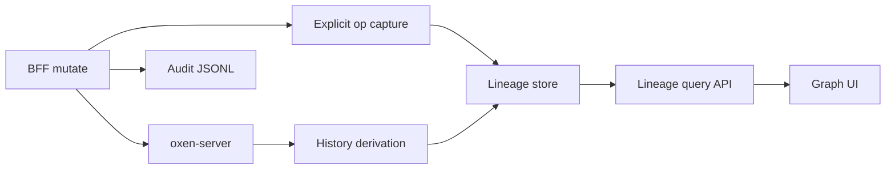

# TRACEABILITY — PLAT-TRACE implementation plan

> **Storage update (ADR 0004/0005):** this plan was written for JSON/JSONL files under `AUTH_DATA_DIR`. Those stores are now PostgreSQL, immudb (audit) and Novu (notifications); file names and file-based mechanics below are historical. See [16-operations.md](./16-operations.md) section 2.3.

Living design and phased plan for epic [`PLAT-TRACE`](./EPICS.md#plat-trace--file-lineage--operation-graph): trace the origin of files via repository operations in a graph view.

Related: [EPICS.md](./EPICS.md) · [01-authentication.md](./01-authentication.md) · [02-authorization.md](./02-authorization.md) · [03-audit.md](./03-audit.md) · [04-gxp-compliance.md](./04-gxp-compliance.md) · [09-jobs.md](./09-jobs.md) · [README.md](../README.md)

## 1. Purpose & scope

**In scope**

- First-class **lineage store** as the source of truth for a file-operation graph
- **Hybrid ingestion**: explicit capture at the auth BFF on mutates, plus derivation / backfill from oxen commit and path-version history
- Typed operations with **inputs** (prior file versions) and **outputs** (new versions); ops with no inputs (upload/create) or no outputs (delete)
- Query API + graph UI to walk origin / descendants of a path or content hash
- Attribution links to audit events and oxen commits where known

**Out of scope (this document)**

- Job **lifecycle** API / runner / logs / cancel — owned by [`PLAT-JOB`](./09-jobs.md). Job I/O **graph edges** unify here via shared version-ref types and a `job` op kind (implemented; see §4)
- Replacing oxen path history / content-addressed version store
- Changing oxen-server internals or adding rename-aware compare APIs upstream
- GxP reason / e-sig gates on mutates — [04-gxp-compliance.md](./04-gxp-compliance.md) layers on AUTH / AUDIT; lineage may later bind to signed versions
- Product copy API if oxen-server lacks a first-class copy route (gap noted below)

**Depends on:** [`PLAT-AUTH`](./01-authentication.md) (identity at BFF); [`PLAT-AUTHO`](./02-authorization.md) (repo read / query gates).

**Complements:** [`PLAT-AUDIT`](./03-audit.md) (who/when/HTTP trail — not the operation graph); [`PLAT-GXP`](./04-gxp-compliance.md) (review / inspection of data provenance).

## 2. Current state

| Piece | Behavior |
| --- | --- |
| Path versions | BlobPage lists versions via `listFileVersions` (commits + content hash per path) |
| Compare | Diff statuses are `added` / `modified` / `removed` only — no `renamed` |
| File APIs | Upload, delete, move/rename (`PATCH` + `new_path`); no dedicated copy client helper |
| Audit | Coarse `file.write` for file mutates ([`../auth/src/audit.ts`](../auth/src/audit.ts)); no input/output version refs |
| Lineage | No lineage store, query API, or graph UI |

**Oxen history alone:** strong for edit / add / delete chains; weak for move (heuristic: same hash removed + added in one commit); ambiguous for copy (identical content at two paths). See §4.

## 3. Goals & non-goals

### Goals

1. Persist operations as a queryable graph: FileVersion ↔ Operation with explicit arity rules
2. Populate the store via **hybrid** ingestion (explicit + derived) without dual competing graphs
3. Expose lineage for a path or content hash (ancestors and descendants)
4. Surface downloadable confidence (`explicit` vs `derived`) so reviewers can trust edges
5. Reuse AuthZ patterns so lineage is not world-readable

### Non-goals (MVP)

- Perfect reconstruction of every historical rename/copy without BFF capture
- Real-time multi-instance shared lineage without a later store swap
- Replacing the Audit page or commit log UI
- Cross-repository lineage (v1 is scoped to one namespace/repo)

## 4. Target architecture

### Decisions

| Topic | Choice |
| --- | --- |
| Source of truth | **Lineage store** — graph always read from here |
| Ingestion | **Hybrid**: BFF explicit ops + oxen history derivation / reconcile |
| Store (v1) | Append-only **JSONL** at `AUTH_DATA_DIR/lineage.jsonl` (same volume / swap path as audit) |
| Explicit emitter | Auth BFF after successful upstream mutate (classify file ops; extract paths, hashes, commit id) |
| Derivation | Offline or on-demand reconcile from commits / path versions / compare; backfill gaps; rename heuristic only when no explicit move for that commit |
| Audit relationship | Lineage may set `auditEventId` / `commitId`; does **not** replace [03-audit.md](./03-audit.md) |
| Job lineage | **Unified and implemented** (verified in `auth/src/lineage.ts`): one `job` op kind (inputs = observed reads @ pin, outputs = writes @ result; either may be empty) sharing the FileVersion type; query by `jobId` (`detail.job_id`). The finer kinds originally sketched (`job_pin`, `job_produces`, `job_reads`, `job_writes`) were **not** adopted. Job lifecycle/status remains in [09-jobs.md](./09-jobs.md) JSONL; graph edges live in this lineage store/query. EPICS.md's claim is therefore correct; only Phase 5 below was stale. Note for the EPICS owner: the PLAT-TRACE Phase 5 bullet in EPICS.md still lists shared job refs as open and should be split (copy/store swap open, job lineage done) |

### Components

| Component | Role |
| --- | --- |
| `auth/src/lineage.ts` (planned) | Append + query lineage JSONL; version-ref helpers |
| [`../auth/src/proxy.ts`](../auth/src/proxy.ts) | After successful file mutate: emit typed lineage op (+ existing audit) |
| Derivation worker / route | Walk oxen history; upsert `source: derived` ops; skip when explicit covers commit+paths |
| `GET /auth/lineage/...` | Subgraph query for UI |
| Graph UI | File / repo lineage visualization |

### Hybrid rules

| Kind | Prefer | Fallback |
| --- | --- | --- |
| `upload` / `create` | Explicit (PUT upload / import) | Derived: path first appears (`added`) |
| `edit` | Explicit when prior hash known | Derived: same path, hash changes across commits |
| `move` | **Explicit required for confidence** | Derived heuristic: same content hash removed at A + added at B in one commit; `confidence: low` |
| `copy` | **Explicit** (when product/API exists) | Derived only as low-confidence “same hash, new path while source remains”; never auto-promoted |
| `delete` | Explicit (DELETE file) | Derived: path `removed` |

Never invent a high-confidence `move`/`copy` from derivation when an explicit op already covers the same commit and paths.

## 5. Graph model & schema

### Nodes

**FileVersion** (logical; may be embedded in op edges rather than a separate table in v1):

| Field | Notes |
| --- | --- |
| `namespace` / `repo` | Scope |
| `path` | Repo-relative path at that version |
| `contentHash` | Oxen content-addressed hash |
| `commitId` | Commit that introduced or last confirmed this path@hash (optional if unknown) |

**Operation** (one JSONL object per line):

| Field | Notes |
| --- | --- |
| `id` | Random hex id |
| `ts` | ISO-8601 |
| `kind` | `upload` \| `create` \| `edit` \| `move` \| `copy` \| `delete` |
| `namespace` / `repo` | Scope |
| `branch` | When known |
| `inputs` | `FileVersion[]` (may be empty) |
| `outputs` | `FileVersion[]` (may be empty) |
| `actor` | `{ sub, iss, email, name }` when from BFF; omit or partial when derived |
| `via` | `session` \| `pat` when from BFF |
| `commitId` | Oxen commit produced by the mutate, when known |
| `auditEventId` | Link to audit row when emitted in the same request |
| `source` | `explicit` \| `derived` |
| `confidence` | `high` \| `low` (derived renames/copies default `low`) |
| `detail` | Small non-secret extras; never tokens or file bytes |

### Operation arity

| Kind | Inputs | Outputs |
| --- | --- | --- |
| `upload` / `create` | none | 1+ new versions |
| `edit` | 1 prior version | 1 new version (same or related path) |
| `move` | 1 version at old path | 1 version at new path (hash may be unchanged) |
| `copy` | 1 source version | 1 new path version |
| `delete` | 1 version | none |

Edge semantics for the UI: version → op (as input), op → version (as output).

## 6. Configuration

| Variable | Purpose |
| --- | --- |
| `AUTH_DATA_DIR` | Directory for `lineage.jsonl` (alongside `audit.jsonl`, `pats.json`) |
| `LINEAGE_DERIVE_ON_QUERY` (future) | If true, cheap reconcile for a path before returning subgraph |

Same Compose `auth_data` volume as PATs / audit.

## 7. Phased delivery

### Phase 0 — Docs

- [x] This plan + [`PLAT-TRACE`](./EPICS.md#plat-trace--file-lineage--operation-graph) epic entry

### Phase 1 — Lineage store + explicit capture

- [x] `lineage.ts` JSONL append + query helpers
- [x] Tighten file-action classification in the proxy (`upload` / `edit` / `move` / `delete`; keep audit coarse `file.write`)
- [x] Explicit **edit**: pre-mutate `/meta` snapshot → PUT with prior → `edit` (else `upload`); post-mutate hash when available
- [x] On successful mutate: append lineage op with inputs/outputs when resolvable (move: old path → `new_path`; upload: no inputs; delete: no outputs)
- [x] Link `auditEventId` / `commitId` when available
- [x] Unit tests for classify + arity validation (`lineage.test.ts`)

### Phase 2 — Oxen derivation / backfill

- [x] Derive add/edit chains from path history (`deriveOpsFromPathHistory`)
- [x] Optional low-confidence rename heuristic when no explicit move (`deriveMoveHeuristic`)
- [x] Idempotent reconcile — deterministic derived ids; one producer per file version (hash/commit aliases); prune duplicates on rebuild
- [x] Repo-scoped `POST /auth/lineage/rebuild` (path history → derived ops; re-run is a no-op)
- [ ] Full compare-based delete/rename scan across commits (future)

### Phase 3 — Query API + AuthZ

- [x] `GET /auth/lineage` returning a subgraph
- [x] AuthZ: repo read via `authorizeLineageQuery`; rebuild via `authorizeLineageRebuild`
- [x] Cursor / depth / direction (`ancestors` \| `descendants` \| `both`)

### Phase 4 — Graph UI

- [x] File / blob page entry: “Lineage” panel for current path
- [x] Ops list with kind / `derived` / `low confidence` badges
- [x] Navigate to blob at path
- [x] Playwright smoke: upload → lineage panel (`e2e/tests/lineage.spec.ts`)

### Phase 5 — Copy + store swap + job kinds

- [ ] Product copy path when oxen (or Mice workspace) supports it; explicit `copy` ops
- [ ] Optional Postgres/Mongo swap behind the same schema (align with audit Phase 2)
- [x] Job lineage: single `job` op kind + shared version-refs for [09-jobs.md](./09-jobs.md), `jobId` query filter (done with PLAT-JOB; finer-grained job kinds not planned)

### Phase 6 — Correction, reconciliation, retention (all unchecked; see §13)

- [ ] Lineage correction/approval: an authorised reviewer can confirm, reject or re-link a derived (`confidence: low`) move/copy; corrections are append-only `correction` ops that supersede, never edit, the original, and are audited
- [ ] Reconciliation status: per repo/path, surface whether explicit capture is complete (e.g. `capture: complete | reconciling | gap`) in the API and Lineage panel, and run a reconcile after a detected mutation→capture gap
- [ ] Retention and export policy: retention period per namespace/repo, legal-hold interaction with [04-gxp-compliance.md](./04-gxp-compliance.md), and filtered NDJSON + manifest export aligned with [03-audit.md](./03-audit.md)

## 8. API

| Route | Auth | Behavior |
| --- | --- | --- |
| `GET /auth/lineage` | Session or PAT; **AuthZ** repo read for `namespace`/`repo` (instance admin for cross-repo) | Query params: `namespace`, `repo`, `path` and/or `contentHash`, `direction`, `depth`, `since`, `until`, `limit`, `cursor` |
| `POST /auth/lineage/rebuild` (Phase 2) | Session; repo admin / instance admin | Kick derivation for a repo (async or sync MVP) |
| (no public write routes) | — | Append from proxy + derivation only |

Disk append is **best-effort** relative to the oxen response (same posture as audit unless `GXP_STRICT` later requires fail-closed). Like audit ([03-audit.md](./03-audit.md)), there is a **mutation → capture crash gap**: if the BFF crashes or the append fails after oxen accepted the mutate, no explicit op exists. Derivation later backfills add/edit/delete, but a gapped move/copy degrades to a low-confidence heuristic or is missed. Users must therefore see reconciliation status (Phase 6), not assume completeness.

## 9. UI

| Surface | Change |
| --- | --- |
| Blob / file page | **Lineage** panel or route: graph for current path |
| Optional repo page | Repo-wide recent ops (table + link into graph) |
| Visual | Bipartite or op-labeled DAG; filter by path; show `source` / `confidence` |

## 10. AuthZ

| Surface | Gate |
| --- | --- |
| Lineage read for one repo | Repo **read** (or equivalent custom permission) |
| Cross-repo / instance scan | Instance admin or instance permission aligned with audit review (`view_audit`) |
| Rebuild | Repo admin (Maintain+) or instance admin |

Do not expose lineage more broadly than file content for that repo.

## 11. Test plan

| Case | Expectation |
| --- | --- |
| TC-TRACE-01 | Upload via BFF → `upload`/`create` op with no inputs, one output hash |
| TC-TRACE-02 | Edit same path → `edit` with prior version input and new hash output |
| TC-TRACE-03 | Move via BFF → `move` explicit, `confidence: high`, old path → new path |
| TC-TRACE-04 | Delete → `delete` with input, empty outputs |
| TC-TRACE-05 | Derivation backfill creates `edit` chain for history before capture; does not duplicate explicit ops |
| TC-TRACE-06 | Rename heuristic without explicit move → `move` with `source: derived`, `confidence: low` |
| TC-TRACE-07 | `GET /auth/lineage` without repo read → 403 |
| TC-TRACE-08 | UI graph shows upload → edit chain after mutations |

## 12. Open risks

| Risk | Mitigation |
| --- | --- |
| Oxen compare has no `renamed` | Prefer explicit move; heuristic only + low confidence |
| Copy API missing | Document gap; no high-confidence `copy` until product path exists |
| Multi-file commits blur one-op-one-edge | Prefer per-path ops; attach shared `commitId` |
| Direct `:3001` bypass skips explicit capture | Deploy: product remote is BFF; derivation backfills add/edit/delete |
| JSONL scan scale | Cap depth/limit; index or store swap later |
| Confusion with job lineage | One graph, two op families (file vs job); filter by kind in API/UI |
| Wrong heuristic move/copy shown as fact | `confidence: low` badge; correction/approval mechanism (Phase 6, §13 Q1) |
| Silent capture gap after crash | Reconciliation status surfaced to users (Phase 6, §13 Q2) |
| Unbounded lineage growth / no retention rule | Retention + export policy (Phase 6, §13 Q3) |

## 13. Open questions

| # | Question | Notes |
| --- | --- | --- |
| Q1 | Who may correct or approve a derived move/copy (repo admin, reviewer role), and is a GxP signature needed? | Open. Corrections are additive; the original derived op stays visible |
| Q2 | How is a mutation→capture gap detected (oxen commit with no matching explicit op, vs. a write-ahead intent record)? | Open. Shared with the audit durable-queue decision in [03-audit.md](./03-audit.md) |
| Q3 | Retention period for lineage vs. audit, and may lineage be purged when a repo is deleted? | Open. Default proposal: retain at least as long as audit |
| Q4 | Is lineage export part of the audit export package or separate? | Open |

## 14. How to use this file

1. Implement phases; tick bullets in PRs.
2. Keep decisions in §4 unless an ADR supersedes them.
3. When epic bullets in [EPICS.md](./EPICS.md) land, mark them done.
4. Keep job **lifecycle** in [09-jobs.md](./09-jobs.md); keep job **graph edges** here with shared version-ref types.
