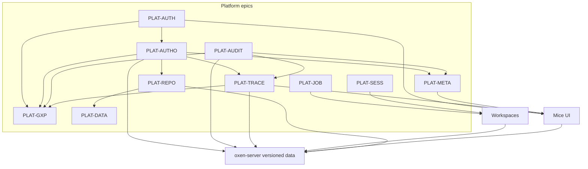

# EPICS — Mice platform

Top-level TODO for Mice + self-hosted [`oxen-server`](https://docs.oxen.ai/getting-started/oxen-server) as a **platform**: identity, GxP-oriented audit, GxP product controls, and compute that mounts **workspaces** pinned to **versioned data**.

These epics need services beyond stock oxen-server (`new backend`). Flip status when an epic lands or narrows; add child bullets rather than renumbering IDs.

## Sequencing

1. **PLAT-GXP Phase 1** (`GXP_STRICT` fail-closed audit; the idle timeout has shipped) lands before W4 and cluster jobs, so new mutating surfaces are built fail-closed.
2. **PLAT-WS W4** (starting with the Oxen ephemeral-workspace spike) is next; it unblocks PLAT-JOB Phase 4.
3. **PLAT-META Phases 2–4** wait until the workspace entity model stabilises after W4.
4. **PLAT-AUTH Phase 2.5** (session and PAT hardening) has shipped ([ADR 0001](../docs/adr/0001-bff-identity-trust-model.md)); SAML is via Keycloak brokering, SCIM (deprovisioning) unscheduled.
5. **PLAT-DATA** first fixes chunk/import route authorization ([06-data-transfer.md](./06-data-transfer.md), TC-DATA-01), then **PLAT-OPS** backup/integrity feeds PLAT-GXP.

## Legend

| Column | Values |
| --- | --- |
| **Status** | `Todo` / `Partial` / `Done` |
| **ID** | Stable `PLAT-*` prefix |

**Shared foundation:** `PLAT-JOB` and `PLAT-SESS` share a **version pin** contract (commit / content hash); **workspace mount** is Phase 2+ for both (jobs v1 use a local clone; sessions may start without a mount). Both require `PLAT-AUTH` + `PLAT-AUTHO` and should emit `PLAT-AUDIT` events. GxP-strict product controls (`PLAT-GXP`) layer on AUTH / AUTHO / AUDIT. File-operation lineage (`PLAT-TRACE`) unifies with job I/O lineage via shared version-ref types and new job op kinds ([09-jobs.md](./09-jobs.md), [11-lineage.md](./11-lineage.md)).

## Summary

Plans are numbered by implementation priority (foundations first, then platform controls, core product surfaces, compute, and cross-cutting features). The `PLAT-*` IDs are stable and do not follow the numbers. Every plan file is `plans/NN-name.md`; Workspaces (with its rev 2, spike and Stages notes) and Sessions (with its IronRDP notes) are each one merged file.

| # | ID | Epic | Plan | Status | Depends on |
| --- | --- | --- | --- | --- | --- |
| 01 | [PLAT-AUTH](#plat-auth--idp--sso-authn) | IdP / SSO authN | [01-authentication.md](./01-authentication.md) | Done | — |
| 02 | [PLAT-AUTHO](#plat-autho--authorization-authz) | Authorization (AuthZ) | [02-authorization.md](./02-authorization.md) | Done | PLAT-AUTH |
| 03 | [PLAT-AUDIT](#plat-audit--gxp-oriented-change-audit) | GxP-oriented change audit | [03-audit.md](./03-audit.md) | Partial | PLAT-AUTH (attributable identity); query gates → PLAT-AUTHO |
| 04 | [PLAT-GXP](#plat-gxp--gxp-product-controls) | GxP product controls (Part 11 / Annex 11) | [04-gxp-compliance.md](./04-gxp-compliance.md) | Partial | PLAT-AUTH; PLAT-AUTHO; PLAT-AUDIT |
| 05 | [PLAT-REPO](#plat-repo--namespaces-repositories--version-browsing) | Namespaces, repositories & version browsing | [05-repositories.md](./05-repositories.md) | Partial (Phase 0 shipped) | PLAT-AUTH; PLAT-AUTHO; emit PLAT-AUDIT |
| 06 | [PLAT-DATA](#plat-data--data-import-export--large-uploads) | Data import, export & large uploads | [06-data-transfer.md](./06-data-transfer.md) | Partial | PLAT-REPO; PLAT-AUTHO; emit PLAT-AUDIT / PLAT-TRACE |
| 07 | [PLAT-CLI](#plat-cli--mice-cli) | `mice` CLI | [07-cli.md](./07-cli.md) | Partial | PLAT-AUTH; PLAT-AUTHO |
| 08 | [PLAT-WS](#plat-ws--overlay-workspaces) | Overlay workspaces (incl. Stages) | [08-workspaces.md](./08-workspaces.md) | Partial (W0, W1, W3 done) | PLAT-AUTH; PLAT-AUTHO; emit PLAT-AUDIT; feeds PLAT-JOB / PLAT-SESS |
| 09 | [PLAT-JOB](#plat-job--versioned-workspace-jobs) | Versioned workspace jobs | [09-jobs.md](./09-jobs.md) | Partial | PLAT-AUTH; PLAT-AUTHO; emit PLAT-AUDIT |
| 10 | [PLAT-SESS](#plat-sess--desktop-sessions) | Desktop sessions (incl. IronRDP) | [10-sessions.md](./10-sessions.md) | Done | PLAT-AUTH; PLAT-AUTHO; emit PLAT-AUDIT |
| 11 | [PLAT-TRACE](#plat-trace--file-lineage--operation-graph) | File lineage / operation graph | [11-lineage.md](./11-lineage.md) | Partial | PLAT-AUTH; PLAT-AUTHO; links PLAT-AUDIT; useful for PLAT-GXP |
| 12 | [PLAT-META](#plat-meta--entity-metadata-indexing--search) | Entity metadata, indexing & search | [12-metadata-search.md](./12-metadata-search.md) | Partial (Phase 1) | PLAT-AUTH; PLAT-AUTHO; emit PLAT-AUDIT; links PLAT-TRACE / PLAT-GXP |
| 13 | [PLAT-FAV](#plat-fav--favorites) | Favorites | [13-favorites.md](./13-favorites.md) | Done (v1) | PLAT-AUTH; PLAT-AUTHO; links notifications |
| 14 | [PLAT-NOTIF](#plat-notif--notifications) | Notifications | [14-notifications.md](./14-notifications.md) | Done (single instance) | PLAT-AUTH; PLAT-AUTHO; PLAT-AUDIT |
| 15 | [PLAT-ADMIN](#plat-admin--administration-console--in-app-docs) | Administration console & in-app docs | [15-administration.md](./15-administration.md) | Partial (Phase 0 shipped) | PLAT-AUTH; PLAT-AUTHO; emit PLAT-AUDIT |
| 16 | [PLAT-OPS](#plat-ops--deployment-state--operations) | Deployment, state & operations | [16-operations.md](./16-operations.md) | Partial | PLAT-AUTH; PLAT-AUDIT; PLAT-GXP (backup/integrity) |

---

## PLAT-AUTH — IdP / SSO authN

**Goal:** Enterprise IdP (OIDC/SAML) login; session/token issuance; BFF gate and identity injection toward oxen-server.

**Status:** Done

**Plan:** [01-authentication.md](./01-authentication.md)

### TODO

- [x] IdP configuration (OIDC) for the Mice platform — Keycloak in Compose; SAML later
- [x] Login / logout UI and secure session (or equivalent token) lifecycle
- [x] Replace Settings bearer token as the primary auth path for interactive users
- [x] Gate oxen-server via BFF; inject commit author from IdP session (unique `sub` in oxen history later)
- [x] CLI / Python via BFF PATs (`mice_pat_*`); Clone box points at BFF remote
- [x] Org/repo RBAC — **moved to** [`PLAT-AUTHO`](#plat-autho--authorization-authz) / [02-authorization.md](./02-authorization.md)
- [x] Phase 2.5 hardening: fail-closed author injection, same-origin CSRF guard, sliding idle timeout, admin session revocation (also cuts off PATs), PAT expiry and last-used, id_token claim checks + `auth_time`, `iss`+`sub` identity with verified-email bootstrap, production startup gate
- [ ] Proposed, not approved ([01-authentication.md](./01-authentication.md) §9): Phase 2.6 self-service sign-out and scoped-credential consolidation; Phase 2.7 id_token JWKS verification; Phase 3 SAML recipe, back-channel logout, directory-sync revocation, step-up re-auth; Phase 4 service principals. SCIM is not planned

---

## PLAT-AUTHO — Authorization (AuthZ)

**Goal:** GitHub Enterprise–shaped namespace/repo authorization at the BFF (additive roles, base permissions, outside collaborators); instance permissions for product surfaces; enforce on proxied oxen calls and audit query.

**Status:** Done

**Depends on:** PLAT-AUTH

**Plan:** [02-authorization.md](./02-authorization.md)

### TODO

- [x] Stores + additive `hasRepoPermission` / namespace checks; enforce on `/api` (Phase 0)
- [x] Instance admin bootstrap, site-admin bypass (audited), last-admin / last-Owner guards
- [x] Namespace Owner/Member, base permissions, five repo roles, outside collaborators
- [x] Hard gate for zero-grant SSO users; `create_namespace` exception; `/pending` UI
- [x] Admin UI (namespace Settings, repo collaborators) + TC-AUTHO unit/e2e (Phase 1)
- [x] Access requests, IdP group/email bootstrap, fine-grained PAT scopes (Phase 2 MVP)
- [x] Training gate `AUTHZ_REQUIRE_TRAINING` (Phase 3 MVP)
- [x] IdP groups as live namespace members and repo collaborators (`OIDC_GROUPS_CLAIM`, group bindings in stores)
- [x] Instance admin + access-request review UI (Settings)
- [x] Custom namespace + custom repository roles (fine-permission catalog)
- [x] IdP directory search (Keycloak Admin API + store fallback) for member/collaborator pickers
- [x] Atomic instance/ns/repo permissions for every product surface (deny-default under enforce: sessions, PATs, CLI device, jobs cancel/complete, lineage, namespace list ACL)

---

## PLAT-AUDIT — GxP-oriented change audit

**Goal:** Append-only, attributable audit of mutations against oxen-server (who / what / when / which repo + version); retention and export suitable for a validated GxP concept.

**Status:** Partial

**Plan:** [03-audit.md](./03-audit.md)

### TODO

- [x] Intercept or subscribe to write paths that mutate oxen-server state
- [x] Immutable, append-only audit store with attributable actor identity (JSONL under `AUTH_DATA_DIR`)
- [x] Audit query UI (filter by actor, repo, time, change type)
- [x] Gate query API/UI per [02-authorization.md](./02-authorization.md) (`view_audit` / instance admin / namespace-Owner ns-scoped)
- [ ] Durable outbox/reconciliation for the mutation→audit crash gap ([03-audit.md](./03-audit.md) Phase 2.1)
- [ ] GxP metadata on relevant changes (reason / change-control id) — see [`PLAT-GXP`](#plat-gxp--gxp-product-controls)
- [ ] Retention policy and export for review / inspection — see [`PLAT-GXP`](#plat-gxp--gxp-product-controls)

---

## PLAT-TRACE — File lineage / operation graph

**Goal:** Trace the origin of files from repository operations in a graph view. A first-class lineage store holds typed ops (upload, edit, move, copy, delete) with version inputs/outputs; hybrid ingestion fills it from BFF explicit capture plus oxen history derivation.

**Status:** Partial

**Depends on:** PLAT-AUTH; PLAT-AUTHO; links PLAT-AUDIT (does not replace it)

**Plan:** [11-lineage.md](./11-lineage.md)

### TODO

- [x] Plan doc — lineage store + hybrid ingestion architecture ([11-lineage.md](./11-lineage.md))
- [x] Phase 1 — Lineage JSONL store + explicit BFF capture (upload / edit / move / delete)
- [x] Phase 2 — Oxen derivation / backfill + rebuild API (compare-wide scan later)
- [x] Phase 3 — Lineage query API + AuthZ
- [x] Phase 4 — Graph UI on file / blob views
- [x] Job lineage (`job` op kind in `lineage.ts`)
- [ ] Phase 5 — Explicit copy when product API exists; optional store swap / shared version-ref types with [`PLAT-JOB`](#plat-job--versioned-workspace-jobs)
- [ ] Phase 6 — Lineage correction/approval, reconciliation status for the mutation→capture gap, retention and export

---

## PLAT-GXP — GxP product controls

**Goal:** Product/tech controls for a GxP-capable Mice: requirements catalog, `GXP_STRICT` audit hardening, reason/change-control gate, full Part 11 electronic signatures, retention and inspection export. CSV/QMS paperwork stays outside the repo.

**Status:** Partial (Phase 0 docs)

**Depends on:** PLAT-AUTH; PLAT-AUTHO; PLAT-AUDIT

**Plan:** [04-gxp-compliance.md](./04-gxp-compliance.md)

### TODO

- [x] Requirements catalog (`GXP-R-*`) + phased plan in [04-gxp-compliance.md](./04-gxp-compliance.md)
- [x] Idle timeout (`SESSION_IDLE_SEC`; value policy owned here)
- [ ] Phase 1 — `GXP_STRICT` fail-closed audit; BFF-only deploy notes
- [ ] Phase 2 — Required reason + optional change-control id on configured mutates
- [ ] Phase 3 — Full electronic signatures (step-up, meaning, bind to version; merge approval first)
- [ ] Phase 4 — Retention policy + filtered audit/esign export; no purge in strict mode
- [ ] Backup/restore with integrity verification of regulated records; signature revocation/correction and reviewer escalation ([04-gxp-compliance.md](./04-gxp-compliance.md))

---

## PLAT-JOB — Versioned workspace jobs

**Goal:** Run container-image jobs from a **local clone** of a pinned Oxen commit (workspace mount optional later); unified I/O lineage with PLAT-TRACE; lifecycle for submit, logs, status, cancel, and result commits. Workspaces are not required for every job.

**Status:** Partial

**Depends on:** PLAT-AUTH; PLAT-AUTHO; emit PLAT-AUDIT; extend PLAT-TRACE (shared types)

**Plan:** [09-jobs.md](./09-jobs.md)

### TODO

- [x] Job API in auth + local Docker runner (local clone of pin → command → optional result commit; observed read-set; cancel; limits + restricted net)
- [x] Dedicated AuthZ `job.submit` / `job.read` dependent on repo write/read; audit events
- [x] Unify lineage with PLAT-TRACE (`job` op kind + shared version-refs; query by `jobId` / `commit`)
- [x] Mice jobs UI monitor (list/logs/status/cancel); submit via `mice job` CLI
- [ ] Optional workspace mount ADR shared with [`PLAT-SESS`](#plat-sess--desktop-sessions); lineage UI polish
- [ ] Retry policy, output/artifact browsing and retention, stuck-job and quota alerts ([09-jobs.md](./09-jobs.md) Phase 5)
- [x] Cluster runner (`JOBS_RUNNER=kubernetes`) + Docker image digest pinning

---

## PLAT-SESS — Desktop sessions

**Goal:** Provision **dedicated** full Linux desktop OS instances for interactive use; connect from Mice via rustguac + guacd (RDP/xrdp); optional workspace mounts on versioned data (shared pin contract with `PLAT-JOB`). Formerly sketched as VM gateways (`PLAT-GW`).

**Status:** Done

**Depends on:** PLAT-AUTH; PLAT-AUTHO; emit PLAT-AUDIT

**Plan:** [10-sessions.md](./10-sessions.md)

### TODO

- [x] Session API in auth + Docker/mock provisioner (Linux desktop + xrdp); Compose guacd (+ optional rustguac profile); local E2E
- [x] AuthZ owner/admin gates; audit `session.*`; exclusive ownership (no share/join)
- [x] Mice Sessions UI (list / create / Connect / stop / destroy)
- [x] Per-user guest OS identity from IdP (mapped username + unique password); idle/max lifetime sweeper
- [x] Optional workspace mount + pin; libvirt/KubeVirt provisioner stubs; template catalog; IronRDP spike notes
- [ ] Desktop security controls (clipboard, drive, egress), reconnect/resume, quota and lifetime warnings, connection audit ([10-sessions.md](./10-sessions.md) Phase 4)

---

## PLAT-META — Entity metadata, indexing & search

**Goal:** Attach governed, auditable metadata (tags, labels, typed fields) to every system entity and make it searchable across the platform with AuthZ-scoped results.

**Status:** Partial (Phase 1)

**Depends on:** PLAT-AUTH; PLAT-AUTHO; emit PLAT-AUDIT; links PLAT-TRACE (renames) / PLAT-GXP (reason capture)

**Plan:** [12-metadata-search.md](./12-metadata-search.md)

### TODO

- [x] Generic entity-ref metadata model + BFF API (get/put/patch/delete/history)
- [ ] Composable metadata: namespace → repo → … inheritance with override/unset, provenance, locks, effective-metadata index
- [x] AuthZ permissions (view/edit metadata, manage schema) and custom-role catalog entries
- [ ] Full-text + facet search (scope-before-paging), CSV export
- [ ] Metadata panel on every entity page + global search page
- [ ] Field definitions (typed, required, sensitive) and bulk edit
- [x] Audit actions for all metadata mutations (with diffs)
- [ ] Lifecycle hooks (rename/delete), reindex, SQLite FTS backend

---

## PLAT-FAV — Favorites

**Goal:** Personal favorites on namespaces, repos, branches, workspaces, jobs and sessions; favorites sort first in listings and are collected per type on the Profile page.

**Status:** Done (v1)

**Depends on:** PLAT-AUTH; PLAT-AUTHO (read gate); notifications (implicit watch)

**Plan:** [13-favorites.md](./13-favorites.md)

### TODO

- [x] BFF store + API (list/add/remove/lookup), read-gated, auto-delete on entity removal
- [x] "Favorites first" default sort option + icon-only star in rows and headers
- [x] Profile panel: tabs per entity type with counts
- [x] `mice favorite add|remove|list`
- [x] Favorited resources notify by default (mute wins)
- [ ] Server-side `favorites=first` for paginated jobs/sessions (v1 decision: ordering is page-local, see [13-favorites.md](./13-favorites.md) Q2)
- [ ] Explicit per-resource watch distinct from a favorite

---

## PLAT-WS — Overlay workspaces

**Goal:** Overlay working trees over shared checkouts with leases and one-writer enforcement; mounted by jobs and sessions; commit/merge back to Oxen.

**Status:** Partial

**Depends on:** PLAT-AUTH; PLAT-AUTHO; emit PLAT-AUDIT

**Plan:** [08-workspaces.md](./08-workspaces.md) (rev 3; merges the former rev 2, spike and Stages docs, see §16–§18)

### TODO

- [x] W0 Spike ([08-workspaces.md §16](./08-workspaces.md#16-appendix-a--spike-findings)); W1 checkout store; W3 leases, ro/rw mounts, audit, authz map
- [ ] W2 remainder — mount spec, `wsctl` mutations, reset
- [ ] W4 Commit builder, merge, op state machine + recovery, update-from-branch
- [ ] W5 remainder — jobs on workspaces (sessions half done)
- [ ] W6 CLI `mice workspace`, web UI rebuild, e2e, docs
- [ ] W7 Kubernetes overlay support (separate design)
- [ ] Fencing/lease authority, workspace notification events, conflict-resolution audit detail, backup/DR ([08-workspaces.md](./08-workspaces.md) §15)

---

## PLAT-NOTIF — Notifications

**Goal:** In-app inbox, toasts, email and Web Push for events affecting users and resources they can access; preferences on Profile.

**Status:** Done for the original scope (single instance; multi-instance out of scope); extensions below are proposed

**Depends on:** PLAT-AUTH; PLAT-AUTHO; PLAT-AUDIT

**Plan:** [14-notifications.md](./14-notifications.md)

### TODO (proposed extensions, unapproved)

- [ ] Security events: PAT expiring, Session revoked, new-device sign-in, admin alerts
- [ ] Webhook / Slack / Teams channel
- [ ] Snooze and archive
- [ ] Review/approval requests with reminders and escalation
- [ ] Stuck-job/session and quota alerts
- [ ] `mice notifications` CLI
- [ ] Per-resource watch from the resource page
- [ ] Admin delivery-health view

---

## PLAT-REPO — Namespaces, repositories & version browsing

**Goal:** Create and manage namespaces and repositories; browse trees, blobs, branches and commits; compare, merge and view dataframes. Shipped with the UI but previously unplanned.

**Status:** Partial (Phase 0 shipped; Phases 1–3 proposed, not approved)

**Depends on:** PLAT-AUTH; PLAT-AUTHO; emit PLAT-AUDIT

**Plan:** [05-repositories.md](./05-repositories.md)

### TODO

- [x] Browse tree/blob, branches, commits, compare, dataframes, merge; namespace and repo create/settings
- [ ] Proposed gaps (paging on commits/trees, blob preview size cap, tags, repo rename/delete semantics, branch protection) — see plan

---

## PLAT-DATA — Data import, export & large uploads

**Goal:** Move data in and out of repositories from the UI and CLI: chunked large uploads, zip/URL import, zip export and hash download.

**Status:** Partial (shipped flows documented; Phases 1–4 proposed, not approved)

**Depends on:** PLAT-REPO; PLAT-AUTHO; emit PLAT-AUDIT / PLAT-TRACE

**Plan:** [06-data-transfer.md](./06-data-transfer.md)

### TODO

- [x] 4 MiB chunked large upload with progress; zip/URL import; zip export; author injection
- [ ] Check chunk/import route authorization (`import/*`, `versions/*` fall through to the admin rule; unverified in a run) — plan TC-DATA-01
- [ ] Audit and lineage for chunked, zip and URL imports; request size limits; resume, checksums, quota (proposed)

---

## PLAT-CLI — `mice` CLI

**Goal:** Device-code login, PAT auth, Oxen passthrough via the BFF, management commands for every `/auth/*` feature, and local jobs.

**Status:** Partial (Phases 1–3 shipped; Phases 4–6 proposed, not approved)

**Depends on:** PLAT-AUTH; PLAT-AUTHO

**Plan:** [07-cli.md](./07-cli.md)

### TODO

- [x] Login/logout/whoami, passthrough, admin groups, local jobs, meta
- [ ] Command registry replacing the `mice.mjs` switch (deferred architecture candidate)
- [ ] Shell completion, distribution, BFF version compatibility check, stage/notification commands (proposed)

---

## PLAT-ADMIN — Administration console & in-app docs

**Goal:** The admin UX surface: settings sections, announcements, access-request inbox, directory/group management, training, in-app docs, profile and home. The authorization model itself stays in PLAT-AUTHO.

**Status:** Partial (Phase 0 shipped; Phases 1–5 proposed, not approved)

**Depends on:** PLAT-AUTH; PLAT-AUTHO; emit PLAT-AUDIT

**Plan:** [15-administration.md](./15-administration.md)

### TODO

- [x] Settings page, announcements, access requests, directory, profile, docs page
- [ ] Admin overview, list pagination/search, announcement scheduling, docs content source (proposed)

---

## PLAT-OPS — Deployment, state & operations

**Goal:** Run Mice safely: Compose topology, production gate, JSON state stores, health, CI, backup, upgrade, and later multi-instance.

**Status:** Partial (dev topology and production gate shipped; the rest proposed, not approved)

**Depends on:** PLAT-AUTH; PLAT-AUDIT; PLAT-GXP (backup/integrity)

**Plan:** [16-operations.md](./16-operations.md)

### TODO

- [x] Compose stack, production startup gate, `/healthz`, atomic JSON writes
- [ ] Backup/restore with integrity check, state versioning, JSON state store module, CI pipeline, metrics, rate limiting (proposed)

---

## How to use this file

1. Pick an epic whose dependencies are met (auth before compute; audit alongside writes).
2. Implement a bullet → check it off; narrow the epic Status to `Partial` when useful.
3. Keep IDs stable; add new `PLAT-*` epics with the next free suffix rather than renumbering.

Related: [README.md](../README.md) · [12-metadata-search.md](./12-metadata-search.md) · [04-gxp-compliance.md](./04-gxp-compliance.md) · [11-lineage.md](./11-lineage.md) · [09-jobs.md](./09-jobs.md) · [10-sessions.md](./10-sessions.md)
