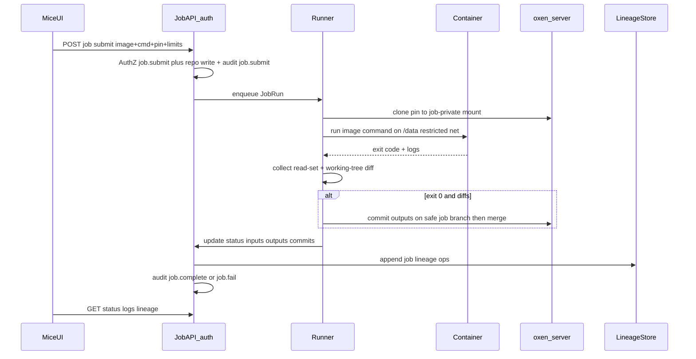

# JOBS — PLAT-JOB implementation plan

Living design and phased plan for epic [`PLAT-JOB`](./EPICS.md#plat-job--versioned-workspace-jobs): container-image jobs against a **local clone** of versioned Oxen data, automatic input/output lineage in the **unified** lineage graph, local Docker runner then cluster. Workspaces are an optional later mount source, not a prerequisite.

Related: [EPICS.md](./EPICS.md) · [Sessions.md](./Sessions.md) · [AUTH.md](./AUTH.md) · [AUTHO.md](./AUTHO.md) · [AUDIT.md](./AUDIT.md) · [TRACEABILITY.md](./TRACEABILITY.md) · [GXP.md](./GXP.md) · [README.md](../README.md)

## 1. Purpose & scope

**In scope**

- Run **container image** jobs that start from a **clean local clone** of a pinned Oxen commit, execute a user-supplied **command**, and on success with file changes produce a **new Oxen commit** from the working-tree diff
- Jobs **do not require a workspace**. They require a job-private clone/checkout on the runner machine. **Phase 2+:** jobs may **mount workspaces** and run against that mount instead of (or in addition to) a fresh commit clone — shared contract with [`PLAT-SESS`](./EPICS.md#plat-sess--desktop-sessions)
- **Automatic input detection** (observed read-set under the data mount) and **automatic output detection** (files changed vs pin, committed as the result when applicable)
- Valid runs that **only read**, or **neither read nor write** (exit 0, empty I/O sets)
- Persist each run in the **unified lineage graph** (shared version-ref / op types with [TRACEABILITY.md](./TRACEABILITY.md)) plus durable `JobRun` records
- **Local Docker** runner first; same `Runner` interface for **cluster** (Kubernetes or equivalent) later
- Job lifecycle API: submit, status, logs, **cancel**; Mice Jobs UI
- Resource limits, network policy, and image-pull constraints **from Phase 0**
- AuthN via [AUTH.md](./AUTH.md), AuthZ via [AUTHO.md](./AUTHO.md) (dedicated job capabilities dependent on repo read/write), audit via [AUDIT.md](./AUDIT.md)

**Out of scope (this document)**

- Interactive desktop Sessions — see [`PLAT-SESS`](./EPICS.md#plat-sess--desktop-sessions) / [Sessions.md](./Sessions.md) (shares the **workspace mount + version pin** contract in Phase 2+)
- Replacing or forking oxen-server
- Host-native (non-container) job execution
- Secrets vault product beyond short-lived runner-injected Oxen credentials
- GxP-strict product controls (e-sig, reason-for-change on job submit) — [GXP.md](./GXP.md) layers later

**Hooks for later epics**

| Epic | Needs from / to PLAT-JOB |
| --- | --- |
| PLAT-AUTH | Session or PAT principal on submit / logs / status / cancel |
| PLAT-AUTHO | Dedicated `job.submit` / `job.read` (dependent on repo write / read) before mount/run |
| PLAT-AUDIT | Emit `job.submit` / `job.complete` / `job.fail` / `job.cancel` with actor + pin/result commits |
| PLAT-TRACE | Shared version-ref types + new job op kinds in the lineage store/query/UI |
| PLAT-SESS | Shared **mount + pin** contract (commit / content hash; **workspace mount** in Phase 2+) — [Sessions.md](./Sessions.md) |
| PLAT-GXP | Optional fail-closed / e-sig / reason fields on job mutations when `GXP_STRICT` |

**Delivery scope:** Phases 0–3 in this document are all in scope to implement (not a Phase-0-only spike).

## 2. Current state

Mice is a web UI + auth BFF in front of self-hosted oxen-server. Versioned data and remote staging exist; **compute does not**.

| Piece | Behavior |
| --- | --- |
| Commits | Oxen commit DAG via BFF → oxen-server ([`web/src/lib/oxen/api.ts`](../web/src/lib/oxen/api.ts), types in [`web/src/lib/oxen/types.ts`](../web/src/lib/oxen/types.ts)). Commit fields: `id`, `parent_ids`, `message`, `author`, `email`, `timestamp` — **no structured commit metadata API** |
| Workspaces | Remote staging pinned to a commit; UI merge → new commit — **not required** for jobs until Phase 2 mount |
| Auth / AuthZ / Audit | Session, PAT, RBAC, JSONL audit at the BFF — see AUTH / AUTHO / AUDIT |
| File lineage | [TRACEABILITY.md](./TRACEABILITY.md) / `lineage.jsonl` — file ops today; job ops unify via new types |
| Jobs / runner | **Not implemented** — EPICS stub only |
| Containers | Compose stack services only; no job runtime |

## 3. Goals & non-goals

### Goals

1. Job API (in **auth** BFF) and runner that execute **image + command** against data from a **local clone** of a pinned commit
2. Clean starting state: job-private checkout of the pin (no dirty host workspace); later Oxen **workspace mounts** as an alternate source
3. **Outputs** = automatic commit of post-run diffs vs pin when non-empty (author from BFF identity); empty-diff success is allowed
4. **Inputs** = **observed read-set** under the data mount from Phase 0 (optional declared path globs filter the recorded set)
5. **Unified lineage** with PLAT-TRACE: shared version-ref types + job-specific op/edge kinds; queryable in Mice
6. Dedicated AuthZ capabilities (dependent on repo permissions) and audit events
7. Resource limits + restricted networking from Phase 0; local Docker path that evolves to cluster without changing the job model
8. Cancel supported from Phase 0

### Non-goals

- Requiring workspaces for every job
- Replacing Oxen workspaces UI for interactive staging (jobs are a compute layer on top)
- Guaranteeing perfect FS tracing for every kernel edge case in Phase 0 (best-effort read-set; harden in Phase 2)
- Building a general CI product (no PR matrix) — jobs are **data-versioned** runs
- Structured Oxen commit key/value metadata (not available today) — see §7

## 4. Target architecture

### Decisions (locked)

| Decision | Choice |
| --- | --- |
| Substrate | **Oxen commits** (not git). Pin = clean commit clone; success with diffs → new result commit |
| Workspace | **Cluster jobs always run on a workspace** (selected, or auto-created) that is **frozen** for the job's lifetime — see §13. Commit-clone jobs without a workspace remain valid for local runs. Historical v1 note: **Not required** for v1. Runner materializes a **local clone/checkout** of `pin_commit`. Phase 2: optional **workspace mount** as the job working tree. Workspaces are now **Mice workspaces** ([Workspaces.md](./Workspaces.md)), not Oxen workspaces |
| Compute unit | User-supplied **container image** + **command** (+ optional `args`, `env`, `workdir`) |
| Placement | Job control plane lives **inside the auth BFF** (`/auth/jobs…`). Local runner may be in-process with Docker socket, or a helper process owned by the auth service — not a separate public API surface |
| Runner | Abstract **`Runner`** interface; **local Docker** first; **Kubernetes** (or similar) later |
| Working tree | Ephemeral clone of pin into a job-private volume/dir mounted read-write at a fixed path (e.g. `/data`) |
| Outputs | On **exit 0** with non-empty diff → stage → **commit** (message includes `job_id`; canonical link is the `JobRun` record). On exit 0 with **empty diff** → `succeeded`, `result_commit=null` |
| Failure | **No result commit on non-zero exit** (logs + `status=failed`). Optional `commit_on_fail` later, off by default |
| Empty I/O | **Allowed:** read-only jobs; jobs that neither read nor write under `/data` (still succeed on exit 0) |
| Inputs | **Observed read-set from Phase 0**. Optional `input_globs` **filter** the recorded set, not replace it |
| Result branch | **Always** commit on safe branch `mice/job/<id>`, then merge into the requested branch |
| Resources | **From Phase 0:** `timeout_seconds`, CPU/memory/disk limits, `max_log_bytes` on submit + stored on `JobRun` (env defaults when omitted) |
| Network | **From Phase 0:** no default container egress; allowlisted image pulls; Oxen access via runner (host/sidecar), not open internet from the job container |
| Lineage | **Unify with PLAT-TRACE:** shared version-ref types + new job op kinds; job I/O and pin/produces edges queryable with file lineage |
| Job ↔ commit link | **Locked:** store commit ids on the job (`JobRun.pin_commit` / `JobRun.result_commit`). Oxen has no structured commit metadata API — do not require commit-side key/value metadata or a tree sidecar. Optionally include `job_id` in the result **commit message** for human search |
| Image identity | Phase 0 may accept a tag; Phase 3 **pins image digest** on submit/resolve |
| AuthZ | Dedicated `job.submit` / `job.read`, **dependent** on underlying repo **write** / **read** (cannot grant job submit without write, etc.) |
| Store | Append-oriented **JSONL** under `AUTH_DATA_DIR` / `JOBS_DATA_DIR` for now (`jobs.jsonl`); swap later if needed |
| Cancel | Supported from Phase 0 (best-effort stop of local container / cluster job) |

```mermaid
flowchart LR
  pin[PinCommit]
  clone[LocalClone]
  runner[Runner_Docker_or_K8s]
  container[Container_image_plus_cmd]
  result[ResultCommit_optional]
  graph[UnifiedLineageGraph]
  pin --> clone
  clone --> runner
  runner --> container
  container -->|diff_commit_if_any| result
  pin --> graph
  result --> graph
  container -->|read_set_and_writes| graph
```

### Components

| Component | Role |
| --- | --- |
| Mice UI | Jobs list / submit / logs / status / cancel; lineage graph (unified) |
| Job API (auth) | Submit, get, list, logs, cancel; AuthZ + audit hooks |
| Job store | Durable `JobRun` JSONL |
| Lineage store | Extended [TRACEABILITY.md](./TRACEABILITY.md) schema with job op kinds |
| Runner (local) | Docker: clone pin → start container (limits + net policy) → stream logs → read-set + diff → commit via Oxen through BFF identity |
| Runner (cluster) | Same interface; Pod/Job; callbacks or poll |
| oxen-server | Unchanged data plane |
| Auth BFF | Hosts Job API; session/PAT; author injection; AuthZ |



### Compose shape

- Job API inside `auth`
- Phase 0: auth (or its runner helper) needs Docker access; prefer not exposing the socket on the browser-facing network path
- Cluster: runner talks to the cluster API; no Docker socket on the BFF host required

## 5. Job model

### JobRun record

| Field | Notes |
| --- | --- |
| `id` | Opaque job id |
| `status` | `queued` \| `running` \| `succeeded` \| `failed` \| `cancelled` |
| `namespace` / `repo` / `branch` | Target repo context (`branch` = user’s intended result branch) |
| `source_ref` | Resolved pin as `branch:commit` |
| `pin_commit` | Clean parent commit id |
| `target_branch` | Merge destination for the safe job branch |
| `result_commit` | Set only when a commit was created (null if exit 0 and empty diff, or failed/cancelled) |
| `result_branch` | Branch that received the commit when created (may be job-specific) |
| `image` | Image reference as submitted |
| `image_digest` | Resolved digest when available (required from Phase 3) |
| `command` / `args` / `env` / `workdir` | Execution payload (`env` redacted in logs/UI for secret-shaped keys) |
| `timeout_seconds` | Wall-clock limit |
| `resources` | `{ cpu, memory, disk }` (units documented at implement; defaults from env) |
| `max_log_bytes` | Cap retained/streamed logs |
| `network` | Policy snapshot applied (e.g. `none` + pull allowlist id) |
| `actor` | `{ sub, iss, email, name }` from session/PAT |
| `via` | `session` \| `pat` |
| `inputs` | `[{ path, hash }]` observed read-set (post-filter); may be empty |
| `outputs` | `[{ path, hash }]` committed paths; may be empty |
| `created_at` / `started_at` / `finished_at` | Timestamps |
| `exit_code` | Process exit code when finished |
| `error` | Short runner/API error when failed before/without process exit |
| `log_ref` | Path or blob id for stdout/stderr |
| `source` | `commit_clone` (Phase 0) \| `workspace_mount` (Phase 2+) |
| `workspace_id` | Set when `source=workspace_mount` |

### Submit request (conceptual)

```json
{
  "namespace": "demo",
  "repo": "data",
  "branch": "main",
  "pin_commit": "abc123…",
  "image": "ghcr.io/org/tool:1.2",
  "command": ["python", "train.py"],
  "env": { "EPOCHS": "3" },
  "workdir": "/data",
  "input_globs": ["datasets/**"],
  "timeout_seconds": 3600,
  "resources": { "cpu": "1", "memory": "2Gi", "disk": "20Gi" },
  "max_log_bytes": 10485760
}
```

`input_globs` optional: recorded inputs = intersection of observed reads and the globs.

UI copy explains safe branch + merge; no commit-target choice.

## 6. Execution contract

1. **Authorize** `job.submit` **and** underlying repo write (dependent AuthZ).
2. **Materialize** a clean **local clone/checkout** of `pin_commit` into the job mount (bit-identical to pin). Phase 2+: optional workspace mount path.
3. **Start** container with mount at fixed path; apply **resource limits** and **network policy**; run `command`; capture stdout/stderr up to `max_log_bytes`.
4. **Observe inputs** during the run (Phase 0 tracer; harden in Phase 2). Empty read-set is valid.
5. On **cancel**: best-effort stop; `status=cancelled`; no result commit; audit `job.cancel`.
6. On **non-zero exit**: `failed`, keep logs, **do not commit**, audit `job.fail`.
7. On **zero exit** with **non-empty diff**: commit on `mice/job/<id>`, merge into requested branch; message includes `job_id` + pin; set `outputs`; audit `job.complete`.
8. On **zero exit** with **empty diff**: `succeeded`, `result_commit=null`, inputs may be empty or non-empty; audit `job.complete`.
9. Append **unified lineage** ops (job node / pin / produces / reads / writes as applicable).
10. Persist final `JobRun`.

**Isolation (v1):** one container per job; no reuse of dirty mounts; restricted network from Phase 0.

## 7. Lineage / graph (unified with PLAT-TRACE)

### Job ↔ commit link (locked)

Canonical linkage is **commit id fields on the job**, not metadata on the Oxen commit:

| Link | Where |
| --- | --- |
| Canonical | `JobRun.pin_commit` / `JobRun.result_commit` (and `job id`) |
| Optional human hint | Result commit **message** may include `job_id` + pin |
| Graph | Lineage ops / edges (below) |

Oxen/`Commit` in Mice exposes `message` / author fields only — no structured commit metadata API. No tree sidecar (e.g. `.mice/job.json`) unless a later ADR requires it.

### Shared types (with TRACEABILITY)

Extend [TRACEABILITY.md](./TRACEABILITY.md) with:

- Shared **version-ref** (`path` + `contentHash` + `commitId` + namespace/repo) — already the FileVersion shape; reuse for job I/O
- New op / edge kinds, e.g.:
  - `job` (or `job_run`) node keyed by `job_id`
  - `job_pin` — commit → job
  - `job_produces` — job → result commit (when present)
  - `job_reads` / `job_writes` — job ↔ file versions

File mutate ops and job ops live in one lineage query surface (filters by kind). Job JSONL remains the lifecycle/status/logs source of truth; lineage store holds graph edges (may reference `job_id`).

### Reproducibility bundle (on the job record)

| Element | Phase |
| --- | --- |
| `pin_commit` + command + env (non-secret) + limits + network policy | 0 |
| Observed `inputs[]` / `outputs[]` (either may be empty) | 0 |
| `result_branch` (`mice/job/<id>`) + merge target | 0 |
| Resolved `image_digest` | 3 |
| Runner kind / version | 0 (metadata) |
| `source` / `workspace_id` | 2 when workspace mount |

## 8. AuthZ & audit hooks

### AuthZ (extend [AUTHO.md](./AUTHO.md) when implementing)

| Gate | Intent |
| --- | --- |
| `job.submit` | Create / cancel a run — **requires** underlying repo **write** (dependent) |
| `job.read` | Status / logs / lineage for jobs in a repo — **requires** underlying repo **read** |
| Instance admin | Cross-repo job admin if needed later |

Checks are **both** dedicated capability **and** repo permission (deny if either fails). Document mapping/bootstrap in AUTHO (default roles grant `job.*` alongside matching read/write).

### Audit actions ([AUDIT.md](./AUDIT.md))

| Action | When |
| --- | --- |
| `job.submit` | Accepted enqueue |
| `job.complete` | Terminal success (with or without result commit; including empty I/O) |
| `job.fail` | Terminal failure |
| `job.cancel` | User/API cancel |

Include `namespace`, `repo`, `job id`, `pin_commit`, `result_commit` in `detail` when known. Never log full env secrets or file bytes.

## 9. Phased delivery

All phases below are **in delivery scope**.

### Phase 0 — Job API + local Docker runner (in auth)

- [x] Job JSONL store + `JobRun` schema (including resources, network, safe `result_branch`, cancel)
- [x] Submit / get / list / logs / **cancel** API on auth (`session` + PAT)
- [x] Dedicated AuthZ `job.submit` / `job.read` dependent on repo write/read
- [x] Local Docker `Runner`: local clone of pin → run with limits + restricted net → logs → observed read-set → diff commit on success
- [x] Always safe job branch `mice/job/<id>` then merge
- [x] No result commit on non-zero exit; empty-diff / empty-I/O success allowed
- [x] Compose wiring for Docker access from auth/runner helper
- [x] Emit audit `job.submit` / `job.complete` / `job.fail` / `job.cancel`
- [x] Emit unified lineage job ops (shared types with TRACE)

### Phase 1 — Mice UI + lineage UX

- [x] Jobs UI: monitor list/detail/logs/cancel; submit via `mice-job` CLI
- [ ] Unified lineage view: job edges + file ops (filter by kind) — API filters `kind=job` / `jobId` / `commit` ready; UI panel polish TBD
- [x] Playwright: Jobs tab smoke (`e2e/tests/jobs.spec.ts`); fuller lifecycle cases TBD

### Phase 2 — Workspace mount + richer tracing

- [x] `source=workspace_mount` + `workspace_id` on submit / materialize path
- [ ] Shared **workspace mount + version pin** ADR with PLAT-SESS ([Sessions.md](./Sessions.md) §11)
- [x] Observed reads via host `inotifywait` (Phase 0); harden further as needed
- [x] Cross-link Sessions plan ([Sessions.md](./Sessions.md))

### Phase 3 — Cluster runner + reproducibility hardening

- [x] Kubernetes `Runner` implementation (`JOBS_RUNNER=kubernetes` + kubectl)
- [x] Queue / concurrency limits (`JOBS_MAX_CONCURRENT`); image pull allowlist
- [x] Resolve and store **image digest** on Docker pull (`docker image inspect`)
- [ ] Tighter secret injection for Oxen credentials
- [ ] Optional `commit_on_fail` (still default off)

### Phase 4 — Cluster submission + workspace freeze (see §13)

- [ ] Depends on Workspaces.md W0–W4 (checkouts, workspace store, leases, commit builder); W5 covers the jobs half
- [ ] Jobs run on a workspace tree with the single `write` lease; auto-create/delete `job-<id>`; auto-commit + advance base
- [ ] Local jobs lease via BFF (`mice job run --workspace`)
- [ ] CLI `mice job run --cluster` with all options as flags (+ `--follow`)
- [ ] Web: Cluster tab form with every job option and workspace picker; lock indicators on workspace pages
- [ ] Tests TC-JOB-18…27; docs/CLI usage

## 10. API

| Route | Auth | Behavior |
| --- | --- | --- |
| `POST /auth/jobs` | Session or PAT; `job.submit` + repo write | Body: pin + image + command + limits (+ opts). Returns `JobRun` (`queued`); commits always on safe branch |
| `GET /auth/jobs` | Session or PAT; `job.read` + repo read | Query: `namespace`, `repo`, `status`, `pin_commit`, `limit`, `cursor` |
| `GET /auth/jobs/:id` | Session or PAT; `job.read` + repo read | Full `JobRun` including inputs/outputs |
| `GET /auth/jobs/:id/logs` | Session or PAT; `job.read` + repo read | Log text or chunked stream |
| `POST /auth/jobs/:id/cancel` | Session or PAT; `job.submit` + repo write | Best-effort cancel |
| Lineage | Via existing/extended `/auth/lineage` | Include job op kinds; optional `job_id` / `commit` filters |

Public surface stays under the auth BFF.

## 11. UI

| Surface | Change |
| --- | --- |
| Layout nav | **Jobs** → `/jobs` (and repo-scoped `/n/:ns/:repo/jobs`) |
| Submit | **Modal** (repo Jobs → New job) with **Local** (CLI snippets) and **Cluster** (real form, §13) tabs. CLI: `mice job run` (local) / `mice job run --cluster` |
| Monitor | List, detail, logs, cancel in UI |
| History / commit | “Produced by job …” via lineage + job id in commit message |
| Lineage | Unified graph with file ops; filter job vs file kinds |


## 12. Test plan

| Case | Expectation |
| --- | --- |
| TC-JOB-01 | Submit with valid pin → `succeeded` + `result_commit` when outputs written |
| TC-JOB-02 | Exit ≠ 0 → `failed`, no new commit |
| TC-JOB-03 | Exit 0, no file changes → `succeeded`, `result_commit` null |
| TC-JOB-04 | Exit 0, reads only → `succeeded`, non-empty `inputs`, empty `outputs`, no result commit |
| TC-JOB-05 | Exit 0, no reads and no writes → `succeeded`, empty `inputs`/`outputs` |
| TC-JOB-06 | Observed inputs match mount reads (+ globs if set) |
| TC-JOB-07 | Outputs match committed diff paths/hashes |
| TC-JOB-08 | Outputs land on `mice/job/<id>` then merge |
| TC-JOB-09 | Cancel → `cancelled`, no result commit, audit `job.cancel` |
| TC-JOB-10 | Missing `job.submit` or repo write → 403; unauthenticated → 401 |
| TC-JOB-11 | Audit contains submit + terminal complete/fail/cancel with actor |
| TC-JOB-12 | Lineage query by `result_commit` / `job_id` returns job edges; shared types with file lineage |
| TC-JOB-13 | PAT submit sets `via: pat` and correct author on result commit |
| TC-JOB-14 | Container without allowlisted egress cannot reach arbitrary internet; pull still works for allowed registries |
| TC-JOB-15 | Exceeding timeout/resources → failed with clear error |
| TC-JOB-16 | (Phase 3) Stored `image_digest` matches resolved image |
| TC-JOB-17 | (Phase 2) Workspace-mounted job runs without requiring every job to use a workspace |

## 13. Cluster submission on Mice workspaces (Phase 4)

> **Superseded design:** the earlier Oxen-workspace freeze/lock plan is replaced by BFF-owned workspaces — see [Workspaces.md](./Workspaces.md) (overlay working trees over a shared per-commit checkout store, leases, API). This section keeps only what is job-specific.

### Decisions (locked)

| Topic | Choice |
| --- | --- |
| Entry points | Web modal **Cluster** tab and `mice job run --cluster`; both call `POST /auth/jobs` (no `runner:'cli'`), executed by `JOBS_RUNNER` |
| Filesystem | Every cluster job runs on a **Mice workspace** (Workspaces.md). `workspace_id` given → use it; omitted / `"auto"` → BFF creates `job-<id>` from the resolved source (`workspace_auto=true`). UI picker: *Auto* + the repo's workspaces |
| Freeze | Job takes the workspace's single **`write` lease** (`queued` with `wait_reason` while another writer holds it; new rw session mounts refused meanwhile; `JOBS_WAIT_TIMEOUT_SEC` 3600; `wait:false` → 409). While held only the job container writes; every other writer gets 423. **Sessions and the UI can still read it live (read-only mount), so users watch outputs in real time without being able to alter the computation** (Workspaces.md §4). `workspace_mode: ro` jobs take `read` leases and may run in parallel. Local jobs with `--workspace`: archive-down / apply-up under the lease (Workspaces.md §7) |
| Tamper check | `upper_hash` (hash of the workspace's changes) recorded at lease grant, verified before the container starts |
| Container user | `--user WORKSPACES_UID:GID`, umask 0002 |
| Working tree | The workspace's **overlay volume** (all files of the commit via the shared checkout + the workspace's changes) is mounted at `workdir` (default `/data`) — Docker runner only in this iteration; Kubernetes uses the copy/reflink driver until W7. No per-job clone or download beyond the shared checkout (Workspaces.md §3–§4). Uncommitted edits in the workspace are visible to the job |
| Output | On exit 0 the diff vs workspace base is **auto-committed atomically, including deletions** (Workspaces.md §5: safe branch `mice/job/<id>`, then merge into target); base advances per committed path; on failure/cancel the upper layer is left as the job left it (diff stays visible in Changes) with no commit. On success the result simply *is* the workspace content (D5 "always overwrite"): in-place writes + auto-commit + compaction |
| Auto workspace cleanup | Deleted when `workspace_auto` **and** succeeded **and** merged (or empty diff). Otherwise kept until the user deletes it (no automatic GC). User-selected workspaces always kept |
| Lease release | Terminal status / cancel; `timeout_seconds + JOBS_LOCK_GRACE_SEC` (300); restart reconciliation; admin force-release |
| Cluster options (UI+CLI) | `image`, `command`, `args`, `env`, `workdir`, `timeout_seconds`, `resources.{cpu,memory,disk}`, `max_log_bytes`, `input_globs`, `name`, source, `target`, workspace |

### API additions

`POST /auth/jobs` accepts `workspace_id` or `workspace:"auto"`, and `wait` (default true). Response adds `workspace_id`, `workspace_auto`, `upper_hash`; `queued` jobs report `wait_reason` (`workspace busy` / `preparing checkout`). Lease routes live in [Workspaces.md §9](./Workspaces.md).

### CLI

`mice job run --cluster [--namespace --repo] [--source <branch|commit>] [--target <branch>] [--workspace <id|auto>] --image  [--name] [--env K=V]… [--workdir] [--timeout s] [--cpu] [--memory] [--disk] [--max-log-bytes n] [--input-glob g]… [--no-wait] [--follow] -- <cmd…>` — works outside a clone with `--namespace/--repo`; `--follow` tails logs and exits non-zero on failure.

### UI

Cluster tab form with every option + workspace picker; Local tab keeps CLI snippets (+ `--workspace`); job detail shows workspace, auto flag, lease state/wait reason, and **Open live view** (read-only session on the workspace).

### Test plan additions

TC-JOB-18 auto workspace created; TC-JOB-19 selected workspace used + second job waits; TC-JOB-20 writers get 423 during a job while a read-only session sees outputs live; TC-JOB-21 lease released on succeeded/failed/cancelled/timeout; TC-JOB-22 uncommitted workspace edits visible to the job; TC-JOB-23 auto-commit advances base; TC-JOB-24 auto workspace deleted/kept rules; TC-JOB-25 `mice job run --cluster` flags + `--follow`; TC-JOB-26 local job with `--workspace` holds/releases lease; TC-JOB-27 UI Cluster tab submit. Workspace-level cases: Workspaces.md §6.

## 14. Open risks

| Risk | Mitigation |
| --- | --- |
| Read-set incomplete (missed opens / mmap) | Document best-effort in Phase 0; harden in Phase 2; globs as filter only |
| Docker socket near BFF | Runner helper + never expose socket to browser network |
| Large clones / slow materialize | Shared per-commit checkout store with incremental sync (Workspaces.md §3); no per-job clone |
| Concurrent commits | Always safe job branch then merge; merge conflicts reported on the job without losing the job-branch commit |
| Secret leakage via `env` / logs | Redact secret-shaped keys; never audit env values |
| No structured commit metadata | Commit ids live on `JobRun`; optional `job_id` in commit message only |
| Network breaks tools that need egress | Document allowlist extension process; keep default deny |
| Shared contract drift with PLAT-SESS | Phase 2 writes one mount/pin ADR used by both ([Sessions.md](./Sessions.md) §11) |
| Admission-only exclusivity / advisory for host-level writers | See Workspaces.md §6.1/§14; tamper check at start |
| Lease leaks (crash) | TTL + startup reconciliation + admin force-release |
| Unified lineage schema churn | Add job kinds additive; keep FileVersion stable |

## 15. How to use this file

1. Implement Phases 0–3; tick bullets in PRs.
2. Keep decisions in §4 locked unless an ADR supersedes them.
3. When epic bullets in [EPICS.md](./EPICS.md) land, mark them done and keep phases in sync.
4. When Autho/Audit/Trace schemas gain job fields/kinds, update §7–§8 and link from AUTHO / AUDIT / TRACEABILITY.
