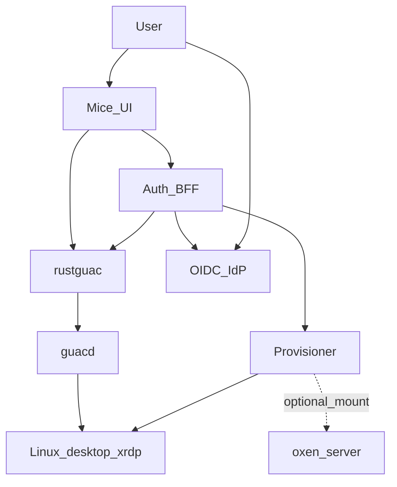
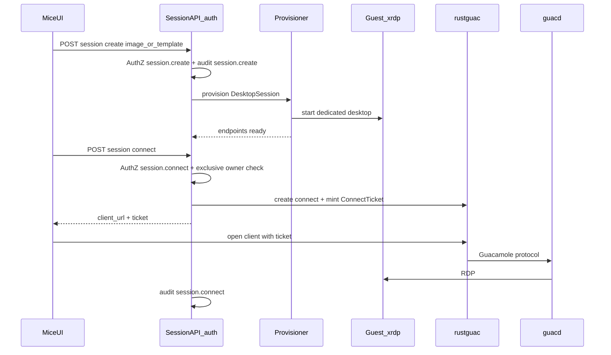

# SESSIONS — PLAT-SESS implementation plan

Living design and phased plan for epic [`PLAT-SESS`](./EPICS.md#plat-sess--desktop-sessions): **provision dedicated Linux full-desktop OS** instances for interactive use, connect from Mice via **rustguac + guacd** (RDP / xrdp), gate with IdP AuthN + AuthZ + audit. Workspaces are an optional mount (Phase 2+), not a prerequisite. Formerly sketched as VM gateways (`PLAT-GW`).

Related: [EPICS.md](./EPICS.md) · [Jobs.md](./Jobs.md) · [SESSIONS-IRONRDP.md](./SESSIONS-IRONRDP.md) · [AUTH.md](./AUTH.md) · [AUTHO.md](./AUTHO.md) · [AUDIT.md](./AUDIT.md) · [GXP.md](./GXP.md) · [notification.md](./notification.md) · [README.md](../README.md)

## 1. Purpose & scope

**In scope**

- **Provision** a dedicated full Linux desktop OS per Session (not attach-only; not shared multi-user seats)
- **Connect** from Mice through **rustguac** (Rust Guacamole-compatible control plane) + **guacd**, using **RDP to xrdp** on the guest
- **Exclusive ownership** — one owner; no Guacamole share/join; stop or destroy on release
- **Identity:** Mice OIDC/IdP gates create/connect; guest OS uses **per-user** login (AD/SSSD or IdP-synced account) — never a shared desktop account
- **Optional workspace mount** (Phase 2+) pinned to versioned Oxen data — shared **mount + pin** contract with [`PLAT-JOB`](./EPICS.md#plat-job--versioned-workspace-jobs)
- Session lifecycle API: create, get, list, connect (ticket), stop/destroy; Mice Sessions UI
- Abstract **`Provisioner`**: local Docker Linux desktop+xrdp first (full Compose E2E on macOS/Linux); libvirt/QEMU or KubeVirt later
- AuthN via [AUTH.md](./AUTH.md), AuthZ via [AUTHO.md](./AUTHO.md), audit via [AUDIT.md](./AUDIT.md)

**Out of scope (this document)**

- Batch / container-image jobs — see [Jobs.md](./Jobs.md)
- Replacing or forking oxen-server
- IronRDP / WASM RDP as the v1 connect path (deferred spike in Phase 3)
- Building a general VDI / Citrix replacement (templates, GPU pools) beyond provision + connect
- GxP-strict product controls (recording retention under `GXP_STRICT`) — [GXP.md](./GXP.md) layers later

**Naming**

| Term | Meaning |
| --- | --- |
| **Session** (`DesktopSession`) | Product noun — provisioned interactive desktop |
| **AuthSession** | OIDC / cookie session on the BFF (existing AUTH) |
| **ConnectTicket** | Short-lived rustguac WebSocket ticket for Connect |

**Hooks for other epics**

| Epic | Needs from / to PLAT-SESS |
| --- | --- |
| PLAT-AUTH | Session or PAT principal on create / connect / stop |
| PLAT-AUTHO | Dedicated `session.create` / `session.connect` / `session.admin` |
| PLAT-AUDIT | Emit `session.create` / `connect` / `disconnect` / `destroy` (and stop) with actor |
| PLAT-JOB | Shared **mount + pin** contract (Phase 2+) |
| PLAT-GXP | Optional recording retention / fail-closed when `GXP_STRICT` |

**Delivery scope:** Phases 0–2 are the primary delivery; Phase 3 is ops/GxP/IronRDP spike.

## 2. Current state

| Piece | Behavior |
| --- | --- |
| Auth / AuthZ / Audit | Session, PAT, RBAC, JSONL audit at the BFF |
| Jobs | Local Docker + K8s runners; optional workspace mount path exists on jobs |
| Interactive desktops | **Not implemented** — EPICS stub only (was `PLAT-GW`) |
| Compose | oxen-server, keycloak, auth, web — no guacd / rustguac / desktop guests |

## 3. Goals & non-goals

### Goals

1. Session API in the **auth** BFF and a provisioner that starts a dedicated Linux desktop with xrdp
2. Mice **Connect** UX via rustguac tickets (browser; no native RDP client required)
3. Full workflow **testable locally** via Compose + Playwright (or make target)
4. Exclusive Sessions; per-user guest identity (Phase 1 hardens beyond lab credentials)
5. Optional Oxen workspace/commit pin mount in Phase 2; non-local VM provisioner in Phase 2
6. Dedicated AuthZ + audit from Phase 0

### Non-goals

- Shared kiosk / multi-user on one guest
- Treating local Docker desktop images as the **production** substrate (they are the **dev/E2E provisioner**)
- Requiring a workspace to create a Session
- Windows guests in v1 (Linux primary)

## 4. Target architecture

### Decisions (locked)

| Decision | Choice |
| --- | --- |
| Product name | **Session** (epic `PLAT-SESS`; replaces gateway/environment naming) |
| Desktop OS | **Full Linux desktop** (primary) |
| Lifecycle | **Provision** dedicated instances |
| Exclusivity | One owner; **no** share/join; stop or destroy on release |
| Connect stack | **rustguac** + **guacd**; guest protocol **RDP via xrdp** |
| Identity | Mice IdP for API; per-user guest OS login (no shared desktop account) |
| Workspace | **Not required** for v1; Phase 2 optional mount + pin (shared with Jobs) |
| Placement | Control plane in auth BFF (`/auth/sessions…`) |
| Provisioner | Abstract **`Provisioner`**; **local Docker** desktop+xrdp first; libvirt/KubeVirt later |
| AuthZ | `session.create` / `session.connect` / `session.admin` |
| Store | JSONL under `AUTH_DATA_DIR` / `SESSIONS_DATA_DIR` (`sessions.jsonl`) for now |
| IronRDP | Deferred spike only |



### Components

| Component | Role |
| --- | --- |
| Mice UI | Sessions list / create / Connect / stop |
| Session API (auth) | CRUD-ish lifecycle + connect ticket; AuthZ + audit |
| Session store | Durable `DesktopSession` JSONL |
| Provisioner (local) | Docker: start exclusive Linux desktop+xrdp container; publish RDP endpoint to guacd network |
| Provisioner (non-local) | libvirt/QEMU or KubeVirt — same interface |
| rustguac | Session/connect tickets, WebSocket → guacd |
| guacd | RDP (and optional VNC/SPICE) protocol translation |
| oxen-server | Data plane for optional mounts |
| Auth BFF | Hosts Session API; OIDC/PAT; AuthZ |



### Compose shape (Phase 0 — local E2E)

| Service | Role |
| --- | --- |
| `guacd` | Official guacamole-server guacd image; internal only |
| `rustguac` | Rust control plane; HTTPS/WS; OIDC optional (Mice may drive via API key + tickets) |
| `auth` | Session API; talks to Docker (provisioner) and rustguac admin/API |
| Desktop guests | **Not** long-lived Compose services — created per Session by the provisioner from `SESSIONS_DESKTOP_IMAGE` |
| Existing | oxen-server, keycloak, web unchanged |

Env (auth / stack):

| Variable | Purpose |
| --- | --- |
| `SESSIONS_ENABLED` | Feature flag |
| `SESSIONS_DATA_DIR` | JSONL store (default under `AUTH_DATA_DIR`) |
| `SESSIONS_PROVISIONER` | `docker` (Phase 0) \| `libvirt` \| `kubevirt` (later) |
| `SESSIONS_DESKTOP_IMAGE` | Linux desktop + xrdp image for local provisioner |
| `SESSIONS_RUSTGUAC_URL` | rustguac base URL (container network) |
| `SESSIONS_RUSTGUAC_API_KEY` | BFF → rustguac API auth |
| `SESSIONS_GUACD_HOSTNAME` | Hostname guacd uses to reach guest RDP (Docker DNS / overlay) |
| `SESSIONS_MAX_PER_USER` | Cap concurrent Sessions per owner |
| `SESSIONS_IDLE_TIMEOUT_SECONDS` | Phase 1+ |
| `SESSIONS_MAX_LIFETIME_SECONDS` | Phase 1+ |

**Apple Silicon note:** Local provisioner uses Docker Desktop Linux guests (full userspace desktop + xrdp), not nested KVM. Production swaps provisioner implementation; API and Connect path stay the same.

## 5. Session model

### DesktopSession record

| Field | Notes |
| --- | --- |
| `id` | Opaque session id |
| `status` | `provisioning` \| `ready` \| `connected` \| `stopping` \| `stopped` \| `failed` \| `destroyed` |
| `owner` | `{ sub, iss, email, name }` — exclusive |
| `via` | `session` \| `pat` (create path) |
| `image` / `image_digest` | Template or image ref (digest when resolved) |
| `provisioner` | `docker` \| `libvirt` \| `kubevirt` |
| `endpoints` | `{ rdp_host, rdp_port }` (internal); never expose raw RDP publicly |
| `guest_user` | Linux username for RDP (per-user; Phase 0 may be provisioner-injected mapped user) |
| `workspace_ref` | Optional `{ namespace, repo, workspace_id }` (Phase 2) |
| `pin_commit` | Optional pin when mounting versioned data (Phase 2) |
| `connect` | Last connect metadata (`connected_at`, `rustguac_session_id`) |
| `created_at` / `ready_at` / `stopped_at` / `destroyed_at` | Timestamps |
| `error` | Short provisioner/API error when `failed` |
| `resources` | `{ cpu, memory, disk }` snapshot |

### Create request (conceptual)

```json
{
  "image": "mice/desktop-xrdp:mate",
  "resources": { "cpu": "2", "memory": "4Gi", "disk": "40Gi" },
  "workspace_ref": null,
  "pin_commit": null
}
```

Create may accept `mounts: [{ namespace, repo, workspace_id?, pin_commit?, mount_mode }]` (preferred) or legacy singular `workspace_ref` + `pin_commit` + `mount_mode` (converted to one mount). Guest paths are server-assigned under `/data/<ns>/<repo>`.

### Connect response (conceptual)

```json
{
  "session_id": "…",
  "client_url": "https://rustguac/…/client/…",
  "ticket": "wst_…",
  "expires_in": 30
}
```

UI opens `client_url` with the ticket; ticket is single-use and short-lived.

## 6. Provisioner contract

```text
Provisioner.provision(session) → endpoints
Provisioner.stop(session)
Provisioner.destroy(session)
Provisioner.health(session) → ready | unhealthy
# Phase 2:
Provisioner.mountWorkspace(session, pin | workspace_ref)
Provisioner.unmountWorkspace(session)
```

**Local Docker rules (Phase 0):**

1. One container per Session; name/label includes `session_id` + `owner.sub`
2. Image = Linux DE + xrdp; RDP port internal to Compose network
3. No published host RDP port required for Connect (guacd reaches guest on overlay)
4. Inject or create **owner-mapped** guest user (Phase 0: mapped from IdP email/sub; Phase 1: AD/SSSD)
5. On destroy: remove container + volumes unless retained disk policy says otherwise
6. Enforce `SESSIONS_MAX_PER_USER`

**Exclusivity:** Reject connect if caller ≠ owner (unless `session.admin`). Do not enable rustguac share URLs.

## 7. AuthZ & audit hooks

### AuthZ (extend [AUTHO.md](./AUTHO.md) when implementing)

| Gate | Intent |
| --- | --- |
| `session_create` | Provision a new Session (instance permission; default allow for authenticated users when Sessions enabled) |
| `session_connect` | Connect to own Sessions (owner default; explicit grant optional) |
| `session_admin` | List/stop/destroy/connect **any** Session; break-glass (also implied by instance admin) |

Instance admins receive all `session_*` grants. Default interactive users create/connect **own** Sessions. Exclusive ownership — no share/join.

**Mounts:** each entry in `mounts[]` requires repo **read** (`authorizeJobRead`) for `ro`, or **write** (`authorizeJobSubmit`) for `rw`. Create fails if any mount is unauthorized. **Connect re-checks** every mount; deny Connect (do not destroy) if access was revoked.

### Audit actions ([AUDIT.md](./AUDIT.md))

| Action | When |
| --- | --- |
| `session.create` | Accepted provision |
| `session.connect` | Connect ticket minted / client attached |
| `session.disconnect` | Client closed or idle disconnect observed |
| `session.stop` | Soft stop (guest powered down, record retained) |
| `session.destroy` | Hard destroy |

Include `session id`, owner `sub`, image, and workspace/pin when known. Never log guest passwords or full tickets.

## 8. Phased delivery

### Phase 0 — Model + local stack + E2E

- [x] `DesktopSession` JSONL store + schema
- [x] Session API: create / get / list / connect / stop / destroy on auth
- [x] AuthZ owner + instance-admin gates (`authorizeSessionAccess`)
- [x] `DockerProvisioner` + `mock` + `SESSIONS_DESKTOP_IMAGE` (linuxserver rdesktop XFCE)
- [x] Compose: `guacd` + optional `rustguac` profile; guacamole-lite WS on auth; ticket handoff
- [x] Audit events for create / connect / disconnect / stop / destroy
- [x] Mice UI: Sessions list / create / Connect / stop / destroy + desktop page
- [x] **Automated local E2E** (`e2e/tests/sessions.spec.ts`, `make test-sessions`)

### Phase 1 — Hardening + guest identity

- [x] Per-user guest credentials from IdP email/sub (unique password); no shared accounts
- [x] Idle timeout + max lifetime sweeper
- [x] Resource limits (cpu/memory) on Docker provisioner
- [x] Optional recording flag (`SESSIONS_RECORDING` / create body)
- [x] No share/join APIs

### Phase 2 — Workspace mount + non-local provisioner

- [x] Optional `workspace_ref` / `pin_commit` mount (via jobsOxen materialize)
- [x] **Multi-mount:** `mounts[]` (workspace_id and/or pin_commit), paths `/data/<ns>/<repo>`; legacy single-ref create still accepted
- [x] Bind when `workspace_id` **or** `pin_commit` (no silent skip); `SESSIONS_MAX_MOUNTS` (default 8)
- [x] Per-mount AuthZ at create + re-check on connect; instance `session_*` permissions
- [x] `LibvirtProvisioner` / `KubevirtProvisioner` stubs
- [x] Template catalog (`GET /auth/sessions/templates`)

### Phase 3 — Ops / GxP / IronRDP spike

- [x] Retention policy endpoint (`GET /auth/sessions/retention`); no purge by default
- [x] IronRDP spike notes — [SESSIONS-IRONRDP.md](./SESSIONS-IRONRDP.md)

### Phase 4 — Desktop security, recovery, cost, audit (proposed; none approved; see §14)

Today the sweeper only tears down on idle/max-lifetime without advance warning, `POST /auth/sessions/:id/retry` handles only `failed`/`stopped` sessions, and `recording` is a flag with no stated retention or access rules.

- [ ] **Desktop security controls**, per template/policy and default-deny where a regulated policy applies: clipboard (off / host→guest / guest→host / both), drive/file redirection, printing/audio, screen capture/recording by the user, with the effective policy snapshotted on the `DesktopSession`
- [ ] **Guest egress policy:** network policy for the guest (none / allowlist incl. Oxen via BFF) snapshotted on the session, same model as Jobs' `network`; mounted data cannot be exfiltrated via an open path unless policy allows
- [ ] **Reconnect/resume:** closing the browser tab or a network drop leaves the guest desktop running; reconnect mints a new `ConnectTicket` (status back to `ready`/`connected`) and is distinguished from a new session in audit
- [ ] **User-visible recovery:** when guacd/rustguac/the provisioner fails or a guest becomes `unhealthy`, the UI shows the cause and a recover action (reconnect, restart gateway link, retry) instead of a bare `failed`; document what survives (mounts and workspace data yes; guest state outside mounts per §11a)
- [ ] **Cost/quota policy:** per-user/instance limits beyond `SESSIONS_MAX_PER_USER` (total cpu/memory/disk, cumulative running hours); usage shown on the session
- [ ] **Warnings before limits:** notify and show a banner before `SESSIONS_MAX_LIFETIME_SECONDS`, before idle teardown, and on resource exhaustion in the guest; allow an extension (bounded by policy) — events delivered via [notification.md](./notification.md) (Sessions only emits them)
- [ ] **Connection audit for regulated use:** audit events carry client IP/user agent, connection start/end, duration, effective security policy and recording state; a `session.recording` lifecycle (start/stop/access/purge); tamper-evident retention aligned with [GXP.md](./GXP.md) and [AUDIT.md](./AUDIT.md)
- [ ] Tests TC-SESS-12…17; docs

## 9. API

| Route | Auth | Behavior |
| --- | --- | --- |
| `POST /auth/sessions` | Session or PAT; `session.create` | Body: image/template + optional resources / Phase 2 mount. Returns `DesktopSession` (`provisioning` → poll until `ready`) |
| `GET /auth/sessions` | Session or PAT | Own Sessions by default; `session.admin` may list all |
| `GET /auth/sessions/:id` | Owner or `session.admin` | Full record |
| `POST /auth/sessions/:id/connect` | Owner or admin; `session.connect` | Mint rustguac `ConnectTicket` + `client_url`; audit connect |
| `POST /auth/sessions/:id/stop` | Owner or admin | Soft stop |
| `DELETE /auth/sessions/:id` | Owner or admin | Destroy |

Public surface stays under the auth BFF. Browser never holds rustguac long-lived API keys.

## 10. UI

| Surface | Change |
| --- | --- |
| Layout nav | **Sessions** → `/sessions` |
| Create | Pick template/image → provision → wait until ready |
| Connect | Opens rustguac client (new tab or embedded) with ticket |
| Monitor | Status, stop, destroy; show owner + created time |
| Copy | Clarify Session ≠ login cookie; exclusive desktop |

## 11. Shared mount + pin contract (Phase 2; with Jobs)

Single ADR (link from Jobs.md + this file):

| Field | Meaning |
| --- | --- |
| `pin_commit` | Oxen commit id (content-addressed pin) — Jobs only; Sessions no longer accept it |
| `workspace_id` | Optional **Mice workspace** ([Workspaces.md](./Workspaces.md)) — a BFF-owned overlay working tree (shared per-commit checkout + the workspace's changes) mounted as a Docker volume (lease `ro`/`rw`); replaces copy + baseline + sync. A `ro` mount of a running job's workspace is the **live view** |
| Mount path | Fixed guest path (e.g. `/data` or `/workspace`) |
| Mode | `ro` \| `rw` per AuthZ |
| Lifecycle | Mount on start or on connect; unmount on stop/destroy |

### 11a. Workspace mounts in sessions (implemented) — workspaces only

**Product decision: session data always comes from workspaces.** Commit-pin / snapshot mounts and the clone-materialization path (`sessionsMount.ts`) are removed from Sessions. Jobs keep `materializeCommitClone`.

- Input: `mounts:[{workspace_id:'w_…', mount_mode?:'ro'|'rw'}]`, or `{new_workspace:{namespace, repo, name?, source:{branch}|{commit}}, mount_mode?}` (see below). Anything else (`pin_commit`, no `workspace_id`, legacy top-level `workspace_ref` / `pin_commit` / `mount_mode`) → 400 `sessions mount workspaces: use workspace_id`. Namespace/repo are derived; one mount per workspace; up to SESSIONS_MAX_MOUNTS. Guest path `/data/<ns>/<repo>` (collision suffix `__<workspace id prefix>`).
- Mount JSON: `{namespace, repo, pin_commit:null, mount_mode, mount_path, workspace_id, effective_mode, lease_id}`. Session JSON adds `workspace_ids: string[]` and `notices: string[]`.
- Create (existing workspace): must be `ready` (409), repo read (ro) / write (rw), leases acquired all-or-nothing in sorted order with holder `{kind:'session', id}`. A requested `rw` that cannot get the writer lease degrades to `ro` plus a notice naming the holder; sessions never block on a lease.
- **On-demand workspaces (`new_workspace`)**: needs repo write on that repo. The server creates the workspace (audit `workspace.create`, detail `{session_id, on_demand:true}`) and the session is created at once in `provisioning`. The mount carries `workspace_id` immediately; `effective_mode` and `lease_id` stay absent until **provision time**, where the provisioner waits (poll, up to WORKSPACES_PREPARE_TIMEOUT_SEC) for `ready` and then leases it (same degrade rules). A workspace that ends in `error`, disappears or times out fails the session with `workspace <name> (<id>) failed to prepare: <error>`. Workspaces created for a session that then fails to be created are rolled back. Retry skips still-preparing workspaces and lets provisioning wait for them.
- Provisioning passes `--mount type=volume,source=mice-ws-<id>-g<gen>,target=<path>,volume-nocopy[,readonly]` and `PUID/PGID/UMASK`; rw re-verifies `upper_hash` (tamper → session fails).
- Lifecycle: leases renewed every 60 s while provisioning/ready/connected; on stop/destroy/failure/idle/max-lifetime the container is removed first, then leases are released. Reconciliation releases leases of terminal/missing sessions.
- Legacy records: stored sessions with commit-pin mounts still load and display. Retry starts them **without** those mounts and adds the notice `legacy commit-pin mount ns/repo#abcdef12 is no longer supported; started without it`.
- `POST /auth/sessions/:id/remount {workspace_id?, mount_path?}` upgrades a degraded mount once the writer is gone (423 + holder otherwise, 409 if nothing to upgrade): stop container → release → acquire → reprovision, same session id.
- Lists: `GET /auth/sessions?workspace_id=w_…` and `?namespace=&repo=` (sessions mounting any workspace of that repo; `repo` optional). Workspace JSON has `session_count` and `mountable_modes` (`['ro','rw']`, `['ro']` while a writer exists / over quota / op≠idle, `[]` when not ready). Workspace delete is 423 naming the sessions while a lease exists **or** while any non-terminal (not stopped/failed/destroyed) session mounts it.
- CLI: `mice session create --mount w_id[:ro|rw]` / `--workspace w_id[:ro|rw]` (repeatable), `--new-workspace ns/repo@branch|ns/repo#commit[=name][:ro|rw]` (repeatable); `mice session list --workspace`, `mice session remount`; `mice workspace list|show|create|delete|changes`.
- **Editing mounts: `PUT /auth/sessions/:id/mounts {mounts:[…]}`** = the desired *full* list (same element forms and validation as create, `[]` = desktop only) → `{session}` (status `provisioning`). Allowed in `ready|connected|stopped|failed` (else 409); needs `stop` access on the session (owner/admin) plus repo read/write per mount; new workspaces need repo write. Same stop+reprovision flow as remount (container removed → all leases of the session released → new leases acquired; rw on a busy workspace degrades to ro with a notice; on-demand workspaces leased at provision time). Mounts keeping their `workspace_id` keep their `mount_path`; session id and guest user are unchanged; guest state outside mounts is lost. On-demand workspaces created by a rejected/failed edit are rolled back; a lease failure after teardown leaves the session `failed` with the error. Audit `session.mounts.update` detail `{session_id, before:[{workspace_id,mount_mode,effective_mode,…}], after:[…]}`. CLI: `mice session mounts <id> [--set w_x[:ro|rw]|none]… [--add …]… [--remove w_x]… [--new-workspace …]…` (`--set` replaces the list; `--add/--remove` edit the current list client-side).

Jobs and Sessions both consume this contract; neither requires a workspace for v1.

## 12. Test plan (local E2E required)

| Case | Expectation |
| --- | --- |
| TC-SESS-01 | Create → `ready` with RDP endpoint reachable by guacd |
| TC-SESS-02 | Connect → ticket + client URL; desktop interactive via rustguac |
| TC-SESS-03 | Non-owner connect → 403 |
| TC-SESS-04 | Stop → guest down; reconnect denied until recreate |
| TC-SESS-05 | Destroy → container removed; GET → 404 or `destroyed` |
| TC-SESS-06 | Unauthenticated → 401; missing `session.create` → 403 |
| TC-SESS-07 | Audit contains create + connect (+ disconnect/stop/destroy) with actor |
| TC-SESS-08 | Second create beyond `SESSIONS_MAX_PER_USER` → rejected |
| TC-SESS-09 | Share/join path absent or disabled |
| TC-SESS-10 | (Phase 2) Workspace-mounted Session sees pin contents under mount path |
| TC-SESS-11 | Full Compose Playwright (or make) path: login → create → Connect → destroy |

Make target sketch: `make test-sessions` (stack up + Playwright `e2e/tests/sessions.spec.ts`).

## 13. Open risks

| Risk | Mitigation |
| --- | --- |
| Docker Desktop ≠ production VM | Document local provisioner as E2E only; Phase 2 real VMs |
| rustguac + Vault dependency for connection catalog | Prefer BFF-driven ad-hoc sessions via API + tickets (no Vault required for Phase 0) |
| Guest identity vs shared lab users | Phase 0 mapped users; Phase 1 AD/SSSD; never document shared passwords as supported |
| guacd CPU under many RDP sessions | Size guacd; optional Janua / IronRDP spike later |
| Name collision with AuthSession | Types/docs use `DesktopSession` / `ConnectTicket` |
| Mount contract drift with Jobs | One ADR; both epics link it |
| RDP credentials in logs | Redact; prefer short-lived injected secrets |

## 14. Open questions (Phase 4)

1. Are clipboard and drive redirection enforced at guacd/rustguac (connection parameters), in the guest (xrdp config), or both? Who can relax the default — template owner, instance admin?
2. What is the default security policy for non-regulated vs `GXP_STRICT` deployments?
3. Is guest egress enforced by the provisioner (Docker network / NetworkPolicy / VM firewall)? Which destinations are always allowed (Oxen via BFF)?
4. Does a dropped connection count as `disconnect` for idle-timeout purposes, and how long may a guest run with no client attached?
5. Which guest/gateway failures are auto-recovered versus user-triggered, and does `retry` extend beyond `failed`/`stopped`?
6. Cost unit and ceilings (hours, cpu·hours, disk) and whether quotas are per user, per namespace or instance-wide; how far ahead are lifetime warnings sent, and may users extend?
7. Where are recordings stored, who may view them, how long are they kept, and does recording imply a user notice in the Connect UI?
8. Which connection facts must audit hold for regulated use (IP, device, clipboard/file transfer events), and can guacd report them reliably?

## 15. How to use this file

1. Implement Phase 0 first (API + Compose + UI + local E2E); tick bullets in PRs.
2. Keep decisions in §4 locked unless an ADR supersedes them.
3. When epic bullets in [EPICS.md](./EPICS.md) land, mark them done and keep phases in sync.
4. When Autho/Audit gain session fields, update §7 and link from AUTHO / AUDIT.
